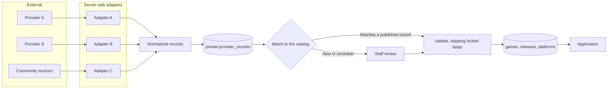

# Architecture decisions

**Status:** Approved design, including the decisions on D1 to D9, Q1 to Q12, A1 to A3, P1 to P10, R1 to R8 and D13, and the strict physical-only scope. M0 to M7 is the accepted roadmap. M0 and M1 are implemented locally. Each later step needs the product owner's authorization.

This records why the database is designed as it is, what each choice costs, and what still needs a product decision. [Product-owner decisions](#decisions-requiring-product-owner-approval) are listed first because some still block implementation.

## Summary

| ADR | Decision |
| --- | --- |
| [001](#adr-001-game-release-and-collection-item-are-separate) | Game, Release and Collection Item are separate tables |
| [002](#adr-002-region-codes-and-markets-are-independent) | Region codes and markets are independent |
| [003](#adr-003-private-purchase-data-lives-in-its-own-table) | Private purchase data lives in its own table |
| [004](#adr-004-visibility-is-layered-and-the-most-restrictive-wins) | Visibility is layered, and the most restrictive setting wins |
| [005](#adr-005-followers-only-means-accepted-followers) | Followers-only means accepted followers |
| [006](#adr-006-grants-and-rls-work-together) | Grants and RLS work together |
| [007](#adr-007-uuid-strategy) | UUIDs, with UUIDv7 for high-volume tables |
| [008](#adr-008-composite-foreign-keys-enforce-ownership) | Composite foreign keys enforce ownership |
| [009](#adr-009-exclusive-arcs-instead-of-polymorphic-references) | Exclusive arcs instead of polymorphic references |
| [010](#adr-010-reviews-extend-posts) | Reviews extend posts |
| [011](#adr-011-a-few-trigger-maintained-counters) | A few trigger-maintained counters |
| [012](#adr-012-fractional-ranks-for-ordering) | Fractional ranks for ordering |
| [013](#adr-013-soft-delete-only-where-evidence-matters) | Soft delete only where evidence matters |
| [014](#adr-014-enums-for-closed-sets-tables-for-open-ones) | Enums for closed sets, tables for open ones |
| [015](#adr-015-metadata-providers-are-replaceable-adapters) | Metadata providers are replaceable adapters |
| [016](#adr-016-catalog-changes-are-reviewed-and-merges-leave-tombstones) | Catalog changes are reviewed, and merges leave tombstones |
| [017](#adr-017-every-image-records-its-source-and-license) | Every image records its source and license |
| [018](#adr-018-feeds-read-on-demand-first) | Feeds read on demand first |
| [019](#adr-019-search-starts-in-postgresql) | Search starts in PostgreSQL |
| [020](#adr-020-staff-see-messages-only-through-reports) | Staff see messages only through reports |
| [021](#adr-021-achievements-are-awarded-by-the-server) | Achievements are awarded by the server |
| [022](#adr-022-partition-later-not-now) | Partition later, not now |
| [023](#adr-023-private-by-default-with-an-explicit-publish-step) | Private by default, with an explicit publish step |
| [024](#adr-024-indexing-is-a-profile-preference) | Indexing is a profile preference |
| [025](#adr-025-the-product-is-permanently-physical-only) | The product is permanently physical-only |
| [026](#adr-026-game-classification-is-a-manual-decision-recorded-as-relationships) | Game classification is a manual decision, recorded as relationships |
| [027](#adr-027-frankfurt-is-the-proposed-initial-region) | Frankfurt is the proposed initial region |
| [028](#adr-028-release-eligibility-and-playability-are-separate) | Release eligibility and playability are separate |
| [029](#adr-029-invalid-records-are-preserved-not-deleted) | Invalid records are preserved, not deleted |
| [030](#adr-030-a-collection-item-always-includes-the-game-medium) | A Collection Item always includes the game medium |
| [031](#adr-031-platform-identity-is-separate-from-its-names) | Platform identity is separate from its names |
| [032](#adr-032-physical-media-is-a-category-plus-a-reference-format) | Physical media is a category plus a reference format |
| [033](#adr-033-hardware-requirements-sit-on-the-release) | Hardware requirements sit on the Release |
| [034](#adr-034-multiple-media-reuses-the-release-component-model) | Multiple media reuses the Release component model |
| [035](#adr-035-game-boy-classification-follows-the-physical-edition) | Game Boy classification follows the physical edition |
| [036](#adr-036-the-public-profile-card-is-enforced-with-column-grants) | The public profile card is enforced with column grants |
| [037](#adr-037-handles-are-unique-by-spelling-and-normalized-only-against-reserved-names) | Handles are unique by spelling, and normalized only against reserved names |
| [038](#adr-038-avatars-are-written-only-by-the-server) | Avatars are written only by the server |
| [039](#adr-039-account-activation-needs-a-verified-email-and-a-handle) | Account activation needs a verified email and a handle |
| [040](#adr-040-follows-and-blocks-are-reached-only-through-functions) | Follows and blocks are reached only through functions |
| [041](#adr-041-rejection-is-silent) | Rejection is silent |
| [042](#adr-042-follower-counts-are-live-and-count-visible-relationships) | Follower counts are live, and count visible relationships |
| [043](#adr-043-the-audit-log-is-private-and-append-only-for-application-roles) | The audit log is private, and append-only for application roles |
| [044](#adr-044-notifications-come-from-state-changes-in-the-same-transaction) | Notifications come from state changes, in the same transaction |
| [045](#adr-045-catalog-records-are-verified-before-they-are-published) | Catalog records are verified before they are published |
| [046](#adr-046-imports-run-as-a-restricted-role-through-audited-functions) | Imports run as a restricted role through audited functions |
| [047](#adr-047-catalog-search-reads-published-records-through-read-only-functions) | Catalog search reads published records through read-only functions |
| [048](#adr-048-web-sessions-are-handled-only-on-the-server) | Web sessions are handled only on the server |
| [049](#adr-049-collections-are-owner-only-copies-added-idempotently) | Collections are owner-only copies, added idempotently |

## Decisions requiring product-owner approval

### What still blocks migrations

**Only the product owner's authorization of each step.** The [plan](#phase-2b-plan) is the accepted roadmap, with M0 and M1 implemented locally.

### D1 to D9: product owner's decisions

| # | Decision | Status | Outcome |
| --- | --- | --- | --- |
| **D1** | Followers only | **Approved** | Access requires an accepted follow |
| **D2** | Default privacy | **Approved with change** | Collections, shelves and items default to **private**. Users explicitly choose to publish. Purchase information stays owner-only. See [ADR-023](#adr-023-private-by-default-with-an-explicit-publish-step) |
| **D3** | Signed-out browsing | **Approved** | Public profiles, collections, games and posts are browsable without signing in. Private information is never exposed. Indexing preferences are supported. See [ADR-024](#adr-024-indexing-is-a-profile-preference) |
| **D4** | Consoles and accessories | **Approved** | Physical video games only, with no console or accessory catalog. Further defined by [ADR-025](#adr-025-the-product-is-permanently-physical-only) |
| **D5** | User-submitted releases | **Approved with change** | Submissions are marked unverified and usable immediately by the submitter. They never automatically become global entries. Staff moderate them through a workflow. See [ADR-016](#adr-016-catalog-changes-are-reviewed-and-merges-leave-tombstones) |
| **D6** | Game versus Release | **Approved** | Ports share a Game. Remakes are separate Games. Different editions, regions and packaging variants are separate Releases. Further defined by [ADR-026](#adr-026-game-classification-is-a-manual-decision-recorded-as-relationships) |
| **D7** | Region taxonomy | **Approved** | A flat [taxonomy](database-schema.md#region_codes) of 11 codes, plus independent distribution markets and physical edition identity, replaces the earlier hierarchy. See the [examples](relationships.md#physical-release-examples) and [ADR-002](#adr-002-region-codes-and-markets-are-independent) |
| **D8** | Rating scale | **Approved** | Half-point steps from 0.5 to 10 |
| **D9** | Review eligibility | **Approved** | Any active user may review. Ownership is self-reported and not required. Only published games and releases can be reviewed |
| **D13** | Data region | **Selected as proposed** | Central EU (Frankfurt), AWS `eu-central-1`. Project not created. Legal review outstanding. See [ADR-027](#adr-027-frankfurt-is-the-proposed-initial-region) |

### Q1 to Q7: product owner's decisions

| # | Question | Decision |
| --- | --- | --- |
| **Q1** | Region tree | **Replaced** by the region code and market model in D7 |
| **Q2** | Remasters | **Decided.** See [ADR-026](#adr-026-game-classification-is-a-manual-decision-recorded-as-relationships) |
| **Q3** | Indexing default | **Off.** Users opt in. It doesn't affect access control |
| **Q4** | Wantlist privacy | **Private by default.** Users can make them public |
| **Q5** | Post visibility | **Composer may preselect public.** Visibility is explicit and changeable, the database never silently makes an unspecified post public, and RLS enforces the selection |
| **Q6** | Boxed download codes | **Excluded**, along with all other digital products. See [ADR-025](#adr-025-the-product-is-permanently-physical-only) |
| **Q7** | Public items on unverified releases | **Approved.** A neutral "Unverified release" placeholder, exposing none of the submitted text |

### Q8 to Q12: product owner's decisions

| # | Question | Decision |
| --- | --- | --- |
| **Q8** | Partial media | **Conditionally allowed.** The medium must contain actual game data, and `media_playability` records whether additional downloads are needed. Unclear eligibility requires editor review. See [ADR-028](#adr-028-release-eligibility-and-playability-are-separate) |
| **Q9** | Invalid or out-of-scope releases | **Preserve user data.** Excluded from the catalog, with no new additions, owners notified, records kept private and uncounted, and a controlled resolution process. See [ADR-029](#adr-029-invalid-records-are-preserved-not-deleted) |
| **Q10** | Arcade boards | **Excluded from launch scope.** No arcade boards, hardware or accessory catalog |
| **Q11** | Region-free platforms | **Approved.** Classify by collector-facing regional identity. `region-free` only for a release genuinely classified that way |
| **Q12** | Box-only and manual-only items | **Excluded, final.** The medium must be present. See [ADR-030](#adr-030-a-collection-item-always-includes-the-game-medium) |

### A1 to A3: product owner's decisions

| # | Question | Decision |
| --- | --- | --- |
| **A1** | Collection statistics | **Approved.** Only active Collection Items on approved, qualifying physical Releases count as owned. Unverified submissions show separately as pending. Rejected, excluded and invalid-preserved records are distinguishable from pending, and never count |
| **A2** | Preserved records | **Approved.** No automatic deletion by age. Owners may delete their own. A formal retention policy will be defined before real user data is processed |
| **A3** | Meaningful game data | **Approved.** Written editorial eligibility guidelines are required before catalog approval workflows open. The medium must contain actual game data. Download codes, Game-Key Cards, installer-only and launcher-only media and digital entitlements stay excluded. Unclear cases require editorial review |

### P1 to P10 and R1 to R8: product owner's decisions

| # | Decision | Outcome |
| --- | --- | --- |
| **P1** | Regional names | **Approved.** One canonical platform, with hardware and media differences preserved at the Release level |
| **P2** | Platform identity | **Approved.** Stable slugs, with names stored separately |
| **P3** | Hardware revisions | **Approved with change.** No automatic new platforms, with release-level requirements. See [ADR-033](#adr-033-hardware-requirements-sit-on-the-release) |
| **P4** | Add-ons | **Approved.** Separate software platforms, using `base_platform_id`. No collecting of hardware |
| **P5** | Cross-compatible products | **Approved.** One Release on its primary intended platform, with ambiguous cases going to editors |
| **P6** | Home computers and PC | **Permanently in scope**, in a later seed batch. Digital-only software, download-code boxes and installer-only products stay excluded |
| **P7** | Media formats | **Modified.** Category plus specific format. See [ADR-032](#adr-032-physical-media-is-a-category-plus-a-reference-format) |
| **P8** | Schema | **Approved.** `platform_names` and `base_platform_id` added. `generation` removed. The array was replaced by a table |
| **P9** | Evercade | **In scope**, in a later seed batch, because its games are on the cartridge |
| **P10** | Platform seed | **Accepted** after checks, with uncertain values null |
| **R1** | Hardware requirements | **Approved** |
| **R2** | Media reference model | **Approved**, through a forward migration |
| **R3** | Manufacturer | **Approved.** The platform owner or primary brand |
| **R4** | Proprietary media names | **Approved.** Specific names |
| **R5** | Aliases | **Approved.** Official regional names and common aliases, excluding clones, codenames and unrelated hardware models |
| **R6** | Multiple media | **Modified.** One Release can hold several pieces and formats. See [ADR-034](#adr-034-multiple-media-reuses-the-release-component-model) |
| **R7** | Game Boy classification | **Modified.** Three distinct cases. See [ADR-035](#adr-035-game-boy-classification-follows-the-physical-edition) |
| **R8** | Seed sources | **Conditionally approved.** Recorded in [reference-data-sources.md](reference-data-sources.md) |

### M4-D1 to M4-D12: product owner's decisions for M4

These are separate from D1 to D22 above. M4 documents cite them as M4-D1 to M4-D12.

| # | Decision | Outcome |
| --- | --- | --- |
| **M4-D1** | Audit log | **Approved.** `private.audit_events`, append-only for application and API roles. Replaces the planned `moderation_actions`. See [ADR-043](#adr-043-the-audit-log-is-private-and-append-only-for-application-roles) |
| **M4-D2** | Who reads the audit log | **Approved.** Admins only, through `get_audit_events()` |
| **M4-D3** | Duplicate notifications | **Approved.** One notice per event, and repeated follows of one account notify once per 24 hours |
| **M4-D4** | Deleted accounts in notifications | **Approved.** Deleting the recipient or the actor deletes the notice |
| **M4-D5** | Who suspends | **Approved.** Moderators suspend and reinstate accounts without a staff role. Admins handle staff accounts. Nobody suspends themselves |
| **M4-D6** | Suspended users | **Approved.** They can still cancel, unfollow, reject, remove followers, block and unblock, as in M3 |
| **M4-D7** | Auth-level bans | **Deferred.** Suspension does not invalidate existing Auth sessions or prevent sign-in. Protected operations enforce account status at the database level, while explicitly permitted access-reducing operations, such as unfollowing and blocking, remain available |
| **M4-D8** | Moderation notices | **Approved.** Mandatory, and never include the staff member or their reason |
| **M4-D9** | Notification preferences | **Approved.** In-app only, on by default, with no backfill when turned on |
| **M4-D10** | Retention of notifications and audit events | **Undecided,** pending legal review and [D10](#needed-before-launch-may-need-legal-advice). M4 has no purge or scheduled deletion |
| **M4-D11** | Notification access | **Approved.** Only through `SECURITY DEFINER` functions. No API role has table access. See [ADR-044](#adr-044-notifications-come-from-state-changes-in-the-same-transaction) |
| **M4-D12** | Granting `admin` | **Approved.** One active admin may grant `admin`, and the grant is audited |

### M5 decisions: the catalog and its import

Approved by the product owner on 2026-11-08, separate from the global decisions above.

| Decision | Outcome |
| --- | --- |
| Product status | Treated as potentially commercial |
| Sources | Wikidata and No-Intro for a limited SNES pilot, subject to each source's licensing check. Metadata permission never covers artwork or third-party content. Redump blocked until written commercial permission, and PS1 and PS2 support doesn't depend on it |
| Neo Geo MVS | A separate platform, `platform_kind = 'other'`, with its own `neo-geo-mvs-cartridge` format. Cartridges only, never cabinets or boards. AES and MVS cartridges are physically different and incompatible |
| Scope of candidates | Legitimate homebrew, aftermarket, unlicensed, demo and promotional releases are review candidates. Counterfeit and pirate copies are rejected |
| Identity | Matching serials are evidence, never grounds to merge. ROM revisions aren't separate releases unless a distinct physical product is confirmed. Game candidates without a Wikidata id are allowed, under review |
| Imports | A local operator tool. Source snapshots stay outside the repository, with provenance and hashes. Nothing is published automatically |
| Batch approval | Allowed for game records. Releases only when every release's identity and required fields have independent source evidence |
| Verification | Separate from publication, and required for it. Publishing a release also publishes its verified game and pairing (decisions 1 and 5) |
| Defaults | None invented: an edition is required to publish, and an `unknown` region needs explicit confirmation (decision 2) |
| Editors | Active catalog editors and administrators. One editor may verify and publish (decision 3). Shared staff lock. A reason for every change, including to verify and publish |
| Lifecycle | Slugs freeze on publication. No unpublishing in M5 |
| Search | Language-neutral PostgreSQL search, with 100 ms as a non-blocking local target (M5c) |
| Images | Deferred until D15 |

### Needed before launch, may need legal advice

| # | Decision | Recommendation | Notes |
| --- | --- | --- | --- |
| **D10** | **Data retention on account deletion.** | Delete personal data and posts. Keep comments and messages with the author removed. Keep report snapshots for a defined period. Purge notifications after 90 days | **Needs legal review, and a formal retention policy before real user data is processed (A2).** GDPR's right to erasure may apply to retained content, especially message text and report snapshots |
| **D11** | **Message privacy.** | Protected by RLS and encryption at rest, without end-to-end encryption. Staff see only reported messages. Privacy policy states this plainly | End-to-end encryption is a large addition that limits moderation and search |
| **D12** | **Minimum age.** A global social network has to address COPPA, GDPR-K and similar rules. | Set a minimum age, such as 16, confirmed at sign-up, and store only the confirmation rather than a birth date | **Needs legal review.** Allowing younger users adds consent requirements |

### Needed before catalog work

| # | Decision | Recommendation | Notes |
| --- | --- | --- | --- |
| **D14** | **Metadata provider and budget.** | Contact IGDB and at least one alternative. No provider goes live until its terms are reviewed and `commercial_use_cleared` is set. See [ADR-015](#adr-015-metadata-providers-are-replaceable-adapters) | We couldn't confirm commercial terms from public sources. Treat all as unknown until confirmed in writing |
| **D15** | **Cover art.** Box art is typically owned by publishers, and a provider's API terms may not grant us display rights. Art is central to the product. | Get legal advice. Start with user-contributed photographs of owned copies, plus any art a provider explicitly licenses | **Needs legal review.** This could shape the visual product |
| **D16** | **Launch scope for messaging.** | One-to-one messaging only at launch, with the schema ready for groups | Groups add moderation and notification work |

## Decisions

### ADR-001: Game, Release and Collection Item are separate

**Decision.** Three separate tables, with `game_platforms` linking games and platforms. A release has a composite foreign key to `game_platforms`.

**Why.** They are different things. A user's favorite is a Game. A catalog entry with a product code is a Release. A copy with a crushed box corner and a price paid is a Collection Item. Merging any two breaks collector use cases: region variants couldn't be told apart, and a user couldn't own two copies.

**Trade-off.** Common screens need joins through three levels. This is fine with the indexes specified, and the reads can be cached at catalog level.

**Considered.** Dropping `game_platforms` and deriving it from `releases`. It was kept because it was part of the requested design, because the composite key catches bad data, and because it makes "games on this platform" a simple query. The earlier reason, that a game could be known on a platform before a physical release is cataloged, no longer applies: rows record physical availability only.

**Known limits.** Publishing a Game requires a qualifying physical Release, directly or through a compilation.

### ADR-002: Region codes and markets are independent

**Decision.** A release has one `region_code` from a controlled vocabulary of 11 values, and any number of `release_markets` rows naming actual countries or territories. There's no constraint between them, no hierarchy, and no table mapping a code to countries. Both attach to the platform-specific Release, never to the Game. Package identity stays on the Release as edition, variant, packaging, languages, rating labels, product code and barcode.

**Why.** A release's classification, where it was sold, and what the physical package is are three different facts. PAL, NTSC-U/C, NTSC-J and Asia don't map to fixed country lists, and conventions vary by platform and generation. Any fixed mapping would be wrong for some releases, and would push reviewers to invent data.

**Approved.** The product owner approved replacing the previously approved hierarchy with this flat taxonomy, since a hierarchy can't separate these three concepts: `pal-de` under `pal` assumes a country belongs to one code, and combines classification with market.

**A region code isn't a hardware lock.** Under Q11, a platform having no region lock doesn't make its releases `region-free`.

**How the requirements are met:**

| Requirement | How |
| --- | --- |
| Mexico isn't automatically separate | It's a market of a shared release when the physical edition is shared |
| Hong Kong, Taiwan and Southeast Asia aren't one release | `asia` is a classification only, and each package is its own Release |
| PAL stays broad | `pal` is one code, and countries are markets |
| Australia and New Zealand are representable without assuming identical packaging | They're markets, on a shared package or their own |
| Nothing is invented | `unknown`, and no market rows |
| Historical differences | Each classification belongs to one platform-specific Release, and withdrawn country codes can be added |

**Trade-offs.** Filtering is less automatic: "show me German releases" means filtering on market `DE`, and only finds releases whose markets are recorded. Catalog entry takes more effort. Markets may be incomplete, so absence isn't evidence. A mapping table could make entry faster later by suggesting values, but it must never enforce them.

### ADR-003: Private purchase data lives in its own table

**Decision.** Price, currency, purchase date, personal rating and notes go in `collection_item_private`, one-to-one with `collection_items`, readable only by the owner.

**Why.** RLS works on rows. Any policy that lets a visitor read a public item also exposes every column in it, including what the owner paid. Purchase history in a public response would be a serious privacy failure, and collectors are also an obvious theft target, so this data shouldn't be one mistaken query away.

**Alternatives considered.**

| Option | Problem |
| --- | --- |
| Single table, with a public view omitting the columns | The base table has to remain unreadable, and the view has to bypass RLS or re-implement it, so the safety depends on every future query |
| Single table with column grants | Owners need to read those columns while others don't, and grants apply per role, not per user |
| Encrypting the columns | Complicated, and blocks spending statistics |

**Trade-off.** Adding an item with purchase data writes two tables, handled by one database function. Owner views need a left join. Selectively sharing a price later would need a new mechanism, but loosening privacy later is much easier than recovering from a leak.

Personal rating is private by default for the same reason. Public opinions belong in `reviews`.

### ADR-004: Visibility is layered and the most restrictive wins

**Decision.** `profiles.collection_visibility` is a master switch. Each item and shelf also has its own `visibility`. A viewer needs to pass all of them, and shelves never grant access to items.

**Why.** Users need a one-click way to make everything private without touching every row. Keeping the settings independent means switching the master back restores the earlier per-item choices. All default to private under D2, as described in [ADR-023](#adr-023-private-by-default-with-an-explicit-publish-step).

**Trade-off.** Each row check calls a function. Queries are nearly always scoped to one owner, so this runs on a small set. Listing items across owners, such as "who owns this release", is the expensive case and should be precomputed.

### ADR-005: Followers-only means accepted followers

**Decision.** Approved as D1. `follows.status` has four states, set by controlled functions. See [ADR-041](#adr-041-rejection-is-silent). Only `accepted` grants access, and only while the follower's account is active.

**Why.** Without approval, followers-only offers no real protection. Adding `status` after launch would require a migration of a hot table, whereas including it now costs one column.

### ADR-006: Grants and RLS work together

**Decision.** Every table has RLS, explicit grants, and column-level update grants wherever a table has system or staff columns.

**Why.** RLS controls rows, not columns, so a user-update policy would otherwise allow forging `like_count`, `follower_count`, `account_status` or `moderation_status`. Default privileges are also set explicitly, because the local stack's defaults gave `anon` full access to new tables. See [security-rls.md](security-rls.md#explicit-grants).

**Consequence for staff.** Grants apply per role, and staff use the `authenticated` role. So staff can't write protected columns directly either. Their changes go through functions that check the staff role and record an audit row. This costs a function per staff action, and in return no staff change can skip the audit log.

**Trade-off.** A new column isn't client-writable until granted. That's a useful safe default, but can surprise developers, and insert grants need the same attention. CI checks guard against mistakes.

### ADR-007: UUID strategy

**Decision.** UUIDs throughout for user-generated and catalog entities. UUIDv7 for high-volume tables: `collection_items`, `posts`, `comments`, `likes`, `notifications`, `messages`, `reports`, `audit_events`, `provider_records`.

**Why.** UUIDs can be created anywhere and don't reveal totals in URLs. Random UUIDv4 values scatter inserts across the index, which hurts at large scale. UUIDv7 is time-ordered and so inserts near the end, and can double as the sort key for pagination.

**Trade-off.** UUIDv7 reveals its creation time. That's not a concern for these tables, where `created_at` is visible anyway, but it's a reason to avoid it on tables where creation time should stay private.

**Implementation.** The local Supabase stack runs PostgreSQL 17.11, which has no built-in `uuidv7()`, and the `pg_uuidv7` extension isn't available. M0 therefore adds `private.uuid_v7()`, which works on any version and can be replaced later without changing the schema. `gen_random_uuid()` remains the default for other tables.

**Ordering.** IDs from different milliseconds sort by time, and tests confirm it. Within one millisecond the order is random, so never assume strict monotonic ordering. Pagination needs a stable sort, and any feature needing an exact order must use another column too. `uuid_extract_timestamp()` doesn't decode version 7 on PostgreSQL 17, so nothing should rely on it.

### ADR-008: Composite foreign keys enforce ownership

**Decision.** Where a row links two things that must share an owner, it carries `owner_id` and uses composite foreign keys, such as `shelf_items` to `shelves` and `collection_items`. `posts` uses this for its item and shelf, and `reviews` uses `(release_id, game_id)` to keep a release consistent with its game.

**Why.** It makes cross-user links impossible at the database level, whatever the application or policy does.

**Trade-off.** A slightly redundant column and extra unique constraints. This is the one form of redundancy that adds safety rather than risk, because the foreign keys keep it consistent.

**Watch for.** PostgreSQL skips a composite foreign key when any of its columns is null. So `posts` needs `CHECK (release_id IS NULL OR game_id IS NOT NULL)`, and migrations must check this for every composite key with nullable columns.

### ADR-009: Exclusive arcs instead of polymorphic references

**Decision.** Tables pointing to one of several parents, such as `likes` and `reports`, have one nullable foreign key per parent, plus `CHECK (num_nonnulls(...) = 1)`.

**Why.** The common alternative of `target_type` and `target_id` can't have foreign keys, so it allows dangling references and has no cascading deletes.

**Trade-off.** Each new target type needs a new column. Targets are few and change rarely.

### ADR-010: Reviews extend posts

**Decision.** A review is a `post` with `kind = 'review'`, plus a `reviews` row holding the title, score and game. The text stays in `posts.body`.

**Why.** Reviews appear in the feed and need likes, comments, bookmarks, moderation and reports, all of which already work on posts. Storing the text once avoids it diverging.

**Trade-off.** Reviews and their posts must be written together, handled by one function. Game page queries join two tables.

### ADR-011: A few trigger-maintained counters

**Decision.** Only the counters listed in [the schema](database-schema.md#scale-and-performance) are stored. Others are computed or held in rollups.

**Why.** Counting likes for every post in a feed gets expensive, and these numbers appear everywhere.

**Trade-off.** Counters can drift and need a periodic reconciliation job. A viral post creates contention on one row. If that happens, move to batched updates. Counters aren't client-writable, because of the column grants.

### ADR-012: Fractional ranks for ordering

**Decision.** Shelves and shelf items sort by a text fractional index (`sort_rank`), compared with `COLLATE "C"`.

**Why.** Moving one game on a shelf with 2,000 items updates one row, rather than renumbering the rest. Users reorder often, and virtual shelves are core to the product.

**Trade-off.** Ranks grow if the same spot is repeatedly split, so an occasional rebalance is needed. Two concurrent moves can tie, so sorts break ties on the ID. `user_favorite_games` uses a simple `position`, as it's capped at 10.

### ADR-013: Soft delete only where evidence matters

**Decision.** `posts`, `comments`, `messages` and `reviews` have `deleted_at`. Everything else is a hard delete.

**Why.** Moderation needs to see what was said, even after deletion. Applying soft delete everywhere, though, leaves every query and unique constraint needing a filter, and it keeps personal data longer than necessary.

**Trade-off.** Soft-deleted content needs a purge schedule, which is part of [D10](#decisions-requiring-product-owner-approval).

### ADR-014: Enums for closed sets, tables for open ones

**Decision.** PostgreSQL enums for stable, closed sets used in code, such as `completeness` and `post_kind`. Lookup tables for sets with attributes or that staff should be able to change, such as `region_codes` and `markets`.

**Why.** Enums generate precise TypeScript types with `supabase gen types`, matching the discriminated unions Phase 1 already uses.

**Trade-off.** Enum values are easy to add, but hard to remove. Removing one needs a type swap migration, so values should be added carefully.

### ADR-015: Metadata providers are replaceable adapters

**Decision.** The internal database is the only source the application reads. Providers connect through server-side adapters, and their data enters through a staged, reviewable pipeline.



**Rules:**

1. **The application never calls a provider during a user request.** A provider outage or rate limit can't take down a page.
2. **Our IDs are ours.** Provider IDs live only in `external_references`, so several can link to one game and any can be dropped.
3. **Human corrections win.** `catalog_field_locks` stops a sync overwriting a corrected field.
4. **Nothing runs until cleared.** `commercial_use_cleared` and `images_cleared` on `external_providers` gate each provider, and the adapter's job checks them first.
5. **Images are copied only when licensed.** No hotlinking. See [ADR-017](#adr-017-every-image-records-its-source-and-license).
6. **A provider match never approves a user submission.** A match can suggest a merge to an editor, but can't change a submission's status, and new provider records also pass through staff review.
7. **Adapters import physical releases only.** Digital-only games and editions in a provider's data are ignored, and never promoted. Provider data alone doesn't establish that a product contains the game on a physical medium, so an editor still confirms it.

**The adapter contract.** Illustrative only, for the implementation phase:

```ts
type ProviderAdapter = {
  code: string;
  capabilities: { games: boolean; releases: boolean; platforms: boolean; images: boolean };
  listChangedSince(entity: CatalogEntity, since: Date, cursor?: string): Promise<ProviderPage>;
  fetchById(entity: CatalogEntity, externalId: string): Promise<ProviderRecord | null>;
  normalize(record: ProviderRecord): NormalizedRecord;
};
```

Each adapter is one module, for example `src/features/catalog/providers/<code>/`. Rate limits and retries sit in a shared job runner.

**What we found on providers.** Public information was thin, and none of this is legal confirmation:

| Provider | Finding | Status |
| --- | --- | --- |
| IGDB | Secondary sources say commercial use requires a partnership ([IGDB's post](https://medium.com/igdb/igdb-api-v4-is-coming-6ba97874edbc), [Twitch developer forum](https://discuss.dev.twitch.com/t/commercial-use-of-igdb-api/23567)) | Confirm directly |
| MobyGames | No commercial pricing or terms found | Unknown |
| ScreenScraper | No commercial terms found. Community tool documentation lists request limits ([Skyscraper docs](https://gemba.github.io/skyscraper/SCRAPINGMODULES)) | Unknown |
| TheGamesDB | No commercial terms found. Community tool documentation lists request limits (same source) | Unknown |

Most general game databases focus on games rather than physical releases. Expect region, edition and product code coverage to be uneven, which is one reason user submissions (D5) matter. Check each provider's coverage for releases as part of [D14](#needed-before-catalog-work).

**Trade-off.** More work upfront than calling an API directly, and there's a data delay. In return, there's no dependency on any provider and the catalog keeps its value independently.

### ADR-016: Catalog changes are reviewed, and merges leave tombstones

**Decision.** Approved under D5, with changes. User submissions are stored in `games`, `releases` and `game_platforms` with `status = 'unverified'`, and are visible only to the submitter and catalog editors. The submitter can attach their own items immediately. Only a staff function can publish one, and each submission has a record in `catalog_change_requests`. Duplicates are merged by setting `status = 'merged'` and `merged_into_id`, then moving references. The old row stays. The workflow is in [relationships.md](relationships.md#submission-and-approval-workflow).

**Why this storage.** `collection_items.release_id` stays a single required foreign key, so every collection query works the same way, and approval changes a status without moving the user's items. A separate submissions table would have needed an optional second reference on every collection item, and a migration of those references at approval.

**The risk of this choice** is that unverified rows sit beside real ones, so anything that bypasses RLS could expose them. Mitigations:

- Search indexes are partial on `published`.
- Jobs using the secret key, such as sitemaps, trending and provider matching, must filter on status, and tests check this.
- `game_platforms` has its own status, so a submission can't add a pairing to the public catalog.
- Global uniqueness applies to published rows only, so duplicate errors can't reveal another user's submission.
- `submitted_by` is cleared on approval, so a public row can't show who owns a rare release. A `CHECK` enforces this.
- Policies check `can_use_release()`, because foreign keys ignore RLS.

**Trade-off.** Needs admin tooling and staff time, and a backlog directly affects users, who see their release as unverified until reviewed. Several users may submit the same release, leaving editors to merge them. Repointing in large collections needs batches. A rejected record stays private to its submitter indefinitely, since the physical copy still exists.

**Excluded differs from rejected.** A rejected record is a genuine physical product with a problem, so the owner's copy and record stay as they are. An excluded record is outside the physical-only scope, so its attached items are preserved as invalid records. See [ADR-029](#adr-029-invalid-records-are-preserved-not-deleted).

**Tombstones.** Keep old links and provider references working, and `ON DELETE RESTRICT` protects user data from an accidental delete.

### ADR-017: Every image records its source and license

**Decision.** `catalog_images` stores `license_status`, `attribution` and `provider_code`. Only approved `licensed` and `user_contributed` images are readable by the public. All are stored in our own buckets, with submission images in a private bucket until approved, and `uploaded_by` cleared on approval. Posts and avatars are handled separately, as described in [security-rls.md](security-rls.md#storage).

**Why.** Rights vary by source, and art is central to this product. Recording the source lets us remove everything from one source if terms change. Hotlinking would make us dependent on another service and expose visitors' requests to it.

**Trade-off.** Storage cost and a review step. Until [D15](#needed-before-catalog-work) is settled, there may be limited cover art.

### ADR-018: Feeds read on demand first

**Decision.** The Following feed queries posts from followed users using `(author_id, id DESC)`. Latest uses a partial index on public posts. For You starts as a simple ranking on recent public posts.

**Why.** Pre-building a feed for each user is complex and only pays off at scale. On-demand reads handle the early stages and are simple to get right with RLS.

**Trade-off.** Following thousands of users, or very high traffic, will eventually be too slow. `feed_items` is the planned next step, adding a table without changing `posts`. Feed responses can't use shared caches because they're per-viewer.

### ADR-019: Search starts in PostgreSQL

**Decision.** Full-text search and trigram indexes in PostgreSQL for titles and handles. Search reads through the same database functions, so RLS still applies.

**Why.** It adds no new infrastructure and is sufficient for early Latin-script catalogs.

**Trade-off.** PostgreSQL's default text search and trigrams handle Japanese and other non-Latin scripts poorly, which matters for a global catalog with `local_title`. A dedicated search engine is the likely next step, fed by the catalog and restricted to public data.

### ADR-020: Staff see messages only through reports

**Decision.** No policy lets staff read conversations. Filing a report copies the reported message into `reports.content_snapshot`.

**Why.** It limits who can see private messages to the people in the conversation, and it's easy to explain to users. The secret key can technically read everything, so server code using it must be limited and audited.

**Trade-off.** Staff get less context when judging a report. Reporters could be allowed to include a few nearby messages, as a later refinement.

### ADR-021: Achievements are awarded by the server

**Decision.** `achievements` holds definitions and `user_achievements` holds awards, written only by server code. Clients can't insert a post with `kind = 'achievement'`.

**Why.** Achievement is a Phase 1 post type, but the requested table list had nowhere to store one, and letting users write their own would make them meaningless.

**Trade-off.** Two small extra tables. Note that achievements based on collection size, such as "Century Shelf", rest on self-reported data, so they can't be treated as proof of ownership.

### ADR-022: Partition later, not now

**Decision.** No partitioning at launch. High-volume tables use UUIDv7 and owner-scoped indexes to keep this path open.

**Why.** Partitioning adds real complexity, including restrictions on primary keys and foreign keys, and has no benefit at small scale.

**Trade-off.** Partitioning an existing large table is a real project. `collection_items` would need its primary key changed to include `owner_id`, which affects composite foreign keys. Revisit when any table nears roughly 100 million rows, or when maintenance becomes slow.

### ADR-023: Private by default, with an explicit publish step

**Decision.** Changed from the original recommendation under D2 and Q4. `profiles.collection_visibility`, `shelves.visibility`, `collection_items.visibility`, `wantlist_items.visibility` and their preferences all default to `private`. Purchase information remains owner-only regardless. Under Q5, `posts.visibility` has no database default, and the composer may preselect `public`.

**Why.** Users decide what becomes public, and a mistake leaves something hidden rather than exposed. Physical collections can be valuable, so this is the safer position.

**Trade-offs for the product owner:**

- **Thinner public content early on.** Trending, suggested collectors and public shelves depend on people choosing to publish. This works against the social-first goal, so onboarding should invite users to publish.
- **Several settings must agree.** A public shelf needs a public collection and public items. A user who makes only the shelf public would see an empty shelf from the outside. The design addresses this with an effective-visibility display and a single confirmed publish action, described in [security-rls.md](security-rls.md#making-things-public-under-private-defaults).
- **Posts can still disclose.** A public pickup post from a private item shows its release and completeness, by the author's explicit choice.

### ADR-024: Indexing is a profile preference

**Decision.** Approved under D3 and Q3. `profiles.allow_search_indexing` controls whether a user's public pages may be indexed, off by default. Published catalog pages are always indexable. Unverified records never are. It doesn't replace privacy or access control, and no policy reads it.

**Why on `profiles`.** A signed-out page needs to read it, and `user_preferences` is owner-only. It isn't sensitive.

**Trade-off.** Indexing rules are enforced by a `noindex` tag and sitemap omission, and search engines choose whether to honor them. So this reduces discovery and doesn't protect content. The default of off reduces search traffic.

### ADR-025: The product is permanently physical-only

**Decision.** My Game Dex exclusively catalogs, manages, showcases and discusses physical video game editions and physical collections. This is a permanent product requirement, not a launch limitation or a feature to revisit.

**The test.** A product qualifies only if its physical medium contains actual game data. Box, manual, inserts, maps and artwork are components of a physical edition, not products themselves, and a user must possess the physical game medium to add a game to their collection.

**Excluded permanently:** download codes in boxes, boxed digital download products, Game-Key Cards that only authorize downloading, digital-only editions, digital copies, account-bound entitlements, streaming and cloud gaming products, digital licenses and access keys, media containing only an installer, launcher or access key or no meaningful game data, and packaging or materials without the game.

**What this changes:**

| Area | Change |
| --- | --- |
| Media format | No boxed-code value exists, and `media_format_code` is required on every Release |
| `games` | Publishing requires a qualifying physical Release, directly or through a compilation |
| `game_platforms` | Records physical availability only, and the release date field was removed |
| `completeness` | `parts_only` is gone, and a Collection Item always includes the medium (Q12) |
| Catalog workflow | A new `excluded` state, separate from `rejected`, which preserves user records (Q9) |
| `media_playability` | Records whether a qualifying release needs additional downloads (Q8) |
| Provider adapters | Digital data is ignored and never promoted |
| Materials | `release_components` and `collection_item_components` record them as parts of an edition and a copy |

**Why no field records "contains game data".** Being published is the record of that decision: every published Release has been accepted by an editor as qualifying. A separate field would be self-reported and could disagree with the status. `media_playability` describes something different, covered in [ADR-028](#adr-028-release-eligibility-and-playability-are-separate).

**Trade-offs.** The database can't detect a Game-Key Card, because it's physically similar to a real game card, so correctness depends on editors, and they need a clear guideline. Modern platforms are where this is hardest. Some users will want to log products that are excluded, so the submission flow should explain the scope before they start.

### ADR-026: Game classification is a manual decision, recorded as relationships

**Decision.** A catalog editor decides whether something is a new Game, and records the link in `game_relations`. **Nothing is classified automatically, and marketing terminology alone never decides it.** A product called "Remastered", "HD" or "Definitive" may be either.

| Rule | Game record | Relationship |
| --- | --- | --- |
| Ports share a Game | Same | None |
| Straight technical enhancements, re-releases, reprints and simple redistributions | Same | None |
| Remakes | Separate | `remake_of` |
| Substantially rebuilt or materially altered remasters | **May be** separate, by editor decision | `remaster_of` |
| Collections containing multiple games | Separate, `kind = 'compilation'` | `contains`, for each game |
| Different physical editions, packaging, regions and print variants | Same | None. Separate Releases |

**Questions for editors**, in order:

1. Is this several games sold as one? If so, it's a compilation.
2. Was the game rebuilt, such as with new engine work or rebuilt assets, rather than running the original at a better resolution or frame rate?
3. Is the content or play materially altered, such as changed structure, mechanics or story?
4. If neither applies, it's the same Game. If the answer is unclear, keep it the same Game and record a note, because a merge is more work than a later split.

**Examples for consistency.** These apply the rules as guidance. Editors should confirm the facts of each case:

| Product | Treatment | Reason |
| --- | --- | --- |
| *Chrono Trigger* on PlayStation, after the SNES original | Same Game, new Release | A port |
| *Metal Gear Solid* Greatest Hits | Same Game, new Release | A reprint |
| *The Last of Us Remastered* | Same Game, new Release | A technical enhancement, despite the name |
| *Resident Evil* (2002, GameCube) | Separate Game, `remake_of` the 1996 original | A remake, despite the same title |
| *Metal Gear Solid: The Twin Snakes* | Separate Game, `remake_of` | A remake |
| *Shadow of the Colossus* (2018, PS4) | Separate Game, `remake_of` the PS2 game | Rebuilt |
| *The Legend of Zelda: Ocarina of Time 3D* | Separate Game, `remaster_of` | Substantially rebuilt. An example of a judgment call |
| *The Ico & Shadow of the Colossus Collection* | Separate compilation Game, `contains` both | The games inside stay the same Games |

**Trade-off.** Judgment means editors will sometimes disagree, so `game_relations.note` records the reasoning and `private.audit_events` records the decision. Reviews and favorites attach to the Game, so a split later would need those reassigned by hand.

### ADR-027: Frankfurt is the proposed initial region

**Decision.** D13 selects Central EU (Frankfurt), AWS `eu-central-1`, as the product owner's preference for the initial deployment. The project hasn't been created.

**Trade-offs.** Readers far from Europe will have higher latency for uncached data, which CDN caching of public content can reduce. A project's region is effectively fixed at creation, so changing later means a migration.

**Not a compliance claim.** Selecting an EU region isn't proof of GDPR compliance. The Data Processing Agreement, processing arrangements, backups and logs, storage and CDN behavior, international transfers, and applicable legal requirements all still need review, as listed in [security-rls.md](security-rls.md#data-region-and-legal-review).

### ADR-028: Release eligibility and playability are separate

**Decision.** Under Q8, whether a release qualifies is an editorial decision recorded by publishing it. Whether it plays without downloads is a fact on the release, `media_playability`: `playable_from_media`, `download_required` or `unknown`.

| Situation | Result |
| --- | --- |
| Playable from the medium, subject to normal installation | Published as `playable_from_media` |
| Holds actual game data, and downloads are needed for essential gameplay | Published as `download_required`, shown clearly |
| Holds actual game data, and download needs aren't known | Published as `unknown` |
| Eligibility is unclear | Stays in review. Never approved by default |
| Installer, launcher, access key, Game-Key Card, or no meaningful game data | Excluded |

**Why.** The two can differ: a disc can qualify and still need downloads. Having a disc or cartridge doesn't mean the complete game is available offline, so the default is `unknown`, never an assumption. A provider's data can't set it to `playable_from_media` on its own.

**Trade-offs.** Editors need evidence, and much of the catalog may stay `unknown`. Download requirements can change after release through patches, so this describes the medium as sold. Under A3, written editorial eligibility guidelines are required before catalog approval opens, because the database can't inspect a medium.

### ADR-029: Invalid records are preserved, not deleted

**Decision.** Under Q9, excluding a release never deletes user data. Attached items become `record_status = 'invalid_preserved'`, which makes them private and uncounted. The workflow is in [relationships.md](relationships.md#invalid-record-preservation-and-correction).

**Why a stored status rather than deriving it from the release.** It's a clear, indexable distinction between a valid game and a preserved record. Policies can check it on the row without a lookup per row, and it gives the resolution queue an index. Both are set in one transaction by the staff function. The trade-off is that the status and the release could disagree if a function were wrong, so tests check that they don't.

**Trade-offs.** Excluded releases can't be hard-deleted while records reference them, so they accumulate. Under A2, preserved records aren't deleted by age, so they stay until resolved, deleted by their owner, or covered by the retention policy still to be defined. A published release later excluded affects every owner, so exclusions need care, and reversal needs an admin. Owners of a preserved copy can read that excluded release, so it isn't hidden from everyone. That read is limited to owners, and is needed to correct the record.

### ADR-030: A Collection Item always includes the game medium

**Decision.** Under Q12, a Collection Item represents an actual physical game. No `completeness` value expresses a missing medium, `media_condition` can't be `not_included`, and a component can't exist without an item. A loose cartridge or disc is a valid item, and counts as one owned game. Sealed copies rely on the declared edition and sealed condition.

**Why completeness stays a declared value.** It isn't derived from `release_components`, because that data will often be incomplete, and a release's contents can't be checked against the copy. The completeness rules catch contradictions only.

**Trade-off.** Collectors can't log an empty box or a standalone manual, by design. The database prevents representing these, and can't verify what someone physically holds, so a false declaration can't be detected. Treat ownership as self-reported.

### ADR-031: Platform identity is separate from its names

**Decision.** A platform's identity is its slug, which a trigger makes immutable. Canonical names can change, and regional names and aliases live in `platform_names`. Mega Drive and Genesis, NES and Famicom, and PC Engine and TurboGrafx-16 are each one platform.

**Why.** Collectors treat these as one system with regional names, and duplicating them would split reviews, search and discussion.

**The rule that makes this safe.** A shared name doesn't imply compatibility: Famicom and NES cartridges have different pin counts, PC Engine and TurboGrafx-16 HuCards have reversed pins, and Japanese Mega Drive cartridges don't fit a Genesis. Those differences belong to each Release, and in `platforms.notes` for reference.

**`generation` was removed,** because console generations are disputed and nothing uses them. Adding it later is simple.

**Trade-off.** One platform row hides physical differences until Releases exist. Filtering by region must use the Release's region code, not the alias.

### ADR-032: Physical media is a category plus a reference format

**Decision.** A closed `media_category` enum holds the general type, and a `media_formats` table holds specific formats. `platform_media_formats` lists valid pairs, which M5 enforces with a composite foreign key. There's no `other` value: an unusual format gets a row, added by staff.

**Why a table, not an enum.** Physical formats are varied: HuCards, Videocarts, proprietary discs, and later cassettes and several floppy sizes. An enum would need a migration per format. A table also gives names and descriptions, and supports the foreign key. This replaces M0's unused `media_format` enum through a forward migration.

**Granularity rule.** A specific row exists only when collectors or manufacturers name that format. Otherwise the generic row plus the platform says enough. So most consoles share `rom-cartridge`, even though shells differ: the platform and Release record that.

**Physical-only.** A category can't express a digital product, and only staff can add a format, with a `CHECK` as a backstop. Game-Key Cards still rely on editors, because they look like game cards.

**Trade-off.** Editors will sometimes debate whether a format deserves its own row. Adding one later is simple.

### ADR-033: Hardware requirements sit on the Release

**Decision.** `hardware_requirements` holds definitions, and `release_hardware_requirements` links a Release to one at a level: `required`, `partial`, `not_compatible` or `compatible`. Revisions create no platform rows.

**Why not a single "requires" field.** Research found the real cases don't fit one: requiring a revision (New 3DS), failing on one (Virtua Racing on Genesis 3), and needing an add-on (Expansion Pak), sometimes only partly (Perfect Dark). Some differ by edition, which is why this sits on the Release.

**Why this isn't a hardware catalog.** Rows exist only when a release needs one, they have no ownership column, and nothing links them to collections. One row can describe a capability met in several ways, such as Super CD-ROM².

**Trade-offs.** Data will be incomplete at launch, so no row means nothing recorded, never "runs on everything". Soft limits, such as a game needing separate controllers on Switch Lite, aren't modeled until needed. Disc-less models such as Series S are a property of the hardware, so they need no rows.

### ADR-034: Multiple media reuses the Release component model

**Decision.** Approved as R6. `releases.media_format_code` is the primary format, and `media_count` counts its pieces. Additional formats in the same retail edition are `release_components` rows with `kind = 'game_media'`, a format and a platform. Separately sold formats remain separate Releases. No new table is needed.

**Alternatives considered.**

| Option | Why not |
| --- | --- |
| A `release_media` table listing every piece | Adds a table, and duplicates the primary format or makes every single-disc release need a child row |
| One Release per format in a box | Contradicts R6, and misrepresents one physical product |
| A format array on `releases` | Can't enforce valid platform and format pairs, or carry quantities |

**Validation.** A rolled-back prototype on the local PostgreSQL 17.11 confirmed multiple discs, multiple floppies, mixed formats, invalid format rejection, missing pieces on a copy, and that Q12 still holds. M5 adds real tests.

**Trade-offs.** Reading all media means reading two places. The "primary" format is an editorial judgment. Completeness stays declared, so a copy's pieces aren't checked against the edition automatically.

### ADR-035: Game Boy classification follows the physical edition

**Decision.** Approved as R7. Original Game Boy, dual-mode and Game Boy Color exclusive releases are distinguished through `hardware_requirements`, using `gb-original`, `gb-dual-mode` and `gbc-exclusive`. A Release has one primary platform, and one cartridge is one Release, however many systems it runs on.

**Rules for editors:**

1. **Shell color alone never decides.** Black and clear shells are only a hint.
2. Work from the physical edition: the label and box, including any compatibility statement.
3. Use documented technical evidence where available. Pan Docs defines a cartridge header value for games that also run on older units, and another for Color-only games. This shows compatibility, and doesn't decide the primary platform by itself.
4. Dual-mode primary platform: the system the physical edition is presented for. If its packaging presents both equally, record that in a note and escalate.
5. A release on these platforms is published only with exactly one of the three classifications.
6. If evidence conflicts or is missing, it stays in review. Never guess, and never create a second Release for the other system.

**Other ambiguous cross-compatible cases** follow the same approach: primary platform from the physical edition, compatibility in `release_hardware_requirements`, and no duplicate Release. Examples are Switch 2 Edition cards and discs with next-generation upgrades. Genuinely different physical editions remain separate Releases.

**Trade-off.** This depends on editors and evidence, and some older cartridges will need research. It's slower, but it avoids misclassifying thousands of releases by a rule that's known to be unreliable.

### ADR-036: The public profile card is enforced with column grants

**Decision.** Anonymous and signed-in clients can select only `id`, `handle`, `display_name`, `avatar_path`, `bio` and `country_code` on `profiles`. Owners read private settings through `public.get_my_account()`. `allow_search_indexing` and `follow_approval_required` are never public.

**Why.** RLS doesn't hide columns, and a public projection would need its own rights and could drift from the table. A missing grant also blocks filtering and sorting on the column, which would otherwise reveal its value.

**Trade-offs.** `select=*` fails for clients, so queries must name columns. Later public pages need a narrow check for indexing, and M3 needs one for follow requests. This replaces the earlier design, in which every column on `profiles` was public.

### ADR-037: Handles are unique by spelling, and normalized only against reserved names

**Decision.** `public.claim_handle()` is the only client path. Ordinary handles are unique by exact lowercase spelling, through a database constraint, and input in any case refers to the same handle. A normalized skeleton is compared only against reserved names and brand terms. A first claim allows one correction within 24 hours, and otherwise a change needs 30 days since the handle was last set. Released handles are held for 30 days by exact spelling, in `private.handle_holds`. A per-handle transaction lock covers claims and releases. This supersedes `citext` and the 3 to 30 length from the earlier design, and an earlier M2 draft that also applied the skeleton to ordinary handles, which the product owner rejected because it would stop `mike_1985` and `mike1985` coexisting.

**Why.** Aggressive normalization suits impersonation of the platform and its staff, where false positives are cheap and the names are few. For ordinary usernames, it would refuse legitimate names. The lock is needed because a unique constraint alone can't stop a claim from reading "no hold" while another transaction is releasing that handle.

**Trade-offs.** Someone can register `b4dminton` to imitate `badminton`, which leaves that to reporting and moderation. A correction allowance lets one account hold an extra name for 30 days, which is a small cost next to fixing typos. A short `exact` list and a `contains` list only for brand terms keep `badminton` valid.

### ADR-038: Avatars are written only by the server

**Decision.** Clients have no storage write access. A server-only workflow verifies the session, decodes and re-encodes every image with `sharp`, and writes with the secret key. This replaces the earlier "own folder" rule for avatars. `sharp` is a direct dependency, pinned exactly.

**Why.** Storage validates the declared type, not the content, so only a server step can guarantee re-encoding and removal of location data.

**Trade-offs.** A secret-key path exists, so its code must stay server-only, and bundle scanning checks that. Upload volume runs through the application server, which needs limits. See [Avatar storage](security-rls.md#avatar-storage) for the remaining integration.

### ADR-039: Account activation needs a verified email and a handle

**Decision.** An account is active only with a verified email, a claimed handle and `account_status = 'active'`, checked in `private.is_active_user()`. The signup trigger creates only default rows. No automatic deletion of unverified accounts exists, and seven-day retention is a proposal pending legal and product approval.

**Why.** It keeps unverified accounts out of public view, and doesn't depend on a single Auth setting.

**Trade-off.** A row exists for each unverified signup, until a retention rule is approved.

### ADR-040: Follows and blocks are reached only through functions

**Decision.** No client role, nor `service_role`, has any access to `follows` or `blocked_users`. RLS is on with no policies. All changes and reads go through `SECURITY DEFINER` functions with an empty `search_path`, which take the actor only from `auth.uid()`. A transaction-scoped lock covers each pair. This replaces the earlier design of own-row policies with triggers.

**Why.** A readable `status` would reveal rejections. Per-row visibility in RLS took 6.5 seconds for one follower page in a prototype, against about 2 ms with one permission check in a function. Functions also put each transition in one place, where it can be locked and tested.

**Trade-offs.** Each new read needs a function, and each function widens the API surface, so guards and exact grant tests cover them. Feeds in L3 will need a helper or a narrow grant.

### ADR-041: Rejection is silent

**Decision.** Approved by the product owner. A rejected request reads as "Requested" until the requester cancels. A retry during the 30-day cooldown looks real, but creates nothing actionable and doesn't change the cooldown. Removing a follower starts the same cooldown.

**Why.** It avoids telling someone they were refused, which can provoke harassment, and it stops request spam.

**Trade-offs.** A legitimate requester can wait indefinitely, seeing "Requested". A rejection row has to be stored, which is personal data awaiting retention rules under D10. A re-follow of a public account during a removal cooldown returns "Requested", which can reveal the removal.

### ADR-042: Follower counts are live, and count visible relationships

**Decision.** Approved by the product owner. `get_profile_counts` computes counts live under the same rule as the lists. Owners see exact totals. Others see relationships with public, active accounts, with no block, plus their own. There are no stored counters.

**Why.** Stored counts can drift, create a hot row and deadlocks, and can't apply a per-viewer rule. A public total would also let someone correlate two counts to infer a private follow.

**Trade-offs.** Public counts undercount, by design, and different viewers can see different numbers. A count takes about 44 ms for 50,000 followers locally, and grows with followers. A cache can sit behind the same function if measurements call for it.

### ADR-043: The audit log is private, and append-only for application roles

**Decision.** Approved by the product owner as M4-D1, M4-D2, M4-D5, M4-D7, M4-D10 and M4-D12. Staff and operator actions are recorded in `private.audit_events`, which replaces the planned `public.moderation_actions`. No API role has any privilege on it. Rows are added only through `private.record_audit()`, in the same transaction as the action, and triggers refuse updates, deletes and truncation. Admins read it through `get_audit_events()`. Staff functions require active staff, take one lock for all staff changes, and record a required reason. Moderators suspend and reinstate accounts without a staff role, admins handle staff accounts, and nobody acts on themselves. One active admin may grant `admin`, and the last active admin can't be removed.

**Why.** An audit trail is only useful if clients can't read, forge or erase it, and if no staff change can happen without a row. Keeping it out of `public` removes a whole class of policy mistakes. Plain IDs without foreign keys mean account deletion never rewrites history.

**Trade-offs.** The triggers don't constrain a database owner or superuser, so the log isn't immutable: trust there rests on credentials, backups and, later, export to write-once storage. Refused attempts aren't logged, because they roll back. One lock serializes every staff change, which is fine at staff volumes. Suspension does not invalidate existing Auth sessions or prevent sign-in (M4-D7). Protected operations enforce account status at the database level, while explicitly permitted access-reducing operations, such as unfollowing and blocking, remain available. Retention is undecided (M4-D10), and nothing removes rows until a policy is approved.

### ADR-044: Notifications come from state changes, in the same transaction

**Decision.** Approved by the product owner as M4-D3, M4-D4, M4-D8, M4-D9 and M4-D11. `public.notifications` is written only by triggers on `follows`, `blocked_users` and `profiles`, in the same transaction as the change. A follow notifies from its status transition alone, so a cooldown retry notifies nobody. A request notice is withdrawn when the request leaves pending, and a block removes every notice between the pair. Each notice is keyed to the time of the change that caused it, and repeated follows of the same account notify once per 24 hours. Preferences are in-app only and on by default. Moderation notices can't be turned off and never carry the staff reason. Deleting either account deletes the notice. Clients have no table access and use four functions, which hide a notice while its actor isn't visible.

**Why.** Triggers cover every write path, including later ones, and one transaction means a notice can't exist without its cause or the reverse. Driving notices from transitions rather than calls keeps M3's silent-rejection promise without special cases. Function-only access lets one visibility rule apply to lists, counts and marking as read.

**Trade-offs.** Inserting a notice locks both profiles, so `request_follow` and `accept_follow_request` now take those locks before the follow row, matching account deletion and avoiding a deadlock. That redefines two M3 functions, with nothing else changed. The withdrawal trigger runs as its owner, because Auth's account deletion reaches it. Cancelling and re-requesting can show a request again, once per cycle. A recipient who deletes a follow notice can get another before 24 hours have passed. There's no delivery beyond the app: no email, push or realtime. Retention is undecided (M4-D10).

### ADR-045: Catalog records are verified before they are published

**Decision.** Approved by the product owner as the M5 decisions. Catalog editors and administrators write `games`, `game_platforms`, `game_relations`, `releases` and their details only through audited functions. Verifying a record is a separate step from publishing it, and publishing requires it. A release is published with its game and platform pairing in one transaction, and a commit-time trigger keeps the three consistent. Imports and their provenance live in `private`, and an imported entry is only a candidate. Nothing invents edition details, and a serial never identifies a release.

**Why.** Imports will bring thousands of candidates, and a source's record isn't proof that a physical edition exists as described. Keeping verification apart from publication lets editors check identity in bulk where evidence supports it, without anything reaching the public catalog by default. The shared staff lock keeps M4a's guarantee that a revoked or suspended editor can't act afterwards, without making editors wait for each other.

**Trade-offs.** Editing an identity field of an unpublished record clears its verification, so editors may verify twice. Descriptive edits don't. Every change needs a reason, a small cost to editors, so the audit log never holds one made up for them. Correcting a published record keeps it published, so a mistaken correction is fixed by another correction until M7 adds exclusion and merging. Relations and pairings can't be removed in M5. `service_role` has no catalog access until a job needs it.

### ADR-046: Imports run as a restricted role through audited functions

**Decision.** Approved by the product owner as the M5b security gates. The import tool connects as `catalog_importer`, a role without inheritance, membership or table privileges, which can call only the functions in the `catalog_import` schema. Those functions run as their owner and enforce every import rule: a provider's commercial use must be cleared against the exact terms reviewed, rechecked on every call; one run per snapshot and one process per run, through a lease; field locks and verified records are never overwritten; release evidence must come from a source record matched to that release; and a known source id resolves to its record, under a lock per id, before anything is created. Every run event and catalog change is audited, with no actor and the operator's reason. Imports only create candidates under review.

**Why.** An import tool with `postgres` credentials could bypass every rule, and a bug in it could publish or overwrite editorial work. Putting the rules in the database means the tool's code doesn't need to be trusted, and the tests can prove each gate against the real role.

**Trade-offs.** Matching is by title on the run's platform, so titles that differ between sources leave entries for review rather than guessing. An import fills only empty fields of unverified records, so a source's later correction to a filled field needs an editor. The role's login is set per environment by an operator, and hosted setup is still to be verified.

### ADR-047: Catalog search reads published records through read-only functions

**Decision.** Approved by the product owner for M5c. Search, the release picker and the platform list are `STABLE` `SECURITY DEFINER` functions that anyone may call, which filter every source to published, verified records and build each response from a fixed list of fields. Results are games; an exact product code or barcode is the release it identifies. Matching uses stored normalized keys with published-only indexes, so search stays in PostgreSQL as ADR-019 planned. Other titles are an editor-curated, audited `game_aliases` table: titles found by imports stay private until an editor adds them. The UI is submit-only, server-rendered, and keeps the selected release in the URL for M6.

**Why.** The read policies were written for owners and editors as well as the public, so search can't rely on them alone. Explicit filters and allowlists make what's public a property of the functions, which the tests and mutations check directly. Stored keys were needed for speed: computing them per row made a prefix search over 50,000 games take about a second.

**Trade-offs.** The keys are generated columns, so the M5b revision trigger was replaced to ignore them; otherwise every update would raise a revision. Trigram thresholds are fixed by the function for each query, whatever the session has set, and aren't tuned per query. Japanese and other non-Latin titles match by prefix and trigram similarity only. The platform list counts the whole catalog on each call, about 170 ms at 150,000 releases, so the app caches it. Editors can't search unpublished records here; that comes with M7.

### ADR-048: Web sessions are handled only on the server

**Decision.** Approved by the product owner for M6a, local only. The app uses `@supabase/ssr` 0.12.7 and `@supabase/supabase-js` 2.118.0, pinned, in the package's documented Next.js pattern:

- `src/proxy.ts` refreshes the session before each request.
- Server code takes identity only from `getClaims()`.
- `getCurrentViewer()` reads the account through the existing `get_my_account()`.

There's no browser client, so the auth cookies are `httpOnly`. Sign-in, sign-out and the handle claim are Server Actions. They also run without JavaScript, but their messages then don't show, so JavaScript is required for form feedback. With partial prerendering, Next.js renders the page after a no-JavaScript action by resuming the prerendered shell, and React's resume API takes no action result (`formState`); only a fully dynamic render does. Fixing it would mean giving up prerendering for those pages, so it's accepted (found in M6c). The claim goes through the existing `claim_handle`. Protected pages are checked by the proxy and again by the page. Return paths must be on this site.

There's no sign-up or password-reset page, and nothing on a hosted project changed. The seed viewer no longer appears in the header; seed content stays limited to the development preview feed. The design is in [security-rls.md](security-rls.md#web-sessions-m6a).

**Why.**
- Server-only sessions keep tokens away from page scripts, and keep one place, the proxy, responsible for refreshing them.
- Reusing the M2 functions means no new database function or privilege.
- Leaving out sign-up and reset keeps hosted registration closed until the [public-authentication blockers](security-rls.md#blockers-before-public-authentication) are resolved.

**Trade-offs.**
- Any later client-side Supabase use, such as Realtime, needs a browser client and non-`httpOnly` cookies, so this decision would need revisiting.
- Access tokens are verified locally, so a copied token keeps working until it expires, up to an hour, even after sign-out.
- Pages that read the session render per request and can't be prefetched.
- Avatars aren't shown yet, because the image component would need the storage host configured.

### ADR-049: Collections are owner-only copies, added idempotently

**Decision.** Approved by the product owner for M6b (decisions D2 to D10 and B1 to B7). Each physical copy is one `collection_items` row.

- **Completeness may be left unrecorded.** It's null until the owner records it. The physical-copy rules are unchanged: a copy always has its medium, and each completeness value's rule applies once it's set.
- **Owner-only details.** Acquisition date, price and currency, notes and storage location are in `collection_item_private`. No other user, staff role or `service_role` has any privilege on it.
- **Pieces.** `collection_item_components` records which of the release's listed pieces a copy has. Pieces are identified by kind and label and checked by a trigger.
- **Owner-only in M6.** There's no read path for anyone else, and `visibility` stays `private`.
- **Idempotent adding.** The client generates each new copy's UUIDv7, so repeating a request returns the same copy. A trigger requires the id to be recent.
- **A limit.** Each owner can have 100,000 copies, checked under a per-owner lock.
- **Only usable releases.** A copy attaches only to a published release or the owner's own submission, checked by `can_use_release()` in the policies.
- **Writes and reads run as the caller.** The seven functions are all `SECURITY INVOKER`, so the policies, column grants, constraints and triggers apply exactly as they would to a direct request. No new privileged function was added.
- **Ready for M7.** `record_status` and a guard on preserved copies are in place, so M7's merge and exclusion need no change to these tables.

**Why.**
- **Unrecorded completeness keeps adding to one step without inventing data.** A default would assert something about the copy, and a new enum value would be counted as if it were real.
- **Caller's rights are the least privilege.** The owner-only policies are cheap (`owner_id = auth.uid()`, indexed), unlike the per-viewer visibility checks that pushed follows into privileged functions (ADR-040).
- **A client-chosen id is enough for idempotency.** It needs no extra column or table, and the primary key resolves concurrent repeats.

**Trade-offs.**
- **Replays and stale tabs.** A repeated request doesn't apply its details again. A stale tab that resends an addition after the copy was removed would add it back.
- **Sorting large collections.** Sorting by title, platform or acquisition date reads the whole collection, so it slows as a collection nears the limit. See the [M6b benchmark](security-rls.md#collection-system).
- **Title search.** The collection's title filter ignores case and Latin accents, but doesn't use the catalog's search keys, which callers can't reach.
- **Preserved copies.** A copy whose release is no longer readable, such as an excluded one in M7, shows no release details. Letting the owners of preserved copies read the release comes with M7.
- **Wrong release.** A copy can't be moved to another release in M6; the owner removes it and adds the right one. M7 adds a proper relink.
- **The limit costs a count.** Each addition counts the owner's copies.
- **A capped list.** `get_my_release_copies` lists the newest 100 copies of one release; its count is always exact.

**M7 compatibility.** M7 needs no change to these tables. `21_collection.test.sql` covers each step as M7 will take it:

| M7 step | What happens to copies |
| --- | --- |
| Submission | The submitter attaches copies at once, through `can_use_release`. They count as pending |
| Approval | The release becomes published, and its copies count as owned, unchanged |
| Rejection | The copies stay, counted as not approved |
| Merge | While merging, copies count as pending. Moving them to the target (`release_id`, by a staff function) keeps their details, and drops pieces the target doesn't list. A stale retry of the original request then gets `request conflict`, not a new copy |
| Exclusion | Copies become `invalid_preserved` and can't be edited, but can be removed. Moving one to a usable release clears the flag |

M7 still has to add a staff function for each step, owners' read access to an excluded release they hold copies of, and an owner's relink.

## Risks to watch

| Risk | Mitigation |
| --- | --- |
| A policy mistake exposes private data | Owner-only table for purchase data, policy matrix tests, schema guards in CI |
| The secret key leaks or is misused | Server-only, never `NEXT_PUBLIC_`, limited to named jobs, rotation plan |
| Per-viewer data enters a shared cache | Rule in [security-rls.md](security-rls.md#operations-requiring-server-side-authorization), with code review and a test for it |
| RLS helper calls slow large queries | Scope by owner, index, measure with `EXPLAIN`, precompute cross-owner views |
| The catalog review queue falls behind | Build admin tools early. Submitters can already use their entries, so a delay doesn't block them. Any trusted-contributor program must still not auto-approve without a new product decision |
| An unverified record leaks into a global surface | Published-only indexes, status filters in jobs using the secret key, and tests for each surface |
| Private defaults leave the platform looking empty | Onboarding that invites publishing, and tracking the share of collections made public |
| A profile card reveals more than users expect | Cards are public by decision, and `country_code` is optional. Keep the settings screen clear about what's always visible |
| A Game-Key Card or similar gets past review | A written guideline for editors, and users can report catalog errors. A published record can move to `excluded`, which preserves every owner's items as invalid records |
| Market data is thin or uneven | Treat markets as known distribution only. Never present absence as fact |
| Classification rules are applied inconsistently | The examples in ADR-026, and a recorded note on judgment calls |
| Cover art rights block the visual design | Resolve [D15](#needed-before-catalog-work) before committing to a provider |
| Self-reported data is treated as fact | Don't present ownership, valuation or achievements as verified |
| Credential attacks succeed because Auth doesn't throttle them | No throttling or lockout was seen locally. Application-level throttling and CAPTCHA are hosted registration requirements |
| A rejected or removed user seeks another route to contact someone | Silent rejection and blocks limit this, and reporting (L4) is required before launch |
| New RLS policies add per-row functions on large tables | Compute once per query, and measure with `supabase/benchmarks/` |
| Two related accounts deleted at the same moment deadlock | Postgres aborts one, with nothing half-deleted, and a retry succeeds. Accepted as a known limitation. See [Notifications](security-rls.md#notifications) |
| A user is deleted without the avatar workflow | Their public file stays behind. Route all deletion through `deleteAccountWithAvatars()` |
| Someone with owner credentials edits the audit log | Triggers only stop application roles. Limit owner credentials, keep backups, and plan an export to write-once storage before launch |
| A suspended user keeps a live session | Suspension does not invalidate existing Auth sessions or prevent sign-in. Protected operations enforce account status at the database level, while explicitly permitted access-reducing operations, such as unfollowing and blocking, remain available. An Auth-level ban is deferred (M4-D7), and needed if non-database features are added |
| A new code path writes rows that notifications reference, in a different lock order | Lock the referenced profiles before the referencing rows, as the follow functions do. The API checks force this race for accept and request |
| Notifications and audit events grow without limit | Nothing removes them until M4-D10 sets a retention period. Both tables are indexed for a later purge |

## Phase 2B plan

Accepted by the product owner as the implementation roadmap. Work proceeds one step at a time, with constraints, grants, RLS policies and tests delivered together, and each step needs authorization.

### Table classification

**First phase** means the first migration phase. **Core** is required for the first functional version: accounts, catalog, physical collections, shelves and privacy. **Supporting** is required for integrity, authorization or catalog correctness. **Later** can be added without changing the initial architecture.

| Table | Purpose | Class | Depends on | First phase | Why |
| --- | --- | --- | --- | --- | --- |
| `profiles` | Public user card | Core | `auth.users` | Yes | Everything is owned by a profile |
| `user_preferences` | Private settings and defaults | Core | `profiles`, `region_codes` | Yes | Holds the private defaults under D2 |
| `platforms` | Consumer gaming platforms | Core | None | Yes | Every Release needs one |
| `platform_names` | Regional names and aliases | Supporting | `platforms`, `region_codes` | Yes | P1 and P2 |
| `media_formats` | Physical media reference | Supporting | None | Yes | P7, and `releases` depends on it |
| `platform_media_formats` | Valid platform and format pairs | Supporting | `platforms`, `media_formats` | Yes | Composite key on `releases` depends on it |
| `hardware_requirements` | Requirement definitions | Supporting | `platforms` | Yes | R1 |
| `release_hardware_requirements` | Release requirements | Supporting | `releases`, `hardware_requirements` | Yes | R1 and R7 |
| `games` | The abstract game | Core | `profiles` | Yes | Core concept |
| `releases` | A qualifying physical edition | Core | `game_platforms`, `region_codes`, `profiles` | Yes | Core concept |
| `collection_items` | An owned physical game | Core | `profiles`, `releases` | Yes | Core concept, with privacy and Q9 status |
| `collection_item_private` | Owner-only purchase data | Core | `collection_items` | Yes | Purchase data can't be added safely later on the public table |
| `shelves` | User-arranged groups | Core | `profiles` | Yes | Virtual shelves are the default collection view |
| `shelf_items` | Item-to-shelf references | Core | `shelves`, `collection_items` | Yes | Shelves don't work without it |
| `game_platforms` | Physical game and platform pairing | Supporting | `games`, `platforms`, `profiles` | Yes | Composite key on `releases` depends on it |
| `region_codes` | Controlled vocabulary | Supporting | None | Yes | Foreign key on `releases` |
| `markets` | Countries and territories | Supporting | None | Yes | Needed by D7 |
| `release_markets` | Distribution of a Release | Supporting | `releases`, `markets` | Yes | Needed by D7 from the first catalog entry |
| `release_components` | Materials an edition included | Supporting | `releases` | Yes | Small, and part of edition identity |
| `collection_item_components` | Materials a copy has | Supporting | `collection_items` | Yes | Completeness tracking under Q12 |
| `game_relations` | Remakes, remasters and compilations | Supporting | `games` | Yes | D6 requires explicit links as records are approved |
| `catalog_change_requests` | Submission review queue | Supporting | `profiles`, `games`, `releases`, `platforms` | Yes | D5 needs it as soon as users can submit |
| `staff_roles` | Staff authorization | Supporting | `profiles` | Yes | Approval is restricted to staff |
| `handle_holds` | Reserved and released handles | Supporting | None | Yes | Handle rules need a store no client can reach. In `private` |
| `private.audit_events` | Audit log | Supporting | None, by design | Yes | Staff functions write to it (M4). A report reference is added with `reports` |
| `follows` | Accepted follows | Supporting | `profiles` | Yes | The visibility policies under D1 depend on it, and retrofitting means rewriting them |
| `blocked_users` | Blocks | Supporting | `profiles` | Yes | Same reason |
| `notifications` | User notices | Supporting | `profiles` | Yes | Q9 and D5 must notify owners. Post, comment and conversation columns are added with those tables |
| `catalog_images` | Image provenance | Supporting | `games`, `releases`, `profiles` | No | Blocked by D15. `provider_code` is added with providers |
| `wantlist_items` | Wanted games | Later | `profiles`, `releases`, `games`, `platforms` | No | Self-contained, and first to follow |
| `user_favorite_games` | Favorites | Later | `profiles`, `games` | No | Profile polish |
| `genres` | Genre vocabulary | Later | None | No | Browsing only |
| `game_genres` | Game to genre | Later | `games`, `genres` | No | Browsing only |
| `franchises` | Franchise vocabulary | Later | None | No | Browsing only |
| `game_franchises` | Game to franchise | Later | `games`, `franchises` | No | Browsing only |
| `posts` | Feed content | Later | `profiles`, `games`, `releases`, `collection_items`, `shelves`, `user_achievements` | No | Next major phase. The Home Feed stays on seed data until then |
| `post_images` | Post images | Later | `posts` | No | With posts |
| `comments` | Post comments | Later | `posts`, `profiles` | No | With posts |
| `likes` | Likes | Later | `posts`, `comments`, `profiles` | No | With posts |
| `bookmarks` | Saved posts | Later | `posts`, `profiles` | No | With posts |
| `reviews` | Scored reviews | Later | `posts`, `games`, `releases` | No | Depends on posts |
| `achievements` | Achievement definitions | Later | None | No | With posts |
| `user_achievements` | Awarded achievements | Later | `achievements`, `profiles` | No | With posts |
| `reports` | User reports | Later | `profiles`, `posts`, `comments`, `messages`, `shelves`, `collection_items` | No | **Required before public launch**, with targets added as their tables arrive |
| `conversations` | Conversations | Later | `profiles` | No | Blocked by D16 |
| `conversation_members` | Membership | Later | `conversations`, `profiles` | No | With messaging |
| `messages` | Messages | Later | `conversations`, `profiles` | No | With messaging |
| `external_providers` | Provider registry | Later | None | No | Blocked by D14 |
| `external_references` | Links to provider IDs | Later | `external_providers`, `games`, `releases`, `platforms` | No | Blocked by D14 |
| `provider_records` | Raw provider data | Later | `external_providers` | No | Blocked by D14 |
| `catalog_field_locks` | Protects corrections from sync | Later | `games`, `releases`, `platforms`, `profiles` | No | Only matters with providers |

That's 9 Core, 20 Supporting and 22 Later. **The first phase has 28 tables**: all Core, and all Supporting except `catalog_images`.

### First phase migration sequence

Each step ships its grants, RLS policies, constraints and tests together, so no table ever exists without its security. Each depends only on earlier steps.

| Step | Contents | Why here |
| --- | --- | --- |
| **M0 Foundation** | Extensions, `private` schema, enum types, timestamp trigger, CI schema guards | Everything uses these |
| **M1 Reference data** (done) | `region_codes`, `markets`, `platforms`, `platform_names`, `media_formats`, `platform_media_formats`, `hardware_requirements`, seeded | No dependencies, public read only |
| **M2 Identity** (done) | `profiles`, `user_preferences`, `staff_roles`, `private.handle_holds`, sign-up trigger, role helpers, handle claim, `avatars` bucket | Everything is owned by a profile |
| **M3 Authorization graph** (done) | `follows`, `blocked_users`, visibility helpers, controlled functions, block-aware profile cards | Later policies call these |
| **M4 Audit and notices** (done, verified on the local stack only) | `private.audit_events`, audited staff functions, a minimal `notifications` | Staff functions write to both |
| **M5 Catalog** (M5a schema and editor functions committed; M5b importer built locally) | `games`, `game_platforms`, `game_relations`, `releases`, `release_markets`, `release_components`, `release_hardware_requirements`, the `requirement_level` enum, `game_media` on `component_kind`, read helpers | Needs reference data and profiles |
| **M6 Collection** (M6a sessions and M6b database built locally) | `collection_items`, `collection_item_private`, `collection_item_components`, and the collection functions ([ADR-049](#adr-049-collections-are-owner-only-copies-added-idempotently)). Shelves are deferred (D3) | Needs the catalog and visibility helpers |
| **M7 Catalog workflow** | M7a: user submissions of missing games and releases (`catalog_change_requests`, `submit_game`, `submit_release`, `my_catalog_submissions`), usable at once by the submitter. M7b: editor review, request changes, reject, merge, exclude, reverse and publish, and an owner's relink of a copy | Exclusion and merge change collection items, so they follow M6. Submitting what the catalog lacks is a permanent product requirement (D5) |

Later groups, in order:

| Step | Contents | Blocked by |
| --- | --- | --- |
| **L1 Collection extras** | `wantlist_items`, `user_favorite_games`, `genres`, `game_genres`, `franchises`, `game_franchises` | Nothing |
| **L2 Images** | `catalog_images`, storage buckets | D15 |
| **L3 Social** | `achievements`, `user_achievements`, `posts`, `post_images`, `comments`, `likes`, `bookmarks`, `reviews`, notification columns | Nothing |
| **L4 Reporting** | `reports`, a report reference on `private.audit_events` | L3. Needed before public launch |
| **L5 Messaging** | `conversations`, `conversation_members`, `messages` | D11, D16 |
| **L6 Providers** | `external_providers`, `external_references`, `provider_records`, `catalog_field_locks`, `catalog_images.provider_code` | D14 |

Shelf photos need a storage bucket separately, using the upload rules in [security-rls.md](security-rls.md#storage). Avatars are part of M2, and described in [Avatar storage](security-rls.md#avatar-storage).

### Before implementation

Results on the local stack, with CLI 3.0.0. All need repeating on a hosted project when one exists.

| Check | Status |
| --- | --- |
| PostgreSQL version and extensions | **17.11.** `citext`, `pg_trgm` and `pgtap` are available |
| UUID generation | `private.uuid_v7()` tested. No built-in `uuidv7()` |
| Grants and RLS behavior | **Differed from the design's assumption.** New tables were fully exposed. M0 corrects this, and tests enforce it |
| Migration dependencies | M0 to M3 apply to an empty database. M4 to M7 reviewed on paper only |
| Secret handling | `npm run secrets:check`, `secrets:bundle`, and a pre-commit hook. No CI yet |
| Reproducible workflow | `npm run db:verify` |

**Gates that must be met along the way:**

| Before | Required |
| --- | --- |
| Catalog approval workflows open (M7 in use) | Written editorial eligibility guidelines (A3) |
| Real user data is processed | Retention policy (A2, D10), minimum age (D12), Frankfurt legal review (D13). See [Legal and age blockers](security-rls.md#legal-and-age-blockers) |
| Public authentication opens | All of [Blockers before public authentication](security-rls.md#blockers-before-public-authentication), and [Requirements before any hosted registration](security-rls.md#requirements-before-any-hosted-registration) |
| Public launch | Reporting (L4), including impersonation reporting and moderation, because lookalike handles may coexist. Rate limiting, and a security review of all policies |

### First implementation step

**M0 Foundation, on the local stack only.** No hosted project is needed.

1. Create a `phase-2b-m0-foundation` branch from `phase-2-architecture`.
2. Add the Supabase CLI as a pinned dev dependency, and initialize `supabase/`.
3. Start the local stack, and run the environment checks above. **If the results contradict this design, stop and report before writing any migration.**
4. Write one migration for: `private` schema, required extensions, enum types, the `updated_at` trigger function and `private.uuid_v7()`.
5. Add the test runner, with schema guards that fail if a `public` table lacks RLS, if `anon` holds an unapproved grant, or if a `SECURITY DEFINER` function has no fixed `search_path`.
6. Add one reset, migrate and test command, and document it in the README.

M0 creates no application tables and changes no application code. It stops there for review before M1.

**Deviation.** `pgtap` isn't installed by the migration. The CLI installs it for a test run and removes it afterwards, so test tooling never exists outside tests. The migration installs `citext` and `pg_trgm`.

### Trade-offs of this sequence

- **The social feed comes after collections.** The Home Feed stays on seed data through the first phase. Collections are the foundation that posts reference, so this order avoids rework, although the product is social-first.
- **No reporting in the first phase.** That's acceptable only before public launch, and L4 has to ship before real users arrive.
- **No images in the first phase.** The catalog shows placeholders until D15 is settled, so the first version won't look like the finished product.

## Suggested next steps

1. The product owner reviews M5b, confirms each source's permissions, and approves the SNES pilot dataset.
2. Run the pilot, then build M5c, M6 and M7, locally, one reviewed step at a time.
3. Create the Supabase project in Frankfurt when authorized, and check the items in [security-rls.md](security-rls.md#to-verify-when-creating-the-project).
4. Sign-in and server sessions are connected locally (M6a, [ADR-048](#adr-048-web-sessions-are-handled-only-on-the-server)). Sign-up and password reset wait for the public-authentication blockers.
5. Settle the gates above: guidelines before catalog approval, retention, D12 and legal review before real user data, and D15 before catalog art.
