# Relationships

**Status:** Approved design, including the decisions on D1 to D9, Q1 to Q12, A1 to A3, P1 to P10, R1 to R8 and D13, and the strict physical-only scope. M0 and M1 are implemented locally.

This document shows how the tables connect and what happens when data is deleted. All of it is proposed to be hosted in Central EU (Frankfurt), AWS `eu-central-1` (D13), with [legal review outstanding](security-rls.md#data-region-and-legal-review). Column details are in [database-schema.md](database-schema.md). To keep the diagrams readable, each shows only the columns that matter for its relationships.

## Domain overview

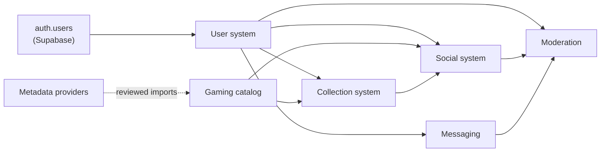

The catalog is shared and depends on no user content, except for attribution such as `submitted_by`. Providers feed the catalog through a review step and have no direct path to the application.

## Game, Release and Collection Item

These three concepts are always separate, and this is the most important relationship in the system. All three describe physical games only: a [product without actual game data on a physical medium](database-schema.md#product-scope) has no Release and no Collection Item, and packaging without the game is never a Collection Item.

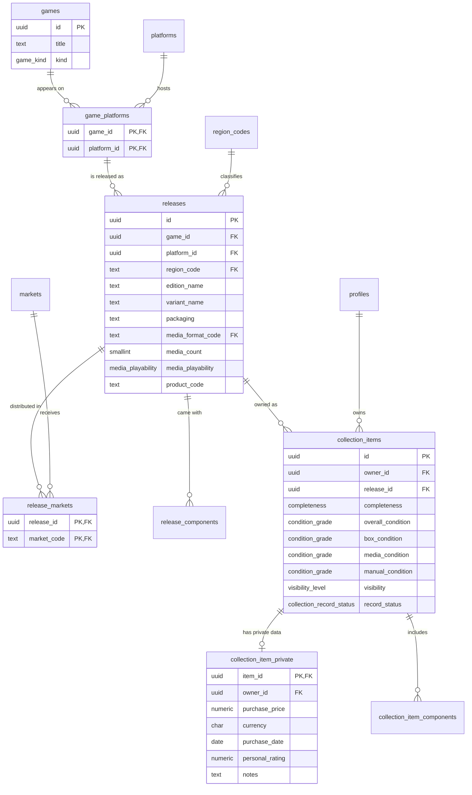

A worked example:

| Level | Example | Count |
| --- | --- | --- |
| Game | The Legend of Zelda: Ocarina of Time | One |
| Game platform | Ocarina of Time on Nintendo 64 | One per platform |
| Release | Nintendo 64, `ntsc-uc`, Collector's Edition, gold cartridge | One per physical edition |
| Release | Nintendo 64, `pal`, Standard, German packaging, markets `DE` and `AT` | Another edition, same game |
| Collection item | Lucía's loose copy of the gold cartridge, media condition `good` | One per physical copy |
| Collection item | Lucía's second, boxed copy of the same release | A separate row |

Three rules follow, all enforced by the database:

- A release can't exist for a game and platform pairing that isn't recorded. The composite foreign key to `game_platforms` prevents it.
- A release can't be deleted while anyone owns a copy. `ON DELETE RESTRICT` prevents it.
- A user can own any number of copies. There's deliberately no unique constraint on owner and release.
- A Release is always on a physical medium, because `media_format_code` is required and only physical formats exist.
- A Release's format must be valid for its platform, because of the composite foreign key to `platform_media_formats`.

## Platforms and physical media

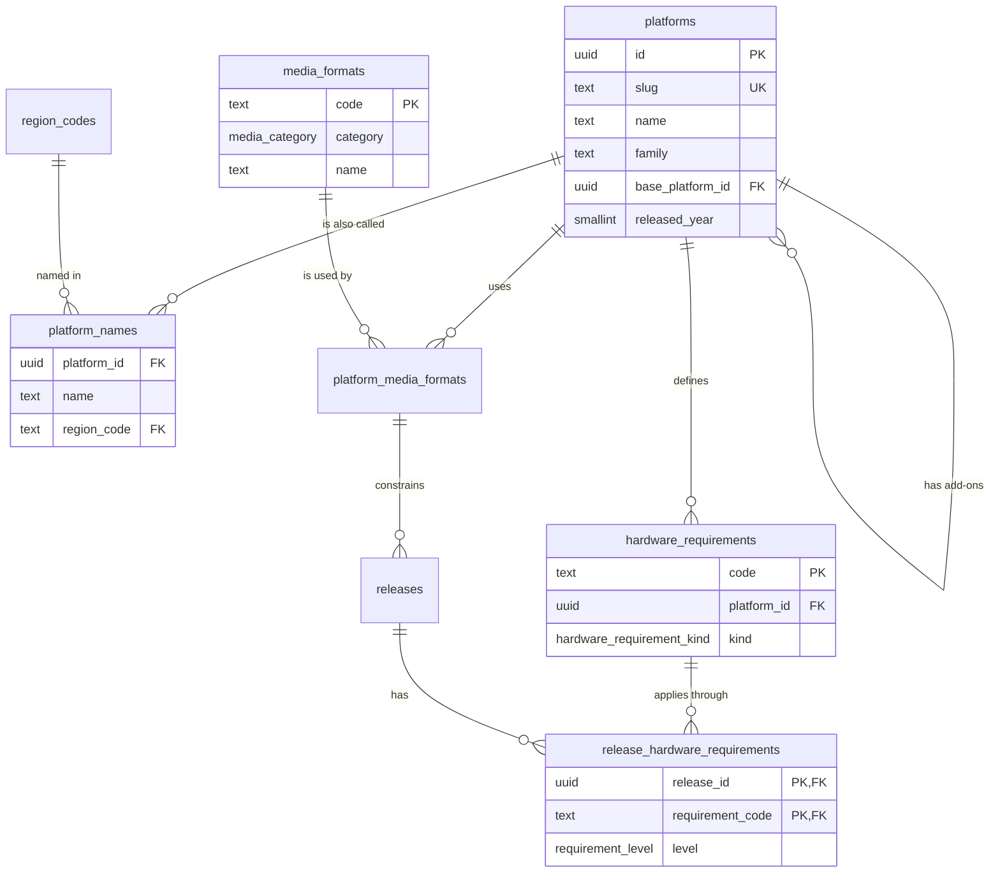

| Situation | Treatment |
| --- | --- |
| Mega Drive and Genesis | One platform, with Genesis in `platform_names`. Physical differences stay on each Release |
| Hardware revision, such as Switch Lite | No platform row |
| A game only for a revision, such as Xenoblade Chronicles 3D | Release on the base platform, with `new-3ds-family` at `required` |
| A game that fails on a revision, such as Virtua Racing | Release on the base platform, with `genesis-3` at `not_compatible` |
| A game needing an add-on, such as Donkey Kong 64 | `n64-expansion-pak` at `required`. Partial needs, such as Perfect Dark, use `partial` |
| Add-on with its own library, such as Mega-CD | A separate platform, with `base_platform_id` set. It adds no collectible hardware |
| Backward compatibility, such as a PS1 disc on a PS2 | Nothing recorded, and no duplicate Release |

## Multiple media in one physical edition

Approved as R6. One retail edition is one Release, however many pieces of media it holds. Separately sold editions in different formats stay separate Releases.

| Edition | `media_format_code` | `media_count` | `release_components` |
| --- | --- | --- | --- |
| A game on two CDs | `cd-rom` | 2 | None |
| A computer game on four floppies | The floppy format | 4 | None |
| A cartridge with a bonus game disc | `rom-cartridge` | 1 | `game_media`, with the disc's format and platform |
| Floppies and CDs in one box | The primary format | Its count | `game_media`, with the other format and quantity |
| The same game sold once on floppy and once on CD | One each | As sold | **Two Releases** |

The primary format is the one holding the main game, an editorial decision. An additional piece must be a valid format for its stated platform, enforced by a foreign key, and a piece without actual game data is an ordinary component rather than `game_media`.

**For an individual copy,** `media_condition` describes the medium overall, and `collection_item_components` records individual pieces. A copy with one disc of two is `incomplete`, with "Disc 2" at `not_included`. It still counts as one owned game, because a Collection Item needs the game medium, not every piece. Whether a copy is complete stays a declared value.

## Game Boy classification

Approved as R7. Three cases are kept distinct, with no duplicate Releases. Rules for editors are in [ADR-035](architecture-decisions.md#adr-035-game-boy-classification-follows-the-physical-edition).

| Case | Primary platform | `release_hardware_requirements` |
| --- | --- | --- |
| Original Game Boy release | `game-boy` | `gb-original` at `compatible` |
| Dual-mode cartridge | Decided from the physical edition | `gb-dual-mode` at `compatible` |
| Game Boy Color exclusive | `game-boy-color` | `gbc-exclusive` at `required` |

## Physical release examples

These illustrate how to model a situation. They aren't claims about specific products, and catalog editors should work from the physical package.

| Situation | Region code | Markets | Identity | Model |
| --- | --- | --- | --- | --- |
| A package sold unchanged in the US, Canada and Mexico | `ntsc-uc` | `US`, `CA`, `MX` | One package | **One Release.** Mexico is a market of the shared edition |
| A separate Mexican package | As classified, `ntsc-uc` or `latam` | `MX` | Own packaging and language | **Two Releases**, because the physical product differs |
| A pan-European package | `pal` | Every country confirmed | Multi-language | One Release |
| German and French packages of a game | `pal` for both | `DE`, `AT` and `FR` | Variants "German packaging" and "French packaging", with own rating labels and languages | **Two Releases**, both PAL, separated by identity |
| Australia and New Zealand share the European package | `pal` | European markets, `AU`, `NZ` | One package | One Release |
| An Australian package with local rating labels | `pal` | `AU`, `NZ` | Own rating labels | **Separate Release.** Neither case is assumed |
| Different packages in Hong Kong and Taiwan | `asia` for both, unless classified otherwise | `HK` and `TW` | Own packaging and languages | **Two Releases.** They aren't one "Asian" release |
| A Japanese package also officially distributed in Hong Kong | `ntsc-j` | `JP`, `HK` | One package | One Release. The market doesn't change its classification |
| A Southeast Asian package | `asia` | The countries confirmed, such as `SG` | Own packaging | One Release. No wider list is assumed |
| A Brazilian package | `pal-m` | `BR` | Own packaging | One Release |
| A regional Latin American edition | `latam` | Each country confirmed | Spanish packaging | One Release |
| A greatest-hits reprint | Same as classified | As confirmed | `edition_kind = 'reprint'`, own label and product code | **Separate Release** of the same Game |
| A second print with a different label | Same as classified | As confirmed | Different `variant_name` | **Separate Release** of the same Game |
| A collector's edition with a map and art book | As classified | As confirmed | `edition_kind = 'collector'`, with `release_components` | Separate Release. The map isn't a product itself |
| A platform with no hardware region lock | As collectors classify the package, such as `pal` | As confirmed | As printed | Hardware locking isn't the test. `region-free` only if the release itself is genuinely region-free or worldwide (Q11) |
| A disc holding the game, with downloads required for essential gameplay | As classified | As confirmed | `media_playability = 'download_required'` | Qualifies, and says so (Q8) |
| A release with little known about it | `unknown` | None | `media_playability = 'unknown'` | Published only if an editor accepts it. Nothing is invented |

The same game can be classified differently across platforms and generations, because each classification belongs to one platform-specific Release.

### Products that don't qualify

| Product | Outcome |
| --- | --- |
| A retail box holding only a download code | Excluded |
| A Game-Key Card that only authorizes downloading the game | Excluded |
| A PC box holding only an activation key | Excluded |
| A disc or card holding only an installer or launcher | Excluded |
| A digital-only edition, download or subscription | Excluded |
| A streaming or cloud version | Excluded |
| A disc or card with no meaningful game data | Excluded |
| An empty box, or a manual, insert, map or artwork without the game | Never a Collection Item |
| A console, arcade board or hardware accessory | Out of scope |
| A game card that contains the game | **Qualifies** with a format such as `nintendo-switch-game-card` |
| A disc that plays the game after normal installation | **Qualifies** as `playable_from_media` |
| A disc holding game data, with additional downloads needed for essential gameplay | **Qualifies** as `download_required` |
| A disc holding game data, where it isn't known what downloads are needed | **Qualifies** as `unknown` |
| A disc or card whose eligibility is unclear | **Stays in editor review**, and is never approved automatically |

## Game classification

Editors record these relationships by hand, and rules for choosing them are in [ADR-026](architecture-decisions.md#adr-026-game-classification-is-a-manual-decision-recorded-as-relationships).

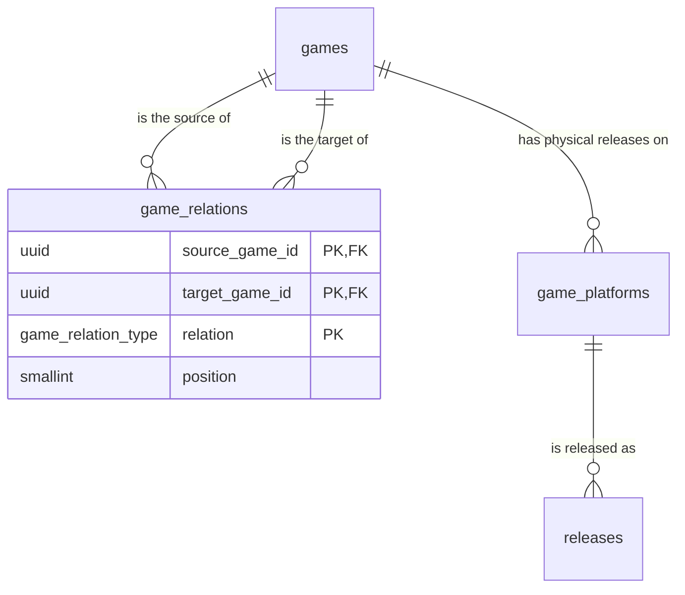

| Case | Game records | `game_relations` | Releases |
| --- | --- | --- | --- |
| Port to another platform | The same Game | None | A new Release on that platform |
| Reprint or re-release | The same Game | None | A new Release |
| Straight technical enhancement | The same Game | None | A new Release |
| Remake | A separate Game | New `remake_of` original | Its own |
| Substantially rebuilt remaster | A separate Game, if the editor decides so | New `remaster_of` original | Its own |
| Compilation | A separate Game, `kind = 'compilation'` | Compilation `contains` each game | Its own |

## Collection Item completeness and components

A Collection Item is one physical game. The medium is always part of it, except that a sealed copy relies on its declared edition rather than being opened.

| What the user owns | `completeness` | `box_condition` | `manual_condition` | Valid? |
| --- | --- | --- | --- | --- |
| Cartridge or disc only | `loose` | Null or `not_included` | Null or `not_included` | Yes, one owned game |
| Game with original box, no manual | `incomplete` | A grade | `not_included` | Yes, one owned game |
| Game with manual, no box | `incomplete` | `not_included` | A grade | Yes, one owned game |
| Game, box and manual | `complete` | A grade | A grade | Yes, one owned game |
| Factory sealed | `sealed` | A grade or null | Null | Yes, one owned game |
| One disc of a two-disc game | `incomplete` | As owned | As owned | Yes, one owned game |
| Box, manual, inserts, maps or artwork without the game | None | | | **No: can't be represented** |

Three structures work together, and none can create standalone component ownership:

| Structure | Holds | Why it can't stand alone |
| --- | --- | --- |
| `collection_items` | The medium, box and manual conditions | No "missing medium" value exists in `completeness` or for `media_condition` |
| `release_components` | What the edition originally included | Describes a Release, with no owner column |
| `collection_item_components` | Which materials this copy has | `item_id` is required, with a foreign key and cascading delete |

Statistics count `collection_items` only, so a loose cartridge counts as one owned game and a map adds nothing. See the [counted copy definition](database-schema.md#collection_items).

The database can't verify what a user physically holds. It makes a standalone component impossible to record, and the rest relies on the user's declaration when adding an item, which the application must ask for clearly.

## User system

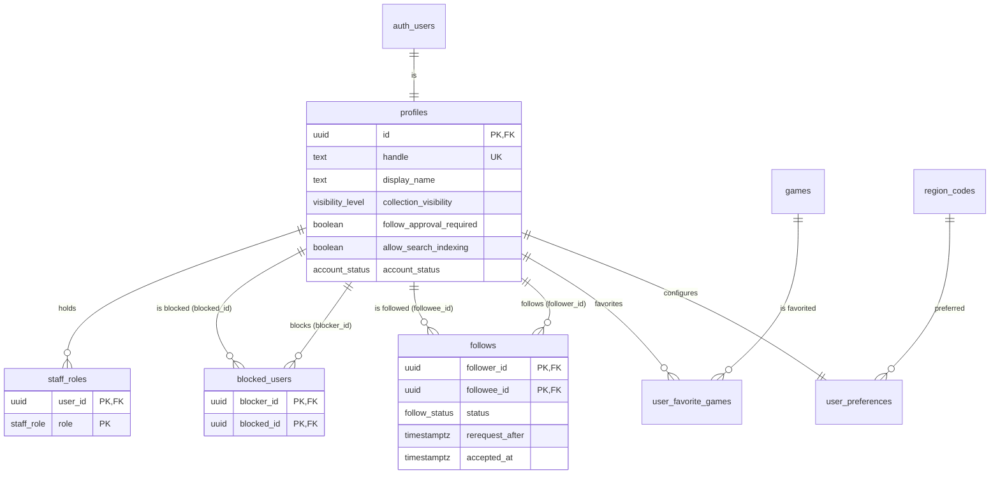

`private.handle_holds` has no relationships, deliberately. A held handle is a string with no link to the person who used it, so holds outlast an account without keeping any trace of who it was.

Deleting a user from `auth.users` cascades to `profiles`, then to `user_preferences`, `staff_roles`, `follows` and `blocked_users`, including rejection history in either direction. A trigger first creates the 30-day hold on the handle. Avatar files don't cascade, because Storage isn't part of the database. See [Account deletion](security-rls.md#account-deletion).

## Gaming catalog

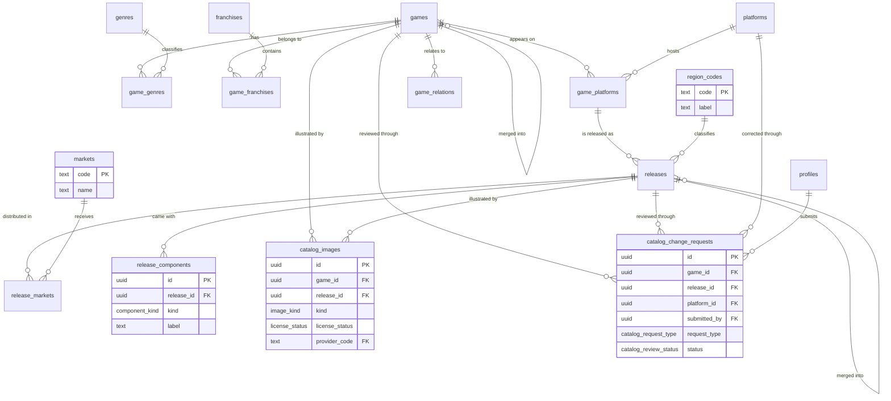

Merged records stay as tombstones with `merged_into_id` set. Old URLs and provider links keep working, and all references are repointed by a server job.

## Submission and approval workflow

Approved as D5, with the change that submissions are marked unverified and never become global catalog entries without a staff decision. There's no automatic path: no timer, vote count, or provider match can approve one.

This workflow is also where the physical-only scope is enforced. An editor checks that the medium holds actual game data before anything else, records `media_playability`, and excludes a product that doesn't qualify rather than merely rejecting it. If eligibility is unclear, the record stays `under_review`, and nothing is approved by default.

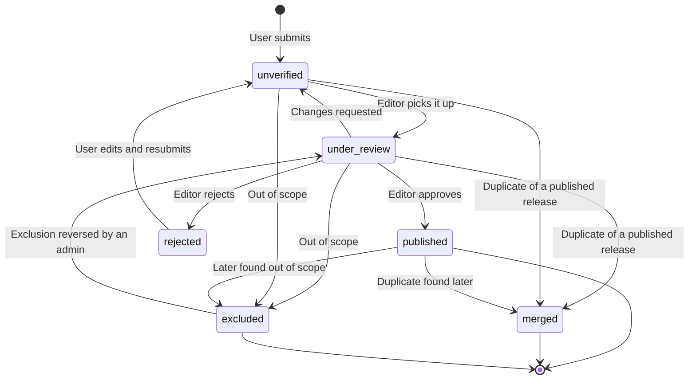

| State | Who can read the record | Can the submitter's items use it? | Other users |
| --- | --- | --- | --- |
| `unverified` | Submitter, catalog editors | Yes, immediately | Can't read it or attach to it |
| `under_review` | Submitter, catalog editors | Yes | Can't read it or attach to it |
| `published` | Everyone | Yes | Normal catalog entry |
| `rejected` | Submitter, catalog editors | Yes, marked "Not approved" | Can't read it or attach to it |
| `excluded` | Submitter, catalog editors, owners of preserved records | No. Existing items are preserved privately, and none can be added | Can't read it or attach to it |
| `merged` | Everyone, as a redirect | Items are moved to the target | Redirected |

What each outcome does, always in one transaction through a staff function that writes an audit row:

| Outcome | Effect |
| --- | --- |
| **Approve** | Publishes the release and any unverified game or pairing it needs, assigns a slug, clears `submitted_by` from the public rows, and moves images to the public bucket. The submitter is notified |
| **Request changes** | Returns it to `unverified` with a note |
| **Merge** | Points the record at the published release and moves every attached collection item to it. Owners are notified. Their copies, conditions, and private data are unchanged |
| **Reject** | For a genuine physical product with a problem such as bad data. Keeps the record and the owner's items, because the physical copy still exists. The user can edit and resubmit, or relink the copy to a published release |
| **Exclude** | For a product outside the physical-only scope. Marks attached collection items as preserved invalid records and notifies every owner. **Nothing is deleted.** The user can't resubmit the record. See [below](#invalid-record-preservation-and-correction) |

Where unverified records can be used:

| Used by | Allowed | Why |
| --- | --- | --- |
| The submitter's own `collection_items` | Yes | The approved requirement |
| Another user's `collection_items` | No | Would make a private record shared. They submit their own, and review merges them |
| `posts`, `reviews`, `wantlist_items`, `user_favorite_games` | No | These are public or social, so it would publish unreviewed text |
| Search, sitemaps, trending, provider matching | No | These read published records only |

When a public item points at an unverified release, other viewers see the item with a neutral "Unverified release" placeholder and nothing from the record, approved as Q7. That includes its markets and components.

## Invalid record preservation and correction

Approved as Q9. If a Release is found to be digital-only or otherwise out of scope, user data is preserved. A preserved record isn't a valid owned game.

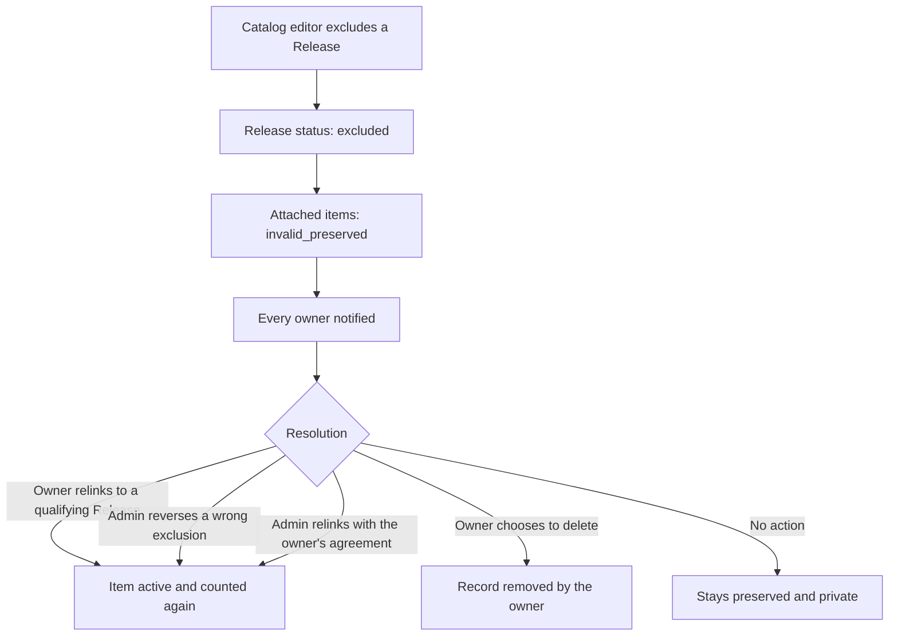

| Requirement | How |
| --- | --- |
| Excluded from the public catalog | `excluded` releases are readable only by the submitter, catalog editors and owners of preserved records |
| No new additions | `can_use_release()` rejects excluded releases, on insert and update |
| Owners notified | The exclusion function sends a `catalog_exclusion` notification to every owner |
| Preserved privately | The row, its components and its private data all stay. Others can't read it, whatever its `visibility` was |
| Not counted as a valid game | Statistics require `record_status = 'active'` and a `published` release. It's shown to the owner as its own category, distinct from pending (A1) |
| Not shown as legitimate | It disappears from public shelves automatically, because a shelf entry needs a readable item |
| Exportable | The owner still reads their own row, and account export includes it, flagged |
| Controlled resolution | Staff functions, each writing an audit row, with an index for the resolution queue |

Under A2, **a preserved record is never deleted automatically because of its age**, and owners may delete their own. A formal retention policy will be defined separately, before real user data is processed.

While preserved, the owner can read, export or delete the record, edit its private notes, or relink it. Other edits are blocked until it's corrected, so an invalid record can't be repaired by changing unrelated fields. Relinking is safe for owners to do themselves, because the target must be a published release, or their own submission. A trigger then clears the flag.

Other references to an excluded release:

| Reference | Effect |
| --- | --- |
| `posts.release_id` | The post stays. The release isn't readable, so it shows no catalog details. A moderator can act on the post separately |
| `reviews.release_id`, `wantlist_items.release_id` | Stay in place and show no catalog details, for a moderator or the owner to resolve |

`ON DELETE RESTRICT` prevents deleting an excluded release while records still reference it, so it can't be removed by accident.

## Collection system

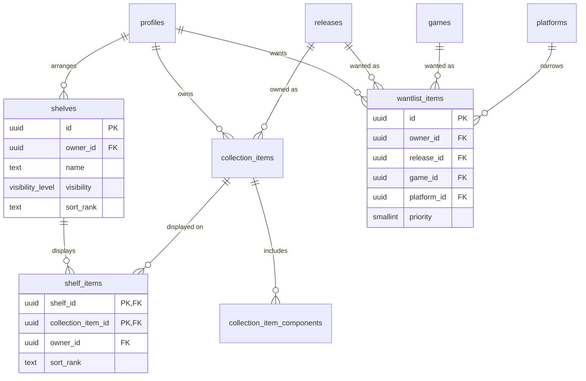

**Shelves hold references, not copies.** `shelf_items` holds only keys and a sort position. Moving an item between shelves, or showing it on three, never duplicates its condition or price.

**One owner per shelf, enforced by composite keys.** `shelf_items.owner_id` looks redundant but is what makes this possible:

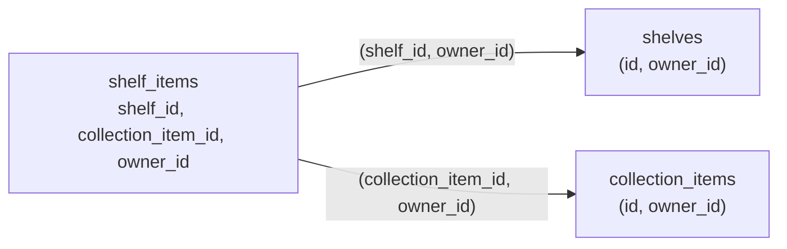

Both foreign keys share the single `owner_id` column, so a row can't reference one person's shelf and another person's item. The database rejects it regardless of application code or RLS. `posts` uses the same pattern for its item and shelf references.

## Social system

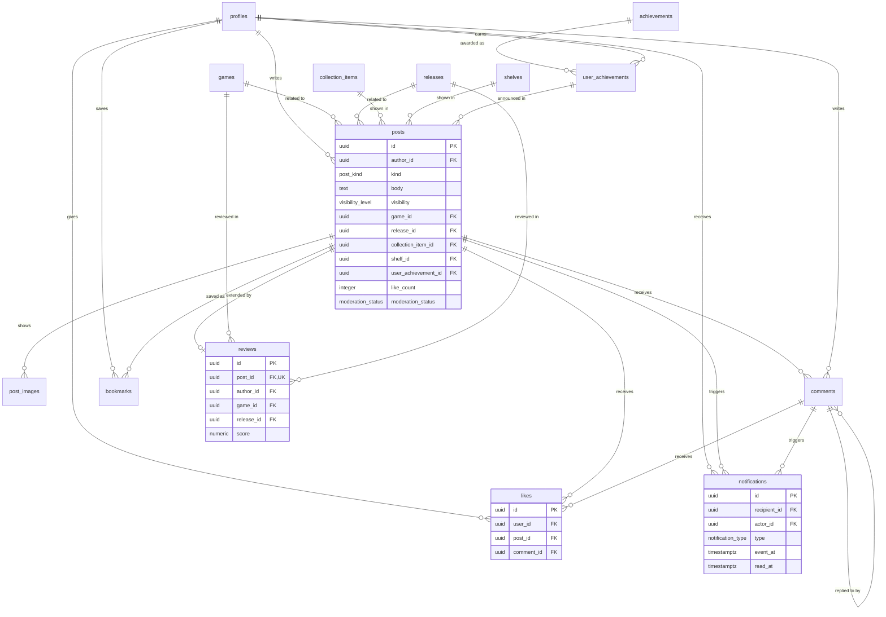

**Reviews and personal ratings are different things.** A review is public opinion, attached to a game or release, with likes and comments through its post. A personal rating is a private note attached to one physical copy.

**What a post shows when its source changes:**

| Event | What happens to the post |
| --- | --- |
| Pickup's item is deleted (sold) | Post stays. `collection_item_id` becomes null. Release and completeness still display |
| Pickup's item is private when posted, or made private later | Post stays and shows the release and completeness the author chose to disclose. Other item details aren't readable |
| Showcase's shelf is deleted | Post stays. `shelf_id` becomes null, and the UI shows the shelf as no longer available |
| Showcase's shelf is private, or its items are | Same display for others. The owner still sees it, and the composer warns that others won't see it |
| Author soft-deletes a post | Hidden from everyone. Its review is soft-deleted too, freeing that user to review the game again |

## Messaging

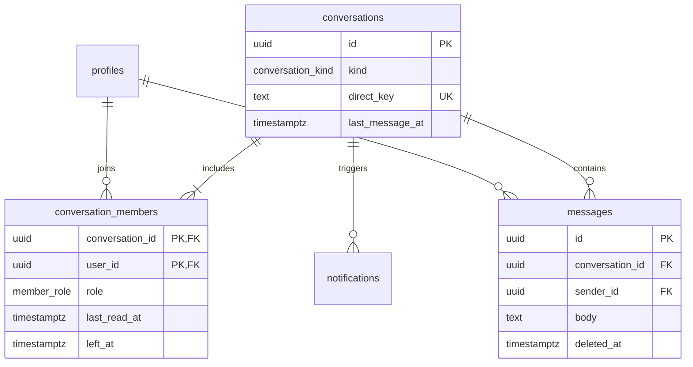

## Moderation

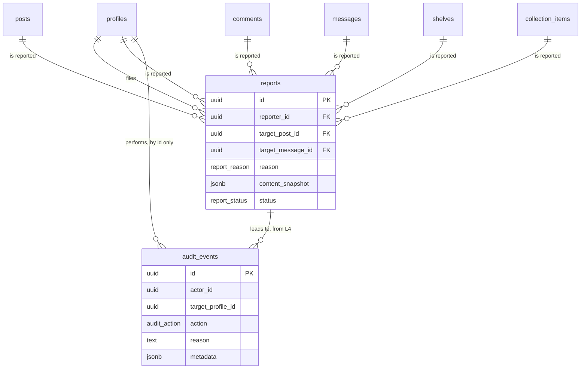

## Metadata providers

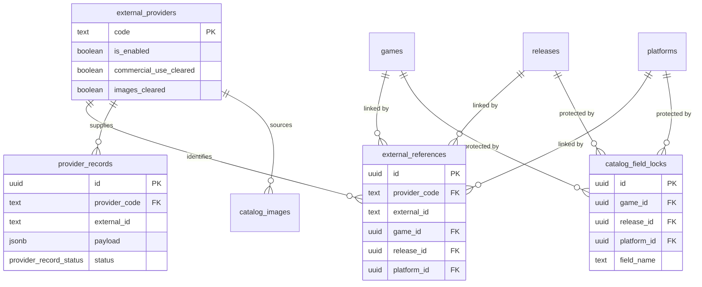

## What happens on delete

### When a user deletes their account

Deleting the `auth.users` row cascades through `profiles`. Behavior for each type of data:

| Data | On account deletion | Why |
| --- | --- | --- |
| Profile, preferences, favorites | Deleted | Personal data |
| Follows and blocks, both directions | Deleted | Meaningless without the account |
| Collection items, private data, shelves, wantlist | Deleted | Personal data |
| Posts, their images, reviews | Deleted | User's content |
| Comments | Kept, author set to null, shown as "Deleted user" | Keeps other people's threads readable |
| Comments on the deleted user's posts | Deleted with the post | The post is gone |
| Likes, bookmarks | Deleted, and counters updated | Personal data |
| Messages sent | Kept, sender set to null | They're part of the other person's history |
| Conversation memberships | Deleted | |
| Reports filed about others | Kept, reporter set to null | Moderation record |
| Reports about the user | Kept, target set to null, snapshot retained | Moderation evidence |
| Catalog submissions | Kept, submitter set to null | Shared data |

The treatment of comments, messages and report snapshots needs legal review. This is [D10](architecture-decisions.md#decisions-requiring-product-owner-approval).

Storage files don't cascade with database rows. Account deletion must also remove the user's files, through a server job.

### Delete behavior by relationship

| Parent | Child | Action | Reason |
| --- | --- | --- | --- |
| `games` | `releases` (through `game_platforms`) | Restrict | Deleting history by accident must be impossible |
| `games` | `game_genres`, `game_franchises` | Cascade | Links only |
| `games` | `user_favorite_games`, `wantlist_items`, `reviews` | Restrict | User data depends on it. Merge instead |
| `releases` | `catalog_change_requests` | Cascade | Rejected and merged records stay, so this is reached only by retention jobs |
| `releases` | `collection_items` | Restrict | Users own physical copies of it. Merge instead |
| `releases` | `wantlist_items`, `posts`, `reviews` | Restrict | Merge instead |
| `region_codes`, `markets`, `genres`, `franchises`, `media_formats`, `hardware_requirements` | All children | Restrict | Reference data |
| `platforms` | `platforms`, `releases`, `hardware_requirements` | Restrict | Reference data |
| `platforms` | `platform_names`, `platform_media_formats` | Cascade | Parts of the platform record |
| `releases` | `release_hardware_requirements` | Cascade | Parts of the release |
| `releases` | `release_markets`, `release_components` | Cascade | Parts of the release |
| `games` | `game_relations` | Cascade | Links only. Merges repoint them first |
| `collection_items` | `collection_item_components` | Cascade | Parts of the item |
| `collection_items` | `collection_item_private`, `shelf_items` | Cascade | Parts of the item |
| `collection_items` | `posts` | Set null | The post outlives the copy |
| `shelves` | `shelf_items` | Cascade | Removes the links, not the items |
| `shelves` | `posts` | Set null | The post outlives the shelf |
| `posts` | `post_images`, `comments`, `likes`, `bookmarks`, `reviews` | Cascade | Parts of the post |
| `comments` | Replies, `likes` | Cascade | Normally replaced by a soft delete |
| `conversations` | `conversation_members`, `messages` | Cascade | Reached only when a cleanup job removes a conversation with no remaining members |

Normal application deletes of posts, comments, messages and reviews are soft deletes, so the cascades above are reached only through account deletion or data retention jobs.
