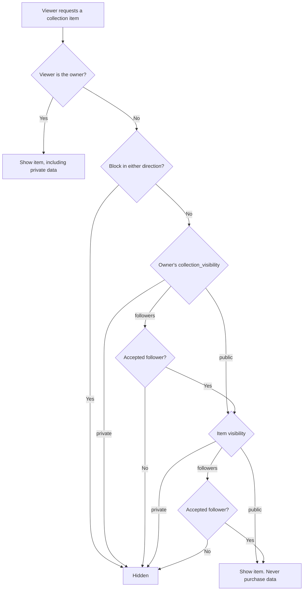
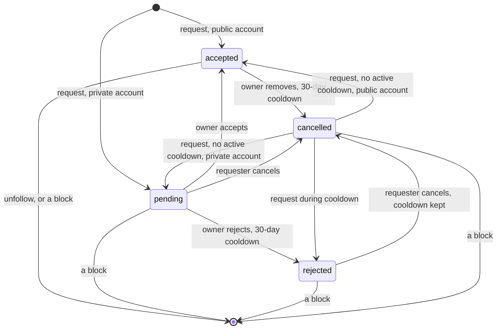
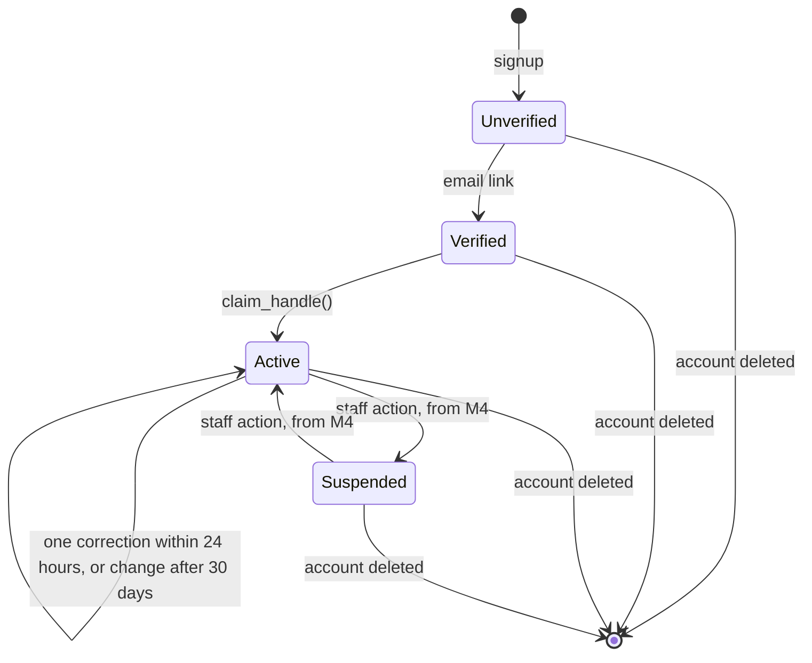

# Security and Row Level Security

**Status:** Approved design, including the decisions on D1 to D9, Q1 to Q12, A1 to A3, P1 to P10, R1 to R8 and D13, and the strict physical-only scope. M0 and M1 are implemented locally, and their rules are enforced by tests. Other SQL here illustrates the policies, and isn't a migration.

## The security model

A browser using the Supabase publishable key can call the Data API directly, without passing through Next.js. So **the database is the security boundary**, and application code can't be relied on to enforce access.

Access passes through four layers, each doing something the others can't:

| Layer | What it controls | Example |
| --- | --- | --- |
| **Grants** | Which tables and **columns** a role may touch | A user can't update `profiles.follower_count` |
| **RLS policies** | Which **rows** a role may touch | A user can only update their own profile |
| **Constraints** | Whether the data is valid and consistent | A shelf and its items must share one owner |
| **Server functions** | Multi-step or privileged actions | Publishing a catalog entry, starting a conversation |

### RLS alone isn't enough

Three properties of RLS shape this design:

1. **RLS can't hide columns.** If someone can read a row, they can read every column in it. That's why purchase prices are in a separate table and `profiles` holds only public-safe fields.
2. **RLS can't restrict which columns are updated.** A policy allowing users to update their own post also lets them set `like_count` to a million. Column-level grants close that gap.
3. **RLS doesn't validate.** Length limits and formats have to be `CHECK` constraints, because a direct API call skips application validation.

### Explicit grants

**The architecture doesn't depend on any Supabase default.** Defaults differ between environments and versions. Supabase [announced](https://github.com/orgs/supabase/discussions/45329) that new `public` tables would stop being exposed automatically. But on the local stack with CLI 3.0.0 and PostgreSQL 17.11, an untouched new table gave `anon` full access with RLS off, and through the real API `anon` could read, insert, delete and run new functions. The hosted behavior hasn't been observed.

So migration M0 sets the privileges explicitly, and tests check the result rather than the default:

| Scope | Change | Reason |
|---|---|---|
| `postgres` in `public` | Revoke all on tables, sequences and functions from `anon`, `authenticated`, `service_role` | New objects get no implicit access |
| `postgres` in `private` | The same | Stays closed if a platform default changes |
| `postgres` in all schemas | Revoke EXECUTE on functions from `PUBLIC` | See below |
| Schema `public` | Revoke CREATE from `PUBLIC` and the API roles | Only migrations create objects |
| Schema `private` | Revoke all from `PUBLIC` and the API roles | Not exposed, and helpers are granted one at a time |

**Default privileges apply per creating role.** Migrations run as `postgres`, a non-superuser that owns all application objects. `supabase_admin` keeps its own defaults, including in `public`, and `postgres` can't change them. So nothing else may own an application object, and a test fails if something does. Extensions go in the `extensions` schema, never `public`.

**The role-wide function revoke.** PostgreSQL grants EXECUTE to `PUBLIC` on every new function, and a schema-scoped default can't remove a built-in default, which we confirmed: `anon` could still execute the function. So this one revoke is role-wide. It applies only to functions `postgres` creates from now on. Existing functions, and those owned by platform roles such as `supabase_auth_admin`, `supabase_storage_admin` and `supabase_admin`, don't change. The consequence is that any `postgres`-owned function, in any schema, needs an explicit grant to be callable.

**Supabase-managed schemas aren't changed.** Comparing a snapshot of function, table and schema privileges and default privileges in `auth`, `storage`, `realtime`, `vault`, `graphql`, `graphql_public`, `supabase_functions`, `pgbouncer` and `_realtime` before and after M0 showed no differences. An API test also confirms auth, the REST API, storage and realtime still work.

**Every later table therefore needs, in the same migration:**

1. RLS enabled.
2. Explicit grants, including to `service_role`. **Its RLS bypass doesn't replace SQL privileges:** without a grant it's refused like any other role.
3. Policies.
4. An entry in the approved grant lists in `supabase/tests/database/03_schema_guards.test.sql`, or the tests fail.

A column default using `private.uuid_v7()` also needs EXECUTE for the inserting role. Tests confirmed that EXECUTE is enough, without USAGE on `private`.

### Known limitations

These are accepted for M0 and stay open until each is resolved:

| Limitation | What it means | Required action |
| --- | --- | --- |
| **Hosted permissions are unverified** | Tests have run only on the local stack | Run the database tests on a hosted project before production use |
| **Default privileges are per role** | `supabase_admin` keeps permissive defaults in `public`, which `postgres` can't change | Application objects must be created only by `postgres`, through migrations. The ownership guard detects others when tests run, not at creation |
| **Guards cover named schemas only** | They inspect `public` and `private` | Add any future application schema to the guards in the same migration that creates it |
| **Supabase-managed schemas stay untouched** | `postgres` keeps permissive defaults in `storage`, and no guard covers that schema | Never create application objects in `auth`, `storage`, `realtime` or other managed schemas, and don't alter their defaults |
| **Secret scanning isn't in CI** | The pre-commit hook is per clone and can be skipped | Add `secrets:check` and `secrets:bundle` to CI when CI exists |
| **Extension functions are callable by `anon`** | `anon` has USAGE on `extensions`, and extension functions are executable by `PUBLIC`. They're platform-owned, and aren't API endpoints because `extensions` isn't an exposed schema | Accepted. Keep extensions out of `public`, and keep `extensions` out of the exposed schemas |
| **Enum types are usable by `PUBLIC`** | This reveals only labels that are public anyway | Accepted. Don't put sensitive values in enum labels |
| **The migration role is powerful** | `postgres` isn't a superuser, but it can bypass RLS and create roles, as Supabase provides it | Accepted. Keep its credentials out of the application |

## Roles

| Role | Who | Key | Bypasses RLS |
| --- | --- | --- | --- |
| `anon` | Signed-out visitors | Publishable | No |
| `authenticated` | Signed-in users | Publishable + user session | No |
| `service_role` | Server jobs only | Secret | **Yes** |
| Staff | Signed-in users with a `staff_roles` row | Publishable + user session | No |
| `catalog_importer` | The operator's import tool only (M5b). A database login, never an API key | Its own password, set per environment | No. It has no table privileges at all |

- Staff are normal `authenticated` users, and read policies check `staff_roles`. **Grants apply per role, not per user, so a column grant can't let staff write what users can't.** All staff writes therefore go through functions that check `private.require_active_staff()` and record a `private.audit_events` row in the same transaction, which also guarantees every staff change is audited. See [Staff actions](#staff-actions). Wherever this document says "Staff" or "Catalog staff" under writes, it means through those functions.
- The secret key bypasses RLS, so server code using it can technically read anything, including private data. It's limited to the named jobs below and must not be used for general reads.
- The secret key is never in browser code, and `NEXT_PUBLIC_` variables never hold it. Supabase is replacing the legacy `anon` and `service_role` keys with publishable and secret keys ([Supabase docs](https://supabase.com/docs/guides/getting-started/api-keys)), so use the new ones from the start.
- Policies never trust `user_metadata` from the JWT, because users can edit it. Roles come from tables.

## Helper functions

These live in the `private` schema, which the Data API doesn't expose. They use `SECURITY DEFINER` so a policy can check membership without recursion, and `set search_path = ''` to prevent search-path attacks. A policy needs only EXECUTE on a helper. No role has USAGE on `private`, so a client calling one directly is refused. This was tested on the local stack.

| Function | Returns true when |
| --- | --- |
| `private.is_active_user()` | Caller has `account_status = 'active'`, a claimed handle and a verified email |
| `private.has_staff_role(role)` | Caller holds that role, or `admin`. Doesn't check the account, so staff functions use `require_active_staff` |
| `private.require_active_staff(role)` | Raises `not permitted` unless the caller holds the role and is active, verified and has a handle (M4) |
| `private.is_accepted_follower(owner)` | Caller has an **accepted** follow of `owner`, and caller's own account is active |
| `private.is_blocked_between(other)` | A block exists in either direction |
| `private.can_view_level(owner, level)` | Caller is the owner; or `owner` is active, no block exists, and `level` allows it. The core rule. Never reads staff status |
| `private.can_view_collection(owner)` | `can_view_level` with the owner's `collection_visibility` |
| `private.can_view_connections(owner)` | Caller is the owner; or is active, no block exists, and `owner` is public or caller is an accepted follower. Lists and counts only |
| `private.block_peers()` | Everyone in a block with the caller, for use once per query |
| `private.can_view_post(post_id)` | Caller can read that post under its policy |
| `private.is_published_release(release)`, `private.is_published_game(game)` | The record is `published` |
| `private.owns_copy_of(release)` | Caller owns a collection item on that release. Not built yet: M7 needs it to let owners of preserved copies read an excluded release |
| `private.can_read_release(release)` | The record is `published` or `merged`, or the caller submitted it or is a catalog editor, or it's `excluded` and the caller owns a preserved copy |
| `private.can_use_release(release)` | The record is `published`, or the caller submitted it and it's `unverified`, `under_review` or `rejected`. Never `excluded` |
| `private.is_conversation_member(conversation)` | Caller is a current member (`left_at IS NULL`) |
| `private.can_send_message(conversation)` | Caller is a member and no block exists with another member of a direct conversation |

```sql
-- Illustrative
create function private.is_conversation_member(conv uuid)
returns boolean language sql stable security definer set search_path = '' as $$
  select exists (
    select 1 from public.conversation_members m
    where m.conversation_id = conv
      and m.user_id = (select auth.uid())
      and m.left_at is null
  )
$$;
```

**Why messaging needs a helper.** The obvious policy on `conversation_members` queries `conversation_members` itself, which PostgreSQL rejects with `infinite recursion detected in policy`. We reproduced this in the design probe below. The helper reads the table with its owner's rights and avoids the loop.

## Public profiles and public collections

### What signed-out visitors can browse

Approved as D3: public profiles, public collections, public games and public posts are available without signing in. The `anon` role gets read access to those and nothing else. Follower lists and who-liked lists are readable only when signed in, because D3 didn't include them and scraping them reveals people's connections.

Public pages should query as `anon`, even for signed-in visitors, wherever per-viewer data isn't needed. A query that runs as `anon` can't return private data, so its result is safe to cache.

### Search engine indexing

Approved as Q3: `profiles.allow_search_indexing` defaults to `false`, and users explicitly opt in for their public profile and eligible public content. **This preference has no effect on access.** No policy reads it. Turning it on can't make private content visible, and turning it off doesn't hide public content.

| Page | Indexed when |
| --- | --- |
| Published games and releases | Always |
| Unverified, rejected or merged catalog records | Never |
| A user's profile, public shelves and public items | `allow_search_indexing` is on |
| A public post | Its author has `allow_search_indexing` on |
| Anything else | Never |

The application enforces this with a `noindex` robots tag, and by leaving these pages out of the sitemap. **This is a request to search engines, not access control.** Public content stays reachable by URL and through the Data API, and the settings screen should say so. Privacy comes from the visibility settings.

### Profiles

**The public card is six columns: `id`, `handle`, `display_name`, `avatar_path`, `bio` and `country_code`.** Column grants enforce this, because RLS can't hide columns. Everything else on `profiles` has no client `SELECT`, including for signed-in users and the owner, so it also can't be filtered or sorted on to infer its value:

| Column | How it's read |
| --- | --- |
| `allow_search_indexing` | Owner, through `public.get_my_account()`. An owner-controlled setting, never on a public card |
| `follow_approval_required` | Owner, through `public.get_my_account()`. See below |
| `collection_visibility` | Owner, through `public.get_my_account()`. M3 policies read it through a helper |
| `account_status`, `handle_changed_at`, `handle_correction_until` | Owner, through `public.get_my_account()` |

A profile row is readable by everyone, signed in or not, once it has a claimed handle and unless the account is suspended. Claiming a handle requires a verified email, so unverified accounts are never public. Block checks arrive with M3. This is deliberate: comment authors and follow requests need a name and avatar to render, even for private accounts.

**`follow_approval_required` isn't public.** Exposing it would let anyone filter for private accounts. `public.get_follow_state(target)` is the narrow alternative, for signed-in active users, one target at a time. It returns `self`, `can_follow`, `can_request`, `requested`, `following`, `blocked_by_you` or `unavailable`. Someone could still check accounts one by one, because a "Request" button inherently shows this, so it needs application rate limiting.

**Blocks hide cards from signed-in users, in both directions.** A signed-out visitor can still see a card, because public means public.

**Follower counts aren't on the card.** See [Follower lists and counts](#follower-lists-and-counts).

**Search engine pages need a controlled read.** Pages can't read `allow_search_indexing` as `anon`. When public profile pages are built, they need a narrow server-side check that returns only whether a page may be indexed, and must default to `noindex` if it fails.

The public card is confirmed by the product owner as handle (username), display name, avatar, optional bio and optional country, and stays visible even when a collection is private. Private collections and private collection information stay inaccessible to signed-out visitors and unauthorized users. Search indexing is a separate preference and doesn't determine access.

A "private account" means `follow_approval_required = true` and `collection_visibility` set to `followers` or `private`. The card stays visible and the content doesn't. Email and auth data stay in `auth.users`, which is never exposed.

### Collections: three checks

Access to a collection item requires passing all of these, and the most restrictive setting wins. **Under D2, collections, shelves, items and wantlist entries are all private by default**, so nothing appears publicly until the user explicitly chooses.



| Owner's setting | Item's setting | Signed-out visitor | Other user | Accepted follower | Owner |
| --- | --- | --- | --- | --- | --- |
| `private` (default) | `private` (default) | No | No | No | Yes |
| `private` | `public` | No | No | No | Yes |
| `public` | `private` | No | No | No | Yes |
| `public` | `followers` | No | No | Yes | Yes |
| `public` | `public` | Yes | Yes | Yes | Yes |
| `followers` | `public` | No | No | Yes | Yes |

Consequences:

- **Purchase price, currency, purchase date, personal rating and notes are visible only to the owner, always.** They're in `collection_item_private`, which has no read path for anyone else, including followers and staff.
- **Shelves don't grant access to items.** Reading a `shelf_items` row requires being able to read both the shelf and the item. A private item on a public shelf is simply absent for other viewers, and displayed counts must count visible rows, not stored totals.
- **Preserved invalid records are private whatever their `visibility`.** The read policy requires `record_status = 'active'` for anyone but the owner, and a preserved record's components and shelf entries follow.
- **Search and aggregates** respect the same rules. Trending counts come from public activity only, and statistics count only [counted copies](database-schema.md#collection_items).

### Making things public under private defaults

Public display needs two or three settings to agree: the collection, the item and, for a shelf, the shelf. Marking one thing public can appear to do nothing, which is the main usability cost of D2. So:

- Each visibility control shows the **effective** result, such as "Hidden: your collection is private".
- A single explicit "publish" action changes the required settings together. It runs through a function and always confirms what will become visible, for example "Publish this shelf and its 40 items".
- Bulk publishing never happens without that confirmation, and changing a default only affects new records.
- Approved as Q5: `posts.visibility` has no database default, so an unspecified post fails rather than becoming public. The composer may preselect `public`, always shows the selection, and lets the user change it before publishing. RLS enforces the selected value.
- Posting a pickup from a private item shows that the release and completeness will be disclosed.
- Approved as Q4: wantlists default to private, and users can explicitly make them public. A wantlist entry's visibility is separate from `collection_visibility`, so a user can share what they're looking for while keeping their collection private.

### Followers-only needs approval to mean anything

If anyone can follow instantly, "followers only" is public with one extra click. So the setting is only as strong as `follow_approval_required`. Approved as D1: access requires `status = 'accepted'`, and a pending request grants nothing. A user who picks `followers` should be prompted to turn on approval.

### Blocks

Blocks are enforced in both directions for signed-in users.

| Effect | Behavior |
| --- | --- |
| Follows, requests and cooldowns | Removed in both directions, atomically, by a trigger, so an operator's insert is covered too |
| Unblocking | Restores nothing. A later request is a fresh one |
| Following while a block exists | Refused with `user unavailable`, the same answer as an unknown or suspended account. A trigger also refuses it at the row level |
| Profile cards | Hidden from both signed-in users |
| Followers-only and public content | Hidden from both signed-in users, through `can_view_level` |
| Follower lists and counts | Unavailable to both, and neither appears in lists the other views |
| A block list | Only the blocker can read it, through `get_my_blocks()`, which returns card fields so they can unblock |
| A suspended user | Can still block, unblock, unfollow, reject and remove followers. Actions that reduce access stay available |

**Previously published public content** isn't deleted or edited. It's hidden from each party while signed in, and stays visible to everyone else. Likes and comments aren't removed. Owners will be able to delete comments on their own posts when those tables arrive in L3, and later tables must apply this rule.

**Limits.** A blocked user can sign out and still see public content, including the card and avatar URL. Comparing signed-in and signed-out views also reveals that a block exists. Followers-only and private content stays hidden either way.

### Who can see what

Implemented by `private.can_view_level`, and tested through a real RLS policy for each viewer.

| Viewer | Card | `public` content | `followers` content | `private` content | Follower lists and counts |
| --- | --- | --- | --- | --- | --- |
| Owner, even if suspended | Own, via `get_my_account()` | Yes | Yes | Yes | Exact |
| Anonymous | Yes | Yes | No | No | No |
| Signed-in stranger | Yes | Yes | No | No | Public accounts only |
| Pending follower | Yes | Yes | **No** | No | Same as stranger |
| Rejected requester | Yes | Yes | **No** | No | Same as stranger |
| Accepted follower | Yes | Yes | Yes | **No** | Yes |
| Blocked, either direction | **No** | **No** when signed in | No | No | No |
| Suspended, deactivated, unverified or no handle | Same as anonymous | Yes | **No**, even if accepted | No | No |
| Moderator or admin | Same as their relationship | Same | **No bypass** | **No bypass** | Same |

If the owner is suspended or has no handle, only the owner can see their content. Staff access to private content can only come through audited M4 functions, and purchase data stays owner-only. Later policies on collections, shelves and wantlists must also apply their own item, shelf and entry checks.

**Authentication alone never grants access.** Being signed in adds nothing beyond a signed-out visitor, except the ability to have a relationship.

## Follow requests

**No client role has any access to `follows` or `blocked_users`.** RLS is on with no client policies, and every change goes through a `SECURITY DEFINER` function with an empty `search_path`, which takes the acting user only from `auth.uid()`. There's one row per ordered pair, ever.



A trigger refuses every other transition, for any writer including an operator.

| State | Meaning | Requester sees | Owner sees |
| --- | --- | --- | --- |
| `pending` | Awaiting a decision | "Requested" | In their queue |
| `accepted` | Grants access while the follower is active | "Following" | A follower |
| `rejected` | The owner refused, or a retry during a cooldown | **"Requested"**, indistinguishable from `pending` | Nothing |
| `cancelled` | Withdrawn by the requester, or removed by the owner | "Follow" or "Request" | Nothing |

**Rejection is silent.** `rejected` reads as "Requested" in `get_follow_state` and `get_sent_follow_requests`, and it stays that way, even after the cooldown ends, until the requester cancels. It never reaches the owner's queue, and can't be accepted later.

**A request during a cooldown:**

- Reads to the requester exactly like a real request.
- Creates nothing actionable. The row becomes `rejected`, and stays out of the owner's queue.
- Sends no notification, because the row never becomes `pending` (M4b).
- Never changes `rerequest_after`.
- Reuses the one row, so it can't build up history.
- Is idempotent when repeated.
- Can't be bypassed by cancelling. `cancelled` keeps the cooldown, so cancelling and retrying leads straight back to `rejected`.

A cooldown ends at exactly 30 days. After that, cancelling and requesting creates a real request.

**Other rules:**

| Situation | Result |
| --- | --- |
| Cancelling your own pending request | No cooldown, so you can request again |
| Unfollowing | Deletes the row, with no cooldown |
| Owner removes a follower | `cancelled` with a 30-day cooldown, including on a public account. A re-follow during it returns "Requested", which can reveal the removal, though the follower has already lost access |
| Owner disables approval | Pending requests stay pending. Rejections stay. Later requests from others follow immediately |
| Owner enables approval | Accepted follows stay |
| Followers-only visibility with approval off | Allowed. It doesn't enable approval, so anyone can follow and gain access. The future UI must clearly explain this |
| Adding access: `request_follow`, `accept_follow_request` | Require an active account |
| Reducing access: cancel, unfollow, reject, remove, block, unblock | Require only a verified account, so a suspended user can still protect themselves |

**Request limit.** At most 200 outstanding requests per user, as a database safeguard, not a substitute for rate limiting. It counts `pending` and `rejected` together, because both read as "Requested", so reaching it can't reveal a rejection. The requester can free places by cancelling. Instant follows of public accounts aren't limited.

**Retention.** `rejected` and `cancelled` rows are kept with no purge job, pending approval of retention under D10. They're removed when either account is deleted, or by a block.

### Concurrency

All follow and block changes for a pair of users take a transaction-scoped lock, in either direction. `request_follow` also takes a per-requester lock first, for the limit, and a shared lock on the target's profile, so it waits for an uncommitted change to that account. The primary key makes a duplicate row impossible.

| Race, tested with a transaction held open | Result |
| --- | --- |
| Six identical requests, or five identical accepts | All succeed, with one row |
| Mutual requests, or mutual blocks | No deadlock |
| Accept, then a cancel during it | The cancel waits and does nothing, so the follow stands |
| Cancel, then an accept during it | The accept is refused |
| Block, then a request or accept during it | Refused, with no row |
| Request or accept, then a block during it | The block waits, then removes it |
| Unblock, then a request during it | The request waits, then succeeds as a fresh relationship |
| Target's deletion, then a request during it | Refused, with no row |
| Request, then the target's deletion during it | The deletion waits, then removes the row |
| Requester's own deletion, then a request during it | Refused, with no row |
| Change to private, then a request during it | The request waits, and is pending |
| Change to public, then a request during it | The request waits, and follows immediately |
| Approval disabled during a repeated request | Stays pending |
| Four requests at 199 outstanding | Exactly one succeeds, and the total never exceeds 200 |

Since M4b, `request_follow` and `accept_follow_request` also lock both accounts before the follow row, because the notifications they create reference both. See [Notifications](#notifications).

### Follower lists and counts

`get_followers`, `get_following` and `get_profile_counts` are signed-in only, and share one rule. **Public counts represent visible relationships, not necessarily the complete total.**

| Viewer | Sees |
| --- | --- |
| Owner | Every accepted relationship: the exact total, including suspended and private accounts |
| Anyone else permitted | Accepted relationships with public, active accounts they have no block with, plus their own relationship |
| Not permitted: blocked, inactive, or a stranger to a private account | An empty list, and no count row. The same as an unknown account |

- **Only accepted relationships count.** Pending and rejected never do.
- **A private account's relationships aren't exposed through either side.** A public account's "following" list doesn't reveal that it follows a private account, and a private follower isn't on a public account's list. So watching two counts can't show who followed whom.
- **Pages** return at most 100 rows, with keyset paging on the timestamp and ID. A test walks every page and compares it with the count, for each kind of viewer.
- **Lists return** only card fields and the cursor.
- **Counts are live, with no cached counters.** When an account changes between public and private, counts are right immediately.

Measured with `supabase/benchmarks/m3_connections.sql`: 50,000 accounts, 20% private, and about 510,000 relationships, on local Docker. Query plans use the partial indexes, and a deep page reads about as many rows as a first page.

| Operation | Time |
| --- | --- |
| First page of 50, from 50,000 followers | 1 to 4 ms |
| A page 40,000 rows in | 1 to 2 ms |
| Counts, for 50,000 followers | 43 to 45 ms |
| Counts, for 5,000 followers | 35 ms |
| Counts, for a typical account | 1 ms |
| Follow state | 1 ms |
| 50 profile cards through RLS | 22 to 26 ms |
| Handle search over cards | 30 ms |

These don't justify a cache. A count scans the account's followers, so it will slow down with very large accounts, and a cache could sit behind the same function if measurements call for it.

An earlier prototype evaluated visibility per row in RLS, and a page took 6.5 seconds, so lists use functions. **Later RLS policies must avoid per-row functions on large tables:** RLS checks run before non-leakproof filters such as `LIKE`, so a per-row block check took 666 ms for one handle search. Computing the block list once per query brought it to 30 ms.

## Policy matrix

R = read, I = insert, U = update, D = delete. "Own" means the row's owner column equals `auth.uid()`. Every table has RLS enabled. "Columns" lists what a client may update; anything else has no grant.

### User system

| Table | `anon` | `authenticated` | Update columns |
| --- | --- | --- | --- |
| `profiles` | R: public card columns, on claimed active accounts | R: same as `anon`, unless a block exists in either direction. U: own, when active. Created only by the signup trigger | `display_name`, `bio`, `country_code`, `collection_visibility`, `follow_approval_required`, `allow_search_indexing` |
| `user_preferences` | None | R: own. U: own, when active. Created only by the signup trigger | All except `user_id` and timestamps |
| `user_favorite_games` | R | R: not blocked. I, U, D: own, published games only | `position` |
| `follows` | **No grant** | **No grant.** Functions only. See [Follow requests](#follow-requests) | None |
| `blocked_users` | **No grant** | **No grant.** Functions only | None |
| `staff_roles` | None | R: own. Changed only through the audited [staff functions](#staff-actions) | None. An operator assigns the first administrator |
| `private.handle_holds` | None | None | None, and no grant to any API role |

`handle` changes only through `public.claim_handle()`, and `avatar_path` only through the server workflow. `service_role` has no direct access to these tables either: it can only execute `public.set_avatar_path()`.

`service_role` has no access to `follows` or `blocked_users` either, and can't execute the follow and block functions, which need a real user.

### Gaming catalog

| Table | `anon` | `authenticated` | Writes |
| --- | --- | --- | --- |
| `region_codes`, `markets`, `platforms`, `platform_names`, `media_formats`, `platform_media_formats`, `hardware_requirements` | R | R | **No client write path.** `service_role` has `SELECT` only. Staff tooling arrives later, through functions. Implemented in M1 |
| `genres`, `franchises` | R | R | Catalog staff |
| `release_markets`, `release_components`, `release_hardware_requirements` | R: `can_read_release` | Same | **No grant.** Editor functions only (M5a). Submission functions from M7 |
| `game_aliases` | R: game published | Same. Catalog editors: all | **No grant.** `add_game_alias` and `remove_game_alias` only (M5c) |
| `game_relations` | R: both games published | Same. Catalog editors: all | **No grant.** `set_game_relation` only (M5a) |
| `games`, `releases` | R: `published`, `merged` | R: same, plus own submissions (M7), and from M6 an `excluded` release the caller owns a preserved copy of. Catalog editors: all. `submitted_by` and `verified_by` aren't readable | **No grant.** Editor functions only (M5a). See [Catalog editing](#catalog-editing) |
| `game_platforms` | R: `published` | R: same. Catalog editors: all. Submitters don't read unpublished pairings, even ones they made, because a pairing is shared ([M7a](#catalog-submissions-m7a)) | **No grant.** Editor functions only (M5a) |
| `game_genres`, `game_franchises` | R | R | Catalog staff |
| `catalog_images` | R: approved, `licensed` or `user_contributed` | Same, plus own uploads. Catalog editors: all | Submission and staff functions only |
| `catalog_change_requests` | **No grant** | **No grant.** Submitters use `my_catalog_submissions()` and `get_my_submission()` (M7a). Catalog editors use `get_submission_queue()` and `get_submission_review()` (M7b-1) | The [submission functions](#catalog-submissions-m7a) and the [review functions](#catalog-review-m7b-1) |
| `private.external_providers`, `external_references`, `provider_records`, `import_runs`, `import_run_records`, `release_evidence`, `catalog_field_locks` | None | None | The `catalog_import` functions, called by `catalog_importer` (M5b), and editor functions for field locks (M5a). The importer has no direct access |

### User-submitted releases

Approved as D5, with changes: submissions are marked unverified and can't become global catalog entries without a staff decision. The full workflow is in [relationships.md](relationships.md#submission-and-approval-workflow). The rules that enforce it:

| Rule | How |
| --- | --- |
| Unverified records are private to the submitter and catalog editors | Read policies on `games` and `releases` check `status` and `submitted_by`. Unpublished `game_platforms` rows are read by catalog editors only (M7a) |
| Users can't approve anything, including their own | `status` has no client grant. Only staff functions change it, after checking the `catalog_editor` role |
| Nothing auto-approves | Approval has one path, the staff function. No job, threshold or provider sync calls it |
| A user can attach only their own submissions | `can_use_release()` in the `collection_items` policies. **This check is required because foreign keys ignore RLS**, so anyone who knew a record's ID could otherwise attach to it |
| Unverified records can't reach public content | `posts`, `reviews`, `wantlist_items` and `user_favorite_games` policies allow published records only |
| A published row doesn't reveal its submitter | `submitted_by` is cleared on approval and a `CHECK` enforces that. Otherwise a catalog entry for a rare release would reveal who owns it, even with a private collection. The credit stays in the staff-only `catalog_change_requests` |
| Duplicate checks don't reveal other submissions | Global uniqueness applies to published records only |
| Submitted images stay private | Held in the private `catalog-submissions` bucket until approved |

Separately from these rules, the submission function is rate limited. Approved as Q7: a public item pointing at an unverified release shows other viewers a neutral "Unverified release" placeholder, and nothing from the record, its markets or its components.

### Physical-only scope

No table, column or enum value represents a digital product, and `releases.media_format_code` is required. **The database can't inspect whether a cartridge or disc contains game data**, or whether a user physically holds what they declare. So eligibility is enforced by the only path into the global catalog, staff review, and the database enforces what follows from that decision.

An editor excludes an out-of-scope release through a staff function. That function:

- Sets the release to `excluded`, which removes it from public view.
- Sets attached items to `invalid_preserved`, without deleting them.
- Notifies every affected owner, and records an audit row.

`can_use_release()` then blocks new additions. The preservation and correction workflow is in [relationships.md](relationships.md#invalid-record-preservation-and-correction).

**`record_status` has no client grant**, so an owner can't clear the flag directly. Relinking to a usable release clears it through a trigger, and every other edit is rejected until then.

### Collection system

**Implemented in M6b, owner-only** ([ADR-049](architecture-decisions.md#adr-049-collections-are-owner-only-copies-added-idempotently)). Nobody but the owner can read a copy, its details or its pieces: not followers, not staff, not `service_role`, and not anon. The layered visibility policy described in [Collections: three checks](#collections-three-checks) comes with public collections, together with shelves and wantlists.

| Table | `anon` | `authenticated` | Insert columns | Update columns |
| --- | --- | --- | --- | --- |
| `collection_items` | **No grant** | R, D: own. I: own, active account, `release_id` passes `can_use_release`. U: own, active account, `release_id` still passes `can_use_release` | `id`, `owner_id`, `release_id`, `completeness`, the four conditions | `completeness` and the four conditions |
| `collection_item_private` | **No grant** | R, D: own. I, U: own, active account | All but timestamps | All except keys and timestamps |
| `collection_item_components` | **No grant** | R, D: own. I, U: own, active account | `item_id`, `owner_id`, `kind`, `label`, `condition` | `condition` |
| `shelves`, `shelf_items` | Deferred (D3) | | | |
| `wantlist_items` | Later (L1). R: entry is `public`, default `private` | R: `public`, or `followers` with an accepted follow and no block, or own. I, U, D: own, published records only | | `minimum_completeness`, `priority`, `visibility` |

`service_role` has no privilege on any collection table. Deleting an account through Auth still removes everything: the foreign keys cascade from `auth.users` through `profiles`, and cascades don't check the caller's privileges. This was tested through the Auth admin API.

**What clients can't do, and what stops them:**

| Attempt | Stopped by |
| --- | --- |
| Read, edit or delete someone else's copy | Owner-only policies. An edit or delete changes no row, and the functions answer `item unavailable`, the same as for a missing copy |
| Give a copy away, or move its details or pieces to another copy | No update grant on `owner_id`, `item_id` or `id`. Composite foreign keys on `(item_id, owner_id)` |
| Attach a copy to an unpublished, rejected, excluded or merged release, or to another user's submission | `can_use_release()` in the insert and update policies, because foreign keys ignore RLS |
| Move a copy to another release, publish it, or clear its preserved status | No update grant on `release_id`, `visibility` or `record_status` |
| Add or edit while suspended, unverified or without a handle | `is_active_user()` in the policies, and the functions check first so the answer is `account not active`. Reading and removing stay available |
| Duplicate a copy by retrying | The client's UUIDv7 is the primary key. A repeat returns the same copy |
| Choose arbitrary or back-dated ids | A trigger accepts only a UUIDv7 made within the last 24 hours |
| Exceed 100,000 copies, including with concurrent requests | A trigger counts under a per-owner advisory lock |
| Record a piece the release doesn't list | A trigger checks the release's components |
| Edit a preserved copy | A trigger refuses any change except a move to a usable release, which M7 makes |

**The functions** are all `SECURITY INVOKER`. They give nothing a direct request couldn't do; they write several rows atomically, return fixed shapes, and turn database errors into fixed messages.

| Function | Purpose |
| --- | --- |
| `add_collection_item(p_item_id, p_release, p_details)` | Adds a copy and, optionally, its details and pieces, in one transaction. Idempotent per `p_item_id` |
| `update_collection_item(p_item, p_changes)` | Sets the given fields; null clears. `components` replaces the recorded pieces the release lists now, and keeps records of pieces it no longer lists; `remove_components` removes those records by exact kind and label (each must be recorded for this copy, unlisted and named once, or the whole change is refused). A row of details is removed when every value is cleared. Changed by `20261111100200_m6_keep_unlisted_pieces.sql` |
| `remove_collection_item(p_item)` | Removes a copy, with its details and pieces |
| `get_my_collection(...)` | One page of the caller's copies. Filters: title, platform, completeness (`not_recorded` included) and status. Sorts: added, title, platform, acquired. Opaque keyset cursors bound to the filters |
| `get_my_collection_item(p_item)` | One copy in full, with notes and the release's pieces |
| `get_my_release_copies(p_release)` | How many copies of a release the caller has. `count` is exact; `copies` lists the newest 100 only |
| `get_my_collection_summary()` | Counts by status (A1) and by platform, for the caller only |

The catalog details in these responses are read through the catalog's own RLS, as the caller, so they show published records and the caller's own submissions only.

**Adding from a game page (M6c).** The selected release on `/games/[slug]` gets an "Add to collection" action, rendered per request in its own Suspense boundary, so the public catalog around it stays cached and identical for everyone:

- **Signed out:** a sign-in link that returns to the same release. **No handle:** a link to choose one, returning there. **Inactive:** a message, and no form.
- **Active:** one button adds a copy with completeness unrecorded. A collapsed "More details" section holds the optional fields, including the release's listed pieces from the catalog.
- **Duplicates:** the page renders a UUIDv7 into the form, and every repeat of that submission sends it, so the M6b function returns the same copy. After an addition the action returns a fresh id for "Add another copy". A second click while a request is pending is ignored in the browser. If a request fails on the way (say the connection drops after the copy was added), the form keeps the id it sent and asks the user to try again, so the retry gets the same copy back. Reloading the page renders a new id: each rendered page is one intended copy, and the reloaded page shows the updated count.
- **The owner is never sent by the browser.** The Server Action `addCopy` reads the verified session with `getClaims()`, and `add_collection_item` takes the owner from `auth.uid()`.
- **Only fixed messages.** The action returns the user's own count and nothing else from the database.
- **Private details stay out of pages.** Neither the game page nor its caches show acquisition data, notes or locations, even to the owner. The browser bundle contains no Supabase client and no collection function names.
- **Without JavaScript,** the form posts to `addCopyFromForm`, which runs the same action. The copy is still added or refused, but the re-rendered page shows no message, so JavaScript is required for the form's feedback.

**My Collection (M6d).** `/collection` lists the signed-in user's copies and `/collection/[itemId]` shows one, with edit and remove. Both are protected pages: the proxy sends visitors to sign in, and each page verifies the session itself. Each reads the session inside its own Suspense boundary, so nothing private is in a prerendered shell or a shared cache.

- **Reads** go through `get_my_collection_summary`, `get_my_collection` (search, filters, sorts and keyset cursors in the database; one page of 50 at a time), `get_my_collection_item` and `get_my_release_copies`. Numbering copies of one release ("Copy 2 of 3") reads `collection_items` directly, through its owner-only policy, in one request whose exact count must equal the rows returned; otherwise nothing is numbered and the list shows "N copies of this release", so a number is never wrong. Both numbers come from that one read. List parameters from the URL are checked against what the functions accept before they're sent.
- **Someone else's copy reads as missing.** `get_my_collection_item` returns null for it, and the page shows the same "This copy isn't available" as for a removed copy or a malformed address.
- **Editing** (`updateCopy`) reads the copy again as the user, takes the release's pieces from the catalog rather than the form, applies the M6c rules and sends every field to `update_collection_item`, so an emptied field is cleared. Pieces are sent only when they change, and each field is matched to its piece by kind and label. The release, owner and status aren't fields; extra form fields are ignored.
- **Records of pieces the release no longer lists are kept.** Editing the listed pieces leaves them, because `update_collection_item` replaces only listed pieces. They're shown under "No longer listed for this release", each with a "Remove this record" control (`removePieceRecord`), the only way to remove one: it sends `remove_components` with that piece's exact kind and label. A suspended account sees no edit form or removal control, and the function refuses both anyway.
- **Removing** (`removeCopy`) needs a confirmation that names the copy, deletes only it through `remove_collection_item` (allowed when suspended), and redirects back to the list as the user left it. A copy that's already gone, or isn't theirs, gets the same "already removed" answer, so removing is safe to repeat and reveals nothing. It works without JavaScript, because success is a redirect.
- **Private details** (acquisition date, price, location, notes) appear only on these owner-only pages, never on game pages or in the browser bundle.

**Tested by:**
- `21_collection.test.sql` (174 assertions);
- `scripts/db-collection-checks.mjs` (58 checks through the API, including concurrent repeats and the limit under concurrency);
- the `m6` suite in `scripts/security-mutations.mjs`;
- `npm run collection:test` (the add form's rules) and `npm run app:collection-checks` (46 checks of the built app over HTTP: signed out, no handle, active, suspended and forged sessions, retries, deliberate duplicates, refusals and leaks);
- `npm run app:my-collection-checks` (109 checks of the built app over HTTP: listing, pagination, search, filters and sorts, details, editing and clearing, removing one of several copies, empty collections, unavailable copies, kept and deliberately removed records of unlisted pieces, copy numbers beyond the read limit, other users, suspended and forged sessions, privacy and the bundle).

`supabase/benchmarks/m6_collection.mjs` measures the reads and writes for a 50,000-copy collection among about a million copies, as the signed-in user. Measured locally (p95, 25 warm runs):

| Shape | 50,000 copies | 1,000 copies |
| --- | --- | --- |
| Newest first, any page; one platform; completeness not recorded | 4 to 9 ms | |
| By acquisition date | 46 ms | |
| By title, by platform | 124 to 173 ms | 29 ms by title |
| Title search | 105 ms with matches, 357 ms with none | |
| One copy; copies of a release; add; edit | 0.4 to 12 ms | |
| Summary | 65 ms | 15 ms |

Sorting by title or platform, and a title search, read every copy's title, so they grow with the collection and miss the 100 ms goal near the 100,000 limit. The product owner accepted this for M6, with no duplicated catalog titles and no extra caching.

**When to optimize.** Revisit these shapes if any of these becomes true, measured with this benchmark or with production metrics:

- Collections of 5,000 copies or fewer take more than 100 ms at p95 for any shape.
- A meaningful share of real collections, around 1% of active collectors, holds more than 20,000 copies.
- Title search or title sorting becomes a common, latency-sensitive action rather than an occasional one.

The options, in order of preference: tune the existing queries and indexes first; then a trigram index over the catalog's own stored keys, reachable without a privileged function; and only then a stored, trigger-maintained title key on copies, which duplicates catalog data and needs a new decision.

### Social system

| Table | `anon` | `authenticated` | Update columns |
| --- | --- | --- | --- |
| `posts` | R: public, visible, not deleted | R: per visibility, not blocked, or own. Staff: all. I, U: own, active, published catalog references only, and `visibility` must be stated | `title`, `body`, `visibility`, `deleted_at` |
| `post_images` | R: post readable | Same. I, D: own post | `alt_text`, `position` |
| `comments` | R: post readable, not deleted | Same. I: own, post readable, not blocked. U: own | `body`, `deleted_at` |
| `likes` | **No grant** | R: post readable. I, D: own, target readable | None |
| `bookmarks` | **No grant** | R, I, D: own, post readable on insert | None |
| `reviews` | R: post readable | Same. Any active user may review a published game or release through a server function, and ownership isn't required (D9) | None directly |
| `achievements` | R | R | Staff |
| `user_achievements` | R | R | **Server only**, so a user can't award themselves |
| `notifications` | **No grant** | **No grant.** Functions only, for the recipient (M4-D11). See [Notifications](#notifications) | None. `read_at` changes through `mark_notifications_read` |

A client can't insert a post with `kind = 'achievement'`. A `WITH CHECK` excludes it, and the server creates it after awarding the achievement.

### Messaging

| Table | `anon` | `authenticated` | Update columns |
| --- | --- | --- | --- |
| `conversations` | **No grant** | R: member. Created through a function | None |
| `conversation_members` | **No grant** | R: member of that conversation. Joined through a function | Own: `last_read_at`, `muted_until` |
| `messages` | **No grant** | R: member. I: sender is self, `can_send_message`. U: own | `body`, `deleted_at` |

```sql
-- Illustrative
create policy messages_read on public.messages
for select to authenticated
using (private.is_conversation_member(conversation_id));

create policy messages_insert on public.messages
for insert to authenticated
with check (
  sender_id = (select auth.uid())
  and private.can_send_message(conversation_id)
);
```

**Staff have no policy that reads conversations.** When a user reports a message, the filing function copies that message into `reports.content_snapshot`. Staff see the snapshot and nothing else in the conversation. Messages are protected by RLS and encrypted at rest, but they aren't end-to-end encrypted. See [D11](architecture-decisions.md#decisions-requiring-product-owner-approval).

### Moderation

| Table | `anon` | `authenticated` |
| --- | --- | --- |
| `reports` | **No grant** | Moderators: R. Everyone else has no read policy. Filed and updated through functions |
| `private.audit_events` (M4, replaces the planned `moderation_actions`) | **No grant** | **No grant.** Admins read through `get_audit_events()`. Rows are added only by staff functions. See [Audit log](#audit-log) |

**Reporters don't read `reports` directly.** A read policy on their own rows would also expose the snapshot and the assigned moderator, because RLS can't limit columns. A `my_reports()` function returns only the target and status.

## Operations requiring server-side authorization

RLS handles simple ownership. These need trusted server code because they span several rows, check rules RLS can't express, or use privileges a client must never hold.

**Database functions callable by signed-in users** (`SECURITY DEFINER`, each checking the caller itself):

| Operation | Why |
| --- | --- |
| Start a conversation, add group members | Enforces `message_permission` and blocks, whose data the caller can't read |
| Publish a review | Writes `posts` and `reviews` atomically |
| File a report, list own reports | Captures a snapshot of content, verifying the reporter could see it. Listing returns only safe fields |
| Staff actions: hide content, set catalog status, review change requests | Column grants block direct writes, and each action records an audit row |
| Add an item with purchase data | Writes both item tables atomically. Built in M6b as `SECURITY INVOKER`, since RLS already allows every step |
| Submit a release or game | Creates `unverified` rows the caller can't otherwise insert, plus the review record. Rate limited |
| List own submissions | `my_catalog_submissions()` returns status and reviewer note, never the reviewer's identity |
| Publish a shelf or a collection | Changes several visibility settings together after explicit confirmation |
| Catalog review: approve, request changes, merge, reject, exclude | Crosses several tables atomically and records an audit row. Requires `catalog_editor` |
| Reverse an exclusion, or relink a preserved record for an owner | Restores valid state across owners. Requires `admin`, with an audit row |
| Collection statistics | One shared function, so every count uses the same definition of a counted copy. A separate summary function returns pending, not approved and invalid preserved, for the caller only (A1). M6b built the caller-only summary, as `SECURITY INVOKER`. The shared count for other viewers comes with public collections |
| Classify games: write `game_relations` | Requires `catalog_editor`. Never automatic, and never based on marketing terms alone |
| Leave a conversation | Sets `left_at` |

**Next.js server code with the secret key** (Server Actions, route handlers, background jobs):

| Operation | Why |
| --- | --- |
| Delete an account | Removes the auth user and storage files |
| Export account data | Crosses every table, and needs identity re-verification |
| Award achievements | Must be unforgeable |
| Run metadata provider sync | Provider credentials must stay server-side |
| Image processing and malware checks | Strips location data before the file becomes visible |
| Send notifications and email | Fan-out and provider credentials |

**Next.js-level controls that the database can't provide:**

- **Rate limiting** of sign-ups, posts, reports, messages and follows. RLS has no notion of request rate.
- **Input validation** with friendly errors, duplicating the database constraints for usability.
- **Secure session handling.** Server code must verify the session rather than trust cookie contents. Confirm Supabase's current recommended method when implementing.
- **Cache safety.** Per-viewer data, including `viewerHasLiked` and anything read with a session, must never enter `use cache` or a shared cache. Only public catalog data can be cached. The existing `cacheComponents` setup makes this an easy mistake.

### Rules for `SECURITY DEFINER`

These functions bypass RLS, so each one is a potential hole:

- Lives in `private` when only policies call it. Functions meant to be called by clients must validate `auth.uid()` as their first step.
- Always sets `set search_path = ''` and schema-qualifies every name.
- Revokes `EXECUTE` from `public`, then grants only to the roles that need it.
- Never takes a user ID as a trusted parameter when `auth.uid()` will do.

Views use `security_invoker = true`, because a default view runs with its owner's rights and silently bypasses RLS.

## Where each rule is enforced

No single layer covers everything. The last column lists what the database can't do, because it can't examine a physical object or know what a user holds.

| Requirement | Database constraint | RLS and grants | Trigger or function | Application or editorial |
| --- | --- | --- | --- | --- |
| Others can't read private collection data | | Owner-only `collection_item_private`. Read policies on items | | Cache rules for per-viewer data |
| Can't attach to another user's submission | | `can_use_release()` on insert and update | | |
| Unverified submissions don't leak | Partial uniqueness on published rows. `submitted_by` cleared by `CHECK` | Read policies on `status` and `submitted_by` | Approval clears submitter | Neutral placeholder |
| Excluded releases can't be added | | `can_use_release()` | | Hide them from pickers |
| Preserved records stay private | `record_status` and `invalidated_at` must agree | `record_status` has no grant. Read policy requires `active` | Exclusion sets it, and relinking clears it | Notification and resolution screens |
| Statistics count only qualifying games (A1) | | Counts see only readable rows | One shared count function, and a caller-only summary for the other categories | All features use those functions |
| Preserved records aren't deleted by age (A2) | | Owners may delete their own | No function or job deletes by age | Retention policy, to be defined |
| No standalone components | `item_id` required, foreign key, cascade | Write limited to own items | | |
| No box-only or manual-only items | No enum value expresses it. `media_condition` can't be `not_included` | | | Declaration when adding an item |
| Medium really holds game data | `media_format_code` required, physical formats only, with a `CHECK` backstop | Users can't approve | One approval function | **Editorial only.** Editors follow written guidelines (A3), and unclear cases stay in review |
| Medium is really present | | | | **User's declaration only.** Can't be verified |
| Staff actions are authorized and audited | | Protected columns have no client grant | Functions check for active staff and write `private.audit_events` in the same transaction | Limit who holds roles and owner credentials |
| Only staff approve the catalog | `status` constraints | `status` has no client grant | One approval function | |
| Public queries and search exclude invalid records | Search indexes are partial on `published` | Read policies on `status` | | Jobs using the secret key filter on status |
| Provider imports exclude invalid records | | Provider data has no client access | Matching skips excluded records | Adapters drop digital-only data |
| Purchase data is owner-only | | Separate table, no other read path | | |
| Accepted follows only (D1) | | `is_accepted_follower()` | Functions set status, and a trigger refuses illegal transitions | |
| Rating scale (D8) | `CHECK` | | | |
| Region code set per Release | Foreign key to `region_codes` | Users can't edit a published release | | Editors classify it. No country rule exists |
| Partial media described (Q8) | Required enum, default `unknown` | Protected once published | | Editors set it, and don't guess |
| Reference data is public and read-only (M1) | | RLS read policies. Only `SELECT` is granted, including to `service_role` | | |
| Platform identity is stable (P2) | Unique slug | | Trigger blocks slug changes | |
| A format is valid for its platform (P7) | Composite foreign key, in M5 | | | Editors choose the format |
| Hardware requirements don't become a hardware catalog (R1) | No ownership column | | | Nothing links them to collections |

## Data region and legal review

Under D13, the proposed initial Supabase region is **Central EU (Frankfurt), AWS `eu-central-1`**. This is the product owner's preference for the initial deployment. The project hasn't been created.

**Hosting in Frankfurt isn't, by itself, proof of GDPR compliance**, and nothing in this design should be read as a claim of legal compliance. Before real user data is stored, these need review:

| Area | To check |
| --- | --- |
| Supabase Data Processing Agreement | Terms, and how it's put in place for this project |
| Data processing arrangements | Roles, purposes, and the subprocessors involved |
| Backups and logs | Where they're stored, what they contain, and how long they're kept |
| Storage and CDN behavior | Where files are stored and served from, and how caching affects deletion |
| International data transfers | Any transfer outside the EU, including by subprocessors and support access |
| Applicable law and privacy requirements | GDPR and other laws for a global audience, including D10 retention and D12 minimum age |

## Authentication lifecycle

This describes the local configuration in `supabase/config.toml`, tested through the real local Auth API and Mailpit. **It proves nothing about a hosted project, which doesn't exist.**



| State | Session | Public card | Can change profile and preferences | Can claim a handle |
| --- | --- | --- | --- | --- |
| Unverified | Refused: `email_not_confirmed` | No | No | No |
| Verified, no handle | Yes | No | No | Yes |
| Active | Yes | Yes | Yes | One correction within 24 hours, then after the cooldown |
| Suspended | Yes | No | No | No |

`private.is_active_user()` reads `auth.users.email_confirmed_at` as well as the profile, so a wrong Auth setting can't by itself activate an unverified account.

**The signup trigger** runs in the same transaction as the auth user. It reads only `new.id`, inserts a profile and a preferences row with their defaults, and never reads metadata, so nothing in a signup request can set a handle or a role. If it fails, the signup rolls back with no user left behind. Exception text reaches the client through Auth, so the trigger logs only the SQLSTATE and raises a fixed, generic message.

### Verified Auth behavior

| Behavior | Result on the local stack |
| --- | --- |
| Email verification | Signup returns no session. Sign-in is refused until the emailed link is used |
| Minimum password length | 12, enforced on signup and on password change |
| Password reset | The emailed link gives a recovery session, which sets a new password. The old password stops working. The link works once |
| Secure password change | A recent session can change its password. A session over 24 hours old gets `reauthentication_needed` |
| Sign-in errors | A wrong password and an unknown email give an identical response |
| Reset requests | The same response for known and unknown emails |
| Signup with a registered email | Doesn't report that it's taken. **This depends on confirmations being enabled for both email and SMS.** With email alone, Auth returned `user_already_exists`. Timing was not measured |
| Repeat emails | A second email to one address within 60 seconds gets a 429 |
| User metadata | A user can write anything to `user_metadata`, including `role: admin`. Nothing reads it. `app_metadata` can't be written by a user |

**What was not verified, and must not be claimed:**

- **Account lockout doesn't exist in this configuration.** 170 consecutive wrong passwords for one account got no 429 and no lockout, and the correct password still worked immediately. The documented `/token` limit of 150 per 5 minutes per IP wasn't observed locally. Don't rely on it without testing it on the hosted project.
- **Leaked-password checks aren't active.** `password1234` and `aaaaaaaaaaaa` were accepted. Supabase documents this check as a Pro plan feature, and it hasn't been tested.
- **Password strength beyond length isn't enforced.**
- **Real email delivery isn't tested.** Local mail goes to Mailpit.

`email_sent = 100` in the local configuration exists only so tests can run. It isn't a production value.

### Web sessions (M6a)

The app signs users in with `@supabase/ssr` and `@supabase/supabase-js`, following the package's documented server pattern for Next.js. It was tested on the local stack only; nothing has been deployed or configured on a hosted project. See [ADR-048](architecture-decisions.md#adr-048-web-sessions-are-handled-only-on-the-server).

| Part | How it works |
| --- | --- |
| Clients | Only server clients, one per request: `src/proxy.ts`, and `createSupabaseServerClient()` in `src/features/auth/server.ts` for Server Components and Server Actions. There's no browser client |
| Session refresh | `src/proxy.ts` runs before every page and Server Action. It calls `getClaims()`, which refreshes an expired access token, and writes the new cookies to both the request and the response, with Auth's no-store cache headers. Server Components can't set cookies, so they rely on this |
| Verification | Identity comes only from `getClaims()`, which checks the token's signature against the project's published keys (ES256 locally). `getSession()` is never used for identity, because anyone can forge the cookie |
| Account | `getCurrentViewer()` reads `get_my_account()` (M2) as the user, so account status and handle come from the database on every request, not from the token |
| Cookies | `sb-<ref>-auth-token`, possibly in chunks: `httpOnly`, `SameSite=Lax`, `Path=/`, and `Secure` in production builds. `httpOnly` works only because no browser client exists. Adding one would need it removed |
| Keys | `SUPABASE_URL` and `SUPABASE_PUBLISHABLE_KEY` are server-only variables, never `NEXT_PUBLIC_`. No secret key is used. `npm run secrets:bundle` checks the browser bundles |
| Protected pages | `/collection`, `/profile`, `/settings` and `/welcome`. The proxy redirects signed-out visitors as an early check. Each page checks again with `requireViewer()` or `requireViewerWithHandle()`, which send an account without a handle to `/welcome` |
| Server Actions | Sign-in, sign-out and the handle claim. Each reads the session itself, and Next.js refuses an action posted from another origin. They return only fixed messages, and on success call `refresh()` so the browser doesn't reuse pages rendered before the change. That refreshes only the client router, not server caches |
| Refresh cost | Only an access token within 90 seconds of expiry is refreshed. Otherwise `getClaims()` verifies the signature against keys cached for 10 minutes per server process, so ordinary requests make no Auth call and write no cookies. Static files and images skip the proxy |
| Redirects | `safeNextPath()` accepts only a path on this site. Absolute URLs, `//host`, backslashes, control characters and over-long values fall back to `/home` |
| Caching | Session reads call `connection()` first, so they're never prerendered, prefetched or cached. Nothing per-user is in `'use cache'`, `'use cache: private'` or a shared cache |
| Pages | Sign in, choose a handle, and Settings, which shows the account, changes the handle under the M2 rules, and signs out. **There's no sign-up or password-reset page.** Local users are created by tests, or in local Studio |

**Known limits of this design:**

- **A signed-out access token stays valid until it expires.** Sign-out revokes the refresh token in Auth and clears the cookies, but `getClaims()` verifies access tokens locally, so a copied token keeps working for up to `jwt_expiry` (an hour locally). The account and its status are still read from the database on each request.
- **Refresh tokens are single use.** If two requests refresh the same expired session at once, one may see no session until the browser has the new cookie. The proxy refreshing once per navigation makes this rare.
- **No sign-in throttling in the app.** It remains blocker 1 below.

Tested by `npm run auth:test` (redirect rules, account parsing and handle rules) and `npm run app:auth-checks`. The second drives the built app over HTTP against the local stack, submitting the forms as a browser without JavaScript would:

- signed-out redirects;
- refused, unverified and cross-site sign-ins;
- the cookie attributes;
- claiming a handle;
- session refresh;
- a forged cookie;
- a session-less Server Action;
- sign-out, including revocation of the refresh token;
- a suspended account;
- no tokens, keys or emails in pages.

### Blockers before public authentication

**Public authentication must not open until every one of these is resolved:**

1. **Effective sign-in throttling and abuse protection.** None was observed locally.
2. **CAPTCHA or equivalent risk controls** where appropriate.
3. **Real email delivery and verification.** Only Mailpit has been tested.
4. **Hosted Supabase security verification.** Everything here was observed locally only.
5. **Minimum-age and applicable legal requirements.** See [Legal and age blockers](#legal-and-age-blockers).
6. **Approved retention and deletion policies.** See [Retention of unverified accounts](#retention-of-unverified-accounts) and D10.

### Requirements before any hosted registration

Registration stays closed. `enable_signup = true` applies to the local stack only. These are the technical steps behind the blockers above.

| Requirement | Why |
| --- | --- |
| Hosted `enable_signup = false` until the [legal blockers](#legal-and-age-blockers) are resolved | `supabase config push` can change hosted Auth settings, so compare before any push |
| Re-run every check in `scripts/db-identity-checks.mjs` on the hosted project | Everything above was observed locally only |
| Custom SMTP, with SPF and DKIM | Supabase's default sender is limited, and restricted to team members |
| Production email rate limit, in place of the local value | The local value is for tests |
| CAPTCHA on signup, sign-in and reset | Signup can be automated otherwise |
| Application-level login throttling, per account and per IP | No throttling was observed locally |
| Leaked-password protection, if the plan supports it | Then test it |
| Email templates that say what the message is for | The defaults are generic |
| Re-run `npm run app:auth-checks` against the hosted project's settings | The [web session](#web-sessions-m6a) design was verified locally only. Confirm the hosted project uses asymmetric signing keys, which `getClaims()` verifies locally; with a shared secret it calls Auth instead |
| Sign-up and password-reset pages, designed with the blockers above | M6a has none, deliberately |
| Decisions on JWT expiry | A token stays cryptographically valid until it expires, including after deletion. On the local stack it found no data, and Auth refused it |

## Staff actions

Staff are ordinary `authenticated` users. Every staff change goes through one of these functions, which check the caller, make the change and write an audit row in one transaction. A call that changes nothing returns `false` and records nothing.

| Function | Caller | Rules |
| --- | --- | --- |
| `grant_staff_role(user, role, reason)` | Admin | The target must be active, verified and have a handle. Admins may grant `admin` (M4-D12) |
| `revoke_staff_role(user, role, reason)` | Admin | At least one other active admin must remain, so the last admin can't step down |
| `set_account_status(user, status, reason)` | Moderator for accounts without a staff role. Admin for staff accounts | Only `active` and `suspended`. Never your own account. `deactivated` accounts are refused |
| `get_audit_events(limit, before)` | Admin | Newest first, 1 to 100 rows per page |

**The caller must be active staff.** `private.require_active_staff(role)` requires the role and an active, verified account with a handle. `private.has_staff_role()` alone doesn't check the account, so no function uses it on its own. A suspended admin can't act.

**Reasons** are required, trimmed, and 1 to 500 characters. They go to the audit log only, never to the affected user (M4-D8).

**Staff changes happen one at a time.** Each function takes a single advisory lock, `private.lock_staff_changes()`, before checking its caller, so the check sees the result of any concurrent change. Two admins revoking each other leaves one admin. A grant to an account being suspended sees the suspension. A moderator suspended mid-action is refused.

**Suspension and M3 locks.** M3 functions never take the staff lock, and the staff functions take no M3 lock, so they can't deadlock. A suspension waits for the user's in-flight follow to commit, through the row lock on their profile. A follow that began before an uncommitted suspension finishes as if it came just before it, because the suspension reads no follow data. Access-reducing actions still work during and after a suspension (M4-D6).

**How suspension takes effect.** Every write path reads `account_status` from the database on each request, never from the session token, so existing sessions are refused on their next request:

| Path | Check | Suspended user |
| --- | --- | --- |
| Profile and preferences updates | RLS with `is_active_user()` | Refused |
| `claim_handle` | Active, under a row lock | Refused |
| Avatar changes | Server checks `get_my_account()`, then `set_avatar_path` rechecks under a row lock | Refused |
| `request_follow`, `accept_follow_request` | `require_active_user()` | Refused |
| Cancel, unfollow, reject, remove follower, block, unblock | Verified account only | Allowed on purpose (M4-D6) |
| Staff functions | `require_active_staff()` | Refused |

**These checks assume `READ COMMITTED`.** Each check runs in its own statement after the lock is taken, so it sees every change committed before. That's Postgres's default, and the only level the Data API uses: clients can't choose another. A direct database session at `REPEATABLE READ` or `SERIALIZABLE` would take its snapshot before the lock and could check against older data. Only the owner and superusers connect directly, and they're outside these protections anyway. Functions added later must keep the lock before the check.

**Not covered (M4-D7).** Suspension doesn't end sessions or block sign-in. A suspended user can still use the Auth API, for example to change their password, but nothing in the database depends on it. An Auth-level ban needs server code with the secret key, and is deferred.

### Audit log

`private.audit_events` records staff and operator actions. It sits in the `private` schema, which the Data API doesn't expose, and no API role has any privilege on it.

| Column | Notes |
| --- | --- |
| `id` | UUIDv7, so ordering by id follows insertion time, to the millisecond. Not a guaranteed commit order |
| `occurred_at` | When the transaction started, not when the change committed |
| `actor_id` | Staff member. Null for an operator working in SQL |
| `action` | `staff_role_granted`, `staff_role_revoked`, `account_suspended`, `account_reinstated`, `operator_action` |
| `target_profile_id` | |
| `reason` | Required |
| `metadata` | Before and after values, such as `{"from": "active", "to": "suspended"}`. At most 2 KB |

**How far the log can be trusted:**

| Who | Protection |
| --- | --- |
| `anon`, `authenticated`, `service_role` | No schema access, no table privileges, no EXECUTE on the writer. They can't read, write or forge rows |
| Our own `SECURITY DEFINER` functions | Rows are added only through `private.record_audit()`. Triggers refuse `UPDATE`, `DELETE` and `TRUNCATE`, and a test checks that no function body changes the table |
| The database owner or a superuser | **Not protected.** They can disable the triggers, or alter or drop the table. Trust here rests on limiting who holds those credentials, backups and the platform's own logs, and later on copying the log to write-once storage outside the database |

So the log is append-only for application and API roles, not immutable.

**Every staff change is audited, or doesn't happen.** The audit row is written in the same transaction, and a failed write rolls the change back. A refused call rolls back too, so refusals aren't logged. Logging them would need a separate connection, and is left to the API layer.

**Neither timestamps nor ids guarantee commit order.** This matters most when transactions run concurrently. `occurred_at` is the transaction's start time, which is before it waited for the staff lock. So two changes can carry times in the opposite order to the one they took effect in. The id comes from the clock when the row is written. For staff functions that happens under the staff lock, so the id usually follows the real order, but only to the millisecond: two changes within one millisecond can sort either way. A row the owner writes directly, without the lock, has no ordering guarantee at all. In the stress tests, id order always matched commit order, but that's an observation, not a guarantee. Don't treat either column as commit order. A strict order would need a sequence column, which can be added if audits ever need one.

**Identifiers, not copies.** IDs are plain values with no foreign keys, so deleting an account doesn't change the log. Rows hold no handles or names.

**Retention is undecided (M4-D10).** Nothing removes rows. That is an interim state pending legal review, not a commitment to keep them indefinitely. A purge and a procedure for erasure requests need a separate, approved change.

## Notifications

In-app notifications for follows, requests, acceptances and moderation (M4b). There's no email, push, realtime delivery, queue or worker: the client reads the unread count when it navigates or every few minutes.

**Written only by triggers, in the same transaction as their cause.** A notification commits or rolls back with the follow, block or status change behind it, so neither can exist without the other. A failure to store one fails the change, and errors are never caught and ignored.

| Change | Effect |
| --- | --- |
| New `pending`, or `cancelled` to `pending` | `follow_request` to the account being followed |
| New `accepted`, or `cancelled` to `accepted` | `follow` to the account being followed |
| `pending` to `accepted` | The request notice is withdrawn, and `follow_accepted` goes to the follower |
| `pending` to `rejected` or `cancelled`, or the row removed | The request notice is withdrawn |
| A retry during a cooldown | **Nothing.** The row stays `rejected`, or moves from `cancelled` to `rejected`, which notifies nobody |
| A block, either direction | Every notice between the two is removed, both ways. Unblocking restores nothing |
| `active` to `suspended`, or back | `moderation` to the account, holding only `{"status": ...}` |
| Account deletion | Every notice the account received or caused is removed (M4-D4) |

**No duplicates (M4-D3).** Each notice records `event_at`, the time of the follow change that caused it, and `(recipient, actor, type, event_at)` is unique, so the same change never notifies twice. Repeated follow, unfollow, follow of one account notifies once per 24 hours. That check runs under the M3 pair lock, so two racing calls can't both pass it. Requests need no window: there's at most one pending request per pair, its notice is withdrawn when it stops being pending, and a rejection starts a cooldown. The window looks only at stored notices. So if the recipient deletes a follow notice, the next follow from that account notifies again, even within 24 hours. Cancelling and re-requesting is a new request, so it shows the request again once per cycle.

**Preferences (M4-D9).** `user_preferences.notification_settings` holds in-app toggles for `follow`, `follow_request` and `follow_accepted`, each `true` or `false`. A missing key means on. A check constraint refuses anything else, so `moderation` can't be turned off (M4-D8). A type that's off stores nothing, and turning it on again brings nothing back. Users change it with the existing update grant, under the same RLS as their other preferences.

**Moderation notices never name who acted, or why.** The actor is always null, and a check constraint allows only the status in `data`. The staff member's reason stays in the audit log.

**Access is through functions only (M4-D11).** No API role has any privilege on the table, and RLS is on with no policies.

| Function | Rules |
| --- | --- |
| `get_my_notifications(limit, before)` | The caller's own, newest first, 1 to 100 per page, with the actor's card |
| `get_unread_notification_count()` | Counts up to 100, so the interface shows "99+" beyond 99 |
| `mark_notifications_read(up_to)` | Marks the caller's visible unread notices up to that id, or all when null, and returns how many changed |
| `delete_notification(id)` | Deletes one of the caller's own. Silent otherwise |

All four take the recipient from `auth.uid()`, need a verified account, and work for suspended accounts too, so a suspended user can read their moderation notice. `anon` and `service_role` can't execute them.

**Actors are shown by M3's card rule.** A notice shows only while its actor is active, has a handle and shares no block with the caller. The list, the count and mark-as-read apply the same filter. A hidden notice isn't deleted, so it shows again, still unread, if the actor is reinstated. Moderation notices have no actor and always show.

**Lock order.** Inserting a notice checks both foreign keys, which takes a key-share lock on both profiles. Account deletion locks the profile first and then the follow rows. So `request_follow` and `accept_follow_request` lock both profiles before the follow row; otherwise a deletion racing them deadlocks, and Postgres aborts the deletion. M4b redefines those two functions for this, adding one statement each and changing nothing else. Any later function that writes rows referencing profiles should follow the same order. This adds no new cycle. Both functions still take the pair lock first, and key-share locks conflict only with deletion or key changes, never with each other or with a status change. Account deletion takes no pair lock and no lock on the other profile. `mark_notifications_read` skips rows another transaction has locked, which are being deleted or marked already, so it never waits on a row lock.

**Account deletion through Auth.** Auth deletes the user as its own role, and the cascade removes their follow rows, which withdraws request notices. So the withdrawal trigger, `private.notify_follow_change()`, is `SECURITY DEFINER`, like `hold_handle_on_delete`. Without that, deleting an account with a pending request fails with a permission error.

| Race, tested with a transaction held open | Result |
| --- | --- |
| An accept, then the requester's deletion during it | The deletion waits, then removes the account and every notice |
| A deletion that has locked the profile, then an accept or the user's own request | The accept or request waits before locking the follow row. No deadlock, and the deletion completes |
| A cancel, then an accept during it | The accept is refused, and nobody is notified |
| An accept, then a cancel during it | The cancel waits and changes nothing. Only the acceptance notice remains |
| A block, then a request during it | Refused, with nothing stored |
| A request, then a block during it | The block waits, then removes the notice |
| A follow, then unfollow and follow again during it | One notice, under the 24-hour rule |
| A notice being created, then mark all as read | Doesn't wait, and the new notice stays unread |
| A block removing notices, then mark all as read | Doesn't wait |

**Known limitation: simultaneous deletion of related accounts.** If two accounts that follow each other, or have notified each other, are deleted at the same moment, each cascade can lock the shared follow or notification rows in a different order. Postgres then aborts one deletion with a deadlock error, the other completes, and nothing is left half-deleted. Retrying the aborted deletion succeeds. M3's follows cascade already had this risk, and notifications add more shared rows. It isn't tested, and it's accepted until account deletion runs through a single serialized path.

**Retention is undecided (M4-D10).** Nothing removes notifications except their recipient, a block, or account deletion. That's an interim state, not a commitment. The indexes support a later purge by age.

## Catalog editing

The catalog is written only by catalog editors and administrators, through audited functions (M5a). Every function needs the editor's own reason. No API role can insert, update or delete any catalog table, and `service_role` can't read it: no server job needs it yet. User submissions arrive in M7, and imports in M5b, as candidates for review.

| Function | Rules |
| --- | --- |
| `create_game`, `update_game` | A game under review. Editing a published game is a correction |
| `verify_game` | Records the editor and time, for the revision the editor reviewed (M5b) |
| `set_game_platform` | Records an unpublished pairing |
| `set_game_relation` | Remake, remaster or compilation contents (ADR-026) |
| `create_release`, `update_release` | A release candidate under review. Only what the editor gives is stored: no default edition, kind or medium count, and `unknown` region unless stated |
| `set_release_markets`, `set_release_components`, `set_release_requirements` | Replace the set |
| `verify_release` | Confirms the physical identity, for the revision the editor reviewed (M5b). Refused until the edition, kind and medium count are set, and an `unknown` region is explicitly confirmed |
| `publish_release` | Needs a verified release, at the revision the editor reviewed (M5b), and a verified game. Publishes the game and its platform pairing in the same transaction, if they aren't yet |
| `set_catalog_field_lock` | Locks or unlocks a field against imports |

**Who.** An active catalog editor or administrator: verified email, handle, `active` status. One editor may both verify and publish (M5 decision 3), and both actions are audited.

**Verification isn't publication.** Verifying records that an editor has checked a record's identity. Publishing makes it public, and requires that verification. Editing an identity field of an unpublished record clears its verification, because what was checked has changed. For a game that's the title, kind and first release date. For a release it's the region and its confirmation, edition name and kind, variant, packaging, product code, barcode, format, medium count and components. Descriptive fields, such as the summary, publisher, release date, languages, ratings, markets and hardware requirements, keep the verification. Editing a published record keeps it published and verified. There's no unpublishing in M5: a trigger refuses it even for the owner. Merging and exclusion come in M7.

**Reviewed revisions (M5b).** Every content change to a game or release, including an import filling an empty field and any change to a release's markets, components or hardware requirements, raises its `revision`. `verify_game`, `verify_release` and `publish_release` take the revision the editor reviewed, and refuse with `record changed` if it moved on. The check is made after the row is locked, so a change committed while the call waited is seen. Verifying doesn't change the revision. Clients can read `revision` but never write it, and a direct write can only raise it by one.

**Publication rules hold at commit.** A constraint trigger, deferred to commit, checks that a published release has a published game and pairing, that a published pairing has a published release, and that a published game has a published physical release of its own or through a compilation. So one call can publish a game with its first release, and no path, including the owner's, can publish one without the other. The trigger runs as its owner, because at commit it runs as the session's role, outside the editor function.

**Physical identity.** A release's format must belong to its platform, through a composite foreign key, so a Neo Geo AES release can't be on an MVS cartridge. Two published releases can't share an identity (D6). A serial or barcode is never unique and never merges records.

**Locking.** Every function first takes the staff-changes lock in **shared** mode, then checks the caller, each in its own statement. Staff-role and account-status changes take the same lock exclusively (M4a). So editors don't wait for each other, but an edit and a revocation or suspension never overlap: an edit after a revocation is refused, and a revocation during an edit waits for it. The caller's profile is then locked for key share before any catalog row, so deleting that account during an edit can't deadlock. Rows are locked game, then release, then pairing. Publishing two games with the same title takes a lock per slug base, so they get different slugs.

**Audit.** Every change records an audit row in the same transaction, with the entity and id in `metadata` and the changed field names, never their values. Every call needs a reason from the editor, kept in the audit row as given, so the M4 rule that every audit row has a reason holds without one being made up. The M5b import tool will give the reason for its own changes.

| Race, tested with a transaction held open | Result |
| --- | --- |
| Two editors publish the same identity | The second waits, then fails on the duplicate. Nothing of it is kept |
| An edit during an editor's revocation | Waits, then is refused, and creates nothing |
| A revocation during an edit | Waits, and the edit comes first |
| Two editors edit at once | Neither waits |
| A publication during the editor's suspension | Waits, then is refused, and publishes nothing |
| A verification during an uncommitted change to the record (M5b) | Waits, then is refused with `record changed` |
| Two games with the same title published at once | Both succeed, with different slugs |
| An editor's account deleted through Auth during their edit | The deletion waits, then completes without a deadlock. The verification stays, without naming the account |

**Not in M5a.** Removing a relation or a pairing, merging, exclusion, unpublishing, imports and search.

## Catalog import

Built in M5b ([ADR-046](architecture-decisions.md#adr-046-imports-run-as-a-restricted-role-through-audited-functions)). An operator runs `scripts/catalog-import.mjs` on a snapshot file kept outside the repository. The tool connects as `catalog_importer` and refuses any other role, and the role can't do anything except call the functions in the `catalog_import` schema. So every rule is in the database, and the tool's code doesn't need to be trusted.

**The role.** No login until an operator sets one, no inheritance, no membership of any role, no privilege on any table, a connection limit of 4, and statement, lock and idle timeouts. It can use only the `catalog_import` schema, and execute only its eight functions. It can't call editor, verification or publication functions, read the catalog, the audit log or Auth, or clear a provider. No API role can use the schema, and PostgREST doesn't expose it.

| Function | What it does |
| --- | --- |
| `start_run` | Starts a run of one snapshot, with its hash, the terms hash and the operator's reason, under a new lease |
| `claim_run` | Takes over a running run whose lease has expired, from the same snapshot file, to resume it |
| `stage_records` | Stores up to 500 entries as source records, in source order. The database computes each hash. An unchanged entry is found, not added |
| `pending_records` | Lists the run's entries still to apply |
| `apply_record` | Resolves, matches or creates a candidate for one entry |
| `mark_record_failed` | Records an entry that couldn't be applied |
| `finish_run` | Completes, fails or abandons a run, and releases its lease |
| `run_report` | The pilot counts for a run |

**The six gates.**

| Gate | How it's enforced |
| --- | --- |
| 1. Only cleared sources | Each run cites the hash of the terms that were reviewed. Every call rechecks that the provider is still cleared against that hash. Withdrawing clearance waits for calls in progress, then stops the run |
| 2. Audited | `catalog_import_run` rows for every start, resume and finish, and `catalog_record_created` or `catalog_record_updated` for every catalog change, with no actor, the run's id and the operator's reason. Clearance is audited as `catalog_provider_cleared` |
| 3. One run per snapshot, one process per run | A unique index allows one running run per snapshot. Each call needs the run's lease, which lasts ten minutes from the last call. A stopped process's run can be taken over only after its lease expires |
| 4. Field locks | Checked inside the functions. An import fills only empty, unlocked fields of a record no editor has verified, and never touches a published, merged, excluded or rejected record |
| 5. Evidence consistency | Release evidence must come from a release-level source record matched to that release. A source record that is evidence can't be matched to another release, and a source record never changes |
| 6. Source ids first | Each entry takes a lock on its provider and source id, then looks up the source id. A known id resolves to its record, and only an unknown one creates a candidate |

**What an import creates.** Game candidates, and release candidates for an entry matching exactly one game on the run's platform, all `under_review` and unverified. A release stores only what the source states: its platform, a region when all of the entry's regions map to one region code, a serial when the source gives one, and languages. Each has its evidence. Edition, kind, medium count and packaging stay empty for an editor. Several matching games, or none, leave the entry `needs_review` and create nothing. A game whose title matches a game already on the platform, without this source's id, waits for review as a possible duplicate. A shared serial is noted for review, never used to merge. Prototypes, pirate copies, hacks and bad dumps are staged as `ignored`, and so are entries whose tag names a digital service (Virtual Console, Switch Online, Steam, GOG) or another platform (Switch, Wii, Evercade, Arcade), each with its reason. Only such explicit tags reject an entry, never a generic word. Nintendo Power flash releases, dumps from a later compilation, later publishers whose medium is unconfirmed, and any tag the tool doesn't recognise are held for an editor with a `review_reason`: staged and reported, never applied. The classification is part of the entry's hash, so a reclassified entry is always a changed one. Physical re-releases by a later publisher, such as Limited Run Games, are candidates marked `re-release`. Homebrew, aftermarket, unlicensed, demo and promotional entries are kept and flagged.

**Matching.** Titles compare after normalizing case, accents, apostrophes, "&", punctuation, separators and a leading or trailing article. Roman numerals II to IX and "Part N" become numbers; I, V and X don't, because they are often letters. A game's own title and every title its source lists, including romanizations, are indexed in `private.game_title_keys`. An entry matching no game exactly, but exactly one game on the run's platform ignoring word breaks ("ClayFighter", "Clay Fighter"), is matched and says so; several such games mean review, and titles under six characters never match this way. An entry whose main title before a subtitle matches a game is suggested for review, never matched. Several matches always wait for an editor: nothing is merged.

**Reclassification.** When a later snapshot ignores or holds an entry whose source id already has a candidate, the import reconsiders that candidate once. It withdraws it, by setting it `rejected`, only when the source now rejects it with explicit evidence (a digital service, another platform, a prototype, a pirate copy, a hack, not a game, a bad dump) and the candidate is unpublished, unverified, without field locks, created by an import, never changed by an editor according to the audit log, and supported by no other source entry. Otherwise it puts the candidate in the editor review queue, `private.catalog_reclassifications`, with the reason and what blocked withdrawal; a held entry is never enough to withdraw. Nothing is deleted, an import never restores a withdrawn candidate, and each withdrawal, queue item and resolution is audited (`catalog_record_withdrawn`, `catalog_review_queued`, `catalog_review_resolved`). Editors read the queue with `get_catalog_review_queue` and close items with `resolve_catalog_review`, which needs a reason. Rejecting or merging a queued candidate is an editor action that comes with M7.

| Race, tested with a transaction held open | Result |
| --- | --- |
| Two runs of one snapshot start at once | The second waits, then is refused |
| Another process uses a run with a live lease | Refused |
| A stopped run is resumed | Refused while its lease is live, then resumes from its checkpoint, with each entry once |
| Two runs apply one new source id at once | The second waits, then resolves to the first one's game |
| Clearance is withdrawn during a batch | The withdrawal waits for it, then the run and new runs are refused |

### Running an import

1. **Choose the slice.** For a pilot, `select-pilot --wikidata <snapshot> --no-intro <snapshot> --out <selection.json>` picks title groups in an order fixed by a seed, so the same snapshots always give the same selection. Keep the selection outside the repository and import with `--ids <selection.json>`.
2. **Clear the source**, as an operator in SQL, after reviewing its terms and saving a copy. Use the SHA-256 of the saved copy:
   ```sql
   select private.record_provider_clearance('no-intro', true, '<terms URL>', '<sha256 of the saved terms>', '<who reviewed it, and the basis>');
   ```
   Clearing `false` withdraws it. A change of terms needs a new review.
3. **Enable the importer's login.** Locally: `CATALOG_IMPORTER_PASSWORD=<generated> node scripts/catalog-import-role.mjs enable`. It sends only a SCRAM verifier, because the database logs DDL statements. On a hosted project, run `alter role catalog_importer login password '<SCRAM verifier>'` in the SQL editor, with a verifier computed offline, never a plain password. Disable it after the import.
4. **Import.** Set `CATALOG_IMPORTER_DATABASE_URL` in the shell, never in a file in the repository, then run `npm run catalog:import -- import --provider no-intro --platform snes --file <snapshot> --terms-file <saved terms> --reason "<why>" [--letters S]`. `--dry-run` parses without connecting.
5. **If it stops**, run `resume --run <id>` with the same file and `--letters` or `--ids`, after the lease expires. To give up on a run, resume it and let it finish, or finish it as `abandoned`.
6. **Review** the report, then candidates, through the editor functions. Nothing is verified or published by an import.

**Not in M5b.** Images, search, other platforms and sources, user submissions, and batch verification or publication. Editors verify and publish one release at a time, with `verify_release` and `publish_release`.

### Imports and private submissions (M7b-1 follow-up)

An import finds an existing game in two ways: through its own external references, which only ever point to records an import created, and by title (exactly, ignoring word breaks, or by main title, as a suggestion). Until `20261112200200_m7b1_import_privacy.sql`, the title paths searched every game on the platform except merged, excluded and rejected ones, including a collector's pending submitted game. A source entry with the same title was then held as a possible duplicate of the submission, or, for a release, created on it, adding a release to someone's private submission. A shared serial was also noted with the ids of every release with that product code.

Now a private submission is invisible to import matching: an unpublished game or release that a collector submitted, with `submitted_by` set or created by a review request, which covers a submitter whose account was deleted. A game entry with the same title creates its own candidate, under review; a release entry matches only other games, or none. Editors see both in review, where possible duplicates are listed. Games have no unique title, so this needs no change to any constraint. Once published, a submission is an ordinary catalog record and is matched as before. Nothing else in the importer changed, and the review guard still refuses verifying or publishing a submission outside review, whatever the path.

Tested by `24_import_submission_privacy.test.sql` (title, word-break, main-title and serial collisions, an unowned submission, an editor's unpublished game still matched, and a submission matched once published) and four mutations in the `m5b` suite.

## Catalog search

Design for M5c. Anyone, signed in or not, can search the published catalog and choose a physical release. Search never shows anything else, to anyone, editors included: editor search comes with M7.

**Three functions, read-only.** `search_catalog(query, platforms, limit, cursor)`, `get_release_picker(game, platform, region, release)` and `list_catalog_platforms()` are granted to `anon` and `authenticated` only. Each is `STABLE`, so it can't write, and `SECURITY DEFINER` with an empty `search_path`, so it can read the stored search keys, which clients can't. The app calls them on the server, as anon, so no session is sent and results can be cached.

**Published means published everywhere.** The read policies also return merged records and a user's own submissions, so the functions filter every source explicitly. A game is a result only when it is published and has at least one published, verified release on a published platform pairing; only such releases are counted, listed or matched by product code, barcode or local title. Aliases and similar-title matches go through the same published-game filter. Unpublished, rejected, excluded and unknown games all return the same `null` from the picker.

**Strict response fields.** Each function builds its response from a fixed list of fields. None includes who submitted, verified or edited a record, provenance, evidence, audit data, revisions, field locks or review state. Unknown details are `null`, never a default, and dates are given only to the precision recorded. The app's parser also copies only known fields.

**Merged games.** A merged game resolves to the game it was merged into only when it was itself public once (it has a slug) and that game is public now. Otherwise it is `null`, like any game that isn't public, so a link can't reveal an unpublished record.

**Matching.** Titles, editor-confirmed aliases and local release titles are compared by a normalized key (accents, articles, Roman numerals and word breaks ignored; letters of every script kept). In order: an exact product code or barcode, which is the release itself; the same key; a key the query begins; every query word; then trigram similarity of at least 0.5, or word similarity of at least 0.6, for typos, from five Latin letters or two of another script. The function sets pg_trgm's thresholds to those values for its own query and restores the caller's afterwards, so a session's settings never change the results; both settings are user-settable, so no superuser is involved. Two games with the same title are two results: nothing is merged.

**Limits and pages.** A query has at most 100 characters and needs two letters or digits, or one character of a script without Latin letters. Pages hold at most 50 results, a query at most 200. A page cursor is opaque, tied to its query and filter, and refused with `invalid cursor` otherwise. The function plans each call for its own values, so a prefix is an index range, and gives each match condition its own indexed branch; otherwise the planner decides as usual. Turning sequential scans off was measured and rejected: title searches got the same plans, and only code lookups and browsing changed, by 10 to 25 ms at 50,000 games.

**Aliases.** `game_aliases` is readable under RLS when its game is published, with column grants that leave out the stored keys. Only catalog editors write it, through `add_game_alias` and `remove_game_alias`, with a reason and an audit row. Titles that imports found are never public until an editor adds them.

**Testing.** `20_catalog_search.test.sql` checks visibility for anon, a user, a submitter and an editor, every match tier, response fields, pages, cursors, limits, the picker and aliases. `scripts/db-search-checks.mjs` checks the same through the API with the dev fixture, and the `m5c` mutation suite proves the tests catch each violation. `scripts/catalog-fixture.mjs` installs a fictional, verified test catalog in the local database only, and `supabase/benchmarks/m5c_catalog_search.mjs` measures a synthetic 50,000-game catalog in a transaction it always rolls back.

## Catalog submissions (M7a)

A signed-in collector with an active account submits a physical release the catalog is missing: of a game it has published, or as a new game with its first release. Nobody else sees it until an editor publishes it (M7b), and the submitter can add their own copy at once.

**What a submission is.** It writes the existing catalog records, never copies of them: a game (for a new game), its platform pairing, a release and its listed pieces, all `unverified` and marked with `submitted_by`. The M5 policies already let only the submitter and catalog editors read those, and keep them out of search, the release picker and counts. `can_use_release()` already lets the submitter attach a copy, which counts as pending (A1). `catalog_change_requests` is the review record: who submitted what, kept after publication clears `submitted_by` from the catalog rows, so M7b can refuse self-review. Its `submitted_by` is set to null, not deleted, when the account is deleted.

**Functions.** Catalog tables have no client write grants, so the submission functions are `SECURITY DEFINER`, like the M5a editor functions: an empty `search_path`, explicit fields and fixed errors.

| Function | Does |
| --- | --- |
| `submit_release(game, platform, media format, region, details, pieces, note, physical)` | A missing release of a published game, or of the caller's own pending game. An identical published release is pointed to instead, since it's public |
| `submit_game(title, kind, year, …)` | A new game with its first release, in one transaction |
| `update_my_submission(id, changes)` | Changes an unreviewed submission. The platform can't change |
| `withdraw_my_submission(id)` | Withdraws an unreviewed submission (below) |
| `my_catalog_submissions(before, limit)`, `get_my_submission(id)`, `my_submission_for_release(release)` | The caller's own submissions: safe fields only. The reviewer's note is shown, the reviewer never |

**Boundaries.**
- **Who.** A signed-in user with an active, verified account and a handle. Visitors, suspended accounts and `service_role` can't call them.
- **What a submitter can set.** Required: platform, a physical format the platform has, and a region, which may be "unknown". Optional: the edition and its type, variant, product code and barcode (unverified evidence), title on the package, publisher, number of discs or cartridges, packaging, release year, listed pieces (inserts, maps, artwork, other) and a note. Never: a status, verification, a slug, a merge, the "region unknown" confirmation, media playability, a submitter, or anything staff-only. An unknown region stays unconfirmed, so the existing publication rule still needs an editor to confirm it.
- **Physical only.** The format must be one of the platform's physical formats, and the submitter confirms a physical game release: not a download code, an empty box or a manual alone. Media playability stays unknown, so a download-only product can't be declared.
- **Hidden records stay hidden.** An unpublished game reads exactly like a missing one. Someone else's identical pending submission isn't checked or revealed; review deduplicates. A pairing that already exists, in any state and from anyone, is reused as it is, and the answer is the same as when it's created. Whether a submission created its pairing is stored, but never returned. Nor can it be read afterwards: only catalog editors read an unpublished pairing, so its maker sees it exactly as a reuser does (`20261112100200_m7a_pairing_visibility.sql`, found in the pre-PR review). Before that fix, the M5 policy let a submitter read pairings they made, so not seeing one after submitting meant someone else's hidden pairing existed.
- **The review record has no client grant.** Not even the submitter reads it directly, so staff columns can't leak through a read policy.
- **The limit.** 10 submissions per user in any rolling 24 hours, withdrawn ones included; edits don't count. A per-user lock, then a count in its own statement, so concurrent submissions can't pass it.
- **Atomic.** Each function is one transaction: a submission that fails partway leaves nothing behind.

**Withdrawing.** Only an unreviewed submission, and never while a copy is linked to its release, so a copy is never removed implicitly. It deletes the release and its pieces, and the pairing and game only when they're the caller's own unreviewed records and nothing else uses them, so a shared or someone else's record is never deleted. Each is locked before that check. The request stays, as `withdrawn`, with a snapshot of what was submitted, and an audit row records it.

**Review.** Once a request is in review its submitter can't change or withdraw it. After changes are requested they can change it again, and withdraw it, then send it back; a rejected submission is read-only, and can be resubmitted as a new, linked request. See [Catalog review (M7b-1)](#catalog-review-m7b-1).

**Copy data through merges.** Release merges must never silently delete user-owned collection information. The M6 trigger `drop_unlisted_components`, which deleted a copy's records of pieces its new release doesn't list, was removed in M7b-2a, before anything moves copies between releases: records stay as "no longer listed" and are removed only by the owner (`remove_components`). See [Relinking copies (M7b-2a)](#relinking-copies-m7b-2a). Submitted pieces use the same kind and label identity as catalog pieces, and copies record pieces by kind and label, not by catalog row id, so those records stay meaningful after a merge.

**When the submitter's account is deleted.** The foreign keys set `submitted_by` to null on the request and on the pending game, pairing and release, and cascade the account's copies away. Nothing is left that breaks a rule:
- `releases_submitter_cleared` allows a null submitter on an unpublished release, and the pending-submission key ignores rows without one.
- The records are readable only by catalog editors. Nobody else can attach a copy (`can_use_release()` needs the submitter), and nobody can change or withdraw the request, because every submitter function matches `submitted_by` to the caller.
- The request keeps its history and its snapshot.

How review handles these "unowned" submissions (M7b-1; M7b-2 adds exclusion and merging):
- **Self-review.** The reviewer is compared with the request's `submitted_by`, not the catalog rows' (publication clears those), using `is not distinct from`. A null submitter is no conflict: a deleted account can't review. A plain `=` or `<>` would return null and silently allow or refuse, depending on how it's written; pgTAP and a mutation check the null case.
- **Outcomes.** Approve (with an editor's corrections) or reject, as for any submission. "Changes requested" is refused, since nobody can answer it.
- **Notifications.** Skipped: there's no recipient.
- **Copies.** None exist, so a rejection has none to keep.
- **Shared pairings.** Rejection never touches a pairing; exclusion in M7b-2 must keep one that another release uses, as withdrawal does.
- **Queue.** It shows them as from a deleted account, never with a guessed name.

**Personal data in submissions (for D10 and the account-deletion workflow).** What outlives an account today:
- the request's free-text note (`reason`) and its snapshot (`details`), including free-text fields such as edition, packaging, publisher, title on the package and piece labels, any of which a person could fill with personal information;
- the same free text in the pending catalog rows;
- creation and update times;
- the editors' notes to the submitter (`reviewer_note`), which may quote what they sent;
- audit rows (`catalog_submission_created`, `_updated`, `_withdrawn`, `_resubmitted`), whose `actor_id` is the deleted account's id and whose metadata names the request. They have no foreign key by design, so they still link that id to the submission. The id is pseudonymous, but it's personal data wherever it can be matched to the person, for example in backups or server logs.

Withdrawn requests are kept too, and a user can't delete their own submission history. None of this is decided yet. Before real user data is processed (A2, D10, M4-D10), the retention policy must say how long requests and their notes are kept, whether account deletion clears `reason` or the audit `actor_id`, and how an erasure request reaches submission notes. M7a and M7b-1 deliberately change none of it, and add no new personal field. The submitter's notifications are deleted with their account (M4-D4). This is a production-launch blocker, not an M7b blocker: see [Legal and age blockers](#legal-and-age-blockers).

**Tested by:**
- `22_catalog_submissions.test.sql`: who can submit, every field rule, the visibility matrix, hidden records, shared pairings, copies of a pending release, withdrawal, edits, locking after review starts, the limit, rollback and the record outliving the account;
- `scripts/db-submission-checks.mjs` (the API boundary, and 15 concurrent submissions of which exactly 10 are accepted);
- `npm run submissions:test` and `npm run app:submission-checks` (the built app over HTTP);
- the `m7a` suite in `scripts/security-mutations.mjs`.

## Catalog review (M7b-1)

Catalog editors review submissions: they start a review, correct the records, then approve (verify and publish), ask for changes or reject. A submitter answers requested changes, and may resubmit a rejected submission. Merging, exclusion, restoration and relinking copies come with M7b-2.

**Who.** Active catalog editors and administrators only, through `private.begin_catalog_edit()` like every M5a editor function: the shared staff lock, the active-role check, then the caller's profile. Visitors, collectors, moderators, suspended or revoked editors and `service_role` can't review. The app's `/review` pages show anyone else the same unavailable page as an address that doesn't exist, and only editors see what the page is.

**Functions.** All `SECURITY DEFINER` with an empty `search_path`, executable by `authenticated` only, and checking the role themselves. The review record still has no client grant.

| Function | Does |
| --- | --- |
| `get_submission_queue(status, after, limit)` | The queue, oldest first. The submitter appears as a handle and account status, or as a deleted account; never an email or anything from a collection |
| `get_submission_review(id)` | One submission: the request, the records as they are now with the revisions approval needs, its earlier and later rounds, and possible duplicates across the whole catalog, published or not: releases of the same game and platform, the same product code or barcode, and games with a similar title. Editors only |
| `start_submission_review(id, version, reason)` | Open to in review. The release, and a new game, become `under_review`, and the submitter can no longer change or withdraw it |
| `approve_submission(id, version, release revision, game revision, reason, note)` | Marks the request approved, then verifies and publishes with the M5 functions at the revisions the editor reviewed, so every publication rule applies: an edition, a medium count, and an unknown region confirmed by an editor. A new game needs its revision too. An identical published release gets `already published` |
| `request_submission_changes(id, version, note, reason)` | Back to the submitter with a note; the records return to unverified, and the snapshot becomes the record as it is now, with any corrections, so the submitter's edit can't undo them. Refused for a deleted account |
| `reject_submission(id, version, reason, note)` | For a genuine physical product whose data or evidence isn't good enough. The release stays, as rejected, and so do the submitter's copies, shown as not approved. A new game is rejected too, unless another release of it is pending or published. Nothing is deleted, and a shared pairing is untouched |
| `resubmit_my_submission(id, note)` | The submitter's: after changes were requested, the same request, not counted again; after a rejection, a new request linked by `previous_request_id`, which counts toward the daily limit (product owner decision 3). Only the latest request of a chain can be resubmitted |
| `can_review_submissions()` | Whether the caller may review, for the account menu |

Corrections use the existing, audited M5a editor functions (`update_release`, `update_game`, `set_release_components`), and only while the request is in review (decision 4). The review page has forms for the release's details, a new game's title, type and year, and the listed pieces. The pieces form uses the submission form's kinds, name length, quantities and limit of 30, and isn't offered when the release lists a kind it can't show, such as game media, so saving never drops one. **Accepted limitation:** the form shows at most 30 pieces, the submission limit, while `set_release_components` allows 50; a release with more is changed through the editor function directly. Removing a listed piece never touches a collector's copy: copies record pieces by kind and label, so the record stays, as no longer listed (M6d follow-up).

**No self-review.** Every review action refuses a caller who is the request's `submitted_by`, which the request keeps after publication clears it from the catalog rows. It's compared with `is not distinct from`: a null submitter, from a deleted account, is no conflict, because a deleted account can't review. On top of that, the guard below refuses verifying or publishing a game or release to anyone who ever submitted it, by the permanent request history, whatever happened to the request since: withdrawn, rejected or resubmitted.

**No bypass.** Found while building M7b-1: the M5 functions verify and publish any unpublished record, so an editor could have published a submission, their own included, without a review. The trigger `private.guard_submitted_record()` runs before every update of `games` and `releases`:
- Verifying or publishing a record is refused while a review request for it is active (open, in review or changes requested), whoever asks. Approval marks its request approved first, then publishes, so approving is the only way.
- It's refused to anyone who submitted the record, as above.
- While a request is active, a signed-in caller may change the record only as its submitter while it's theirs to change, and never to confirm an unknown region, or as an editor while it's in review.
- Sessions that aren't a client role, such as tests and operators, skip only the caller rules, never the first two.
A trigger covers every write path: the M5 functions, imports, and anything added later.

**Stale pages.** The request has a `version` that any change raises, including an account deletion clearing its submitter. Every action needs it, and approval also needs the M5b revisions of the release and a new game. A stale page gets `request conflict` or `record changed`, and nothing changes. The app's correction forms also refuse a record that changed since the page was read.

**Locks.** Always in this order: the staff lock, profiles (the caller's, then the submitter's), the request, the game, the release, the platform pairing. Account deletion locks the profile first, so a review and a deletion wait for each other rather than deadlock. Two M7a fixes, made in M7b-1:
- `begin_submission` now locks the caller's profile first, as the editor functions do.
- `lock_open_submission` now locks the game before the release. Withdrawal used to lock the release, the pairing and then the game, the reverse of `publish_release`, so a withdrawal and an approval on the same game and pairing could deadlock.
The M6 collection functions lock only the owner's copies and take no review row, so they needed no change.

**One active request per release.** A unique index, `catalog_change_requests_active_release_key`, allows at most one open, in-review or changes-requested request per release.

**Submissions from deleted accounts.** They stay in the queue, shown as from a deleted account. They can be started, corrected, approved or rejected; "changes requested" is refused (`submitter unavailable`), since nobody could answer. Nobody is notified. The account's copies were deleted with it, and nobody else can attach one, so there are none to keep or move.

**Notifications.** A `catalog_submission` notice tells the submitter their submission was published, sent back for changes, or rejected. Like a moderation notice it has no actor, so the reviewer is never named, and its data is only the status and the submission's id; the `notifications_shape` constraint enforces that. It's always on: the preferences can't hold this type. The note to the submitter is read on the submission's page; the editor's reason stays in the audit log. Starting a review doesn't notify. The app's notifications page is still a placeholder, so for now the submission's page is where the outcome shows.

**Audit.** `catalog_submission_review_started`, `_approved`, `_changes_requested`, `_rejected` (with the editor's reason) and `catalog_submission_resubmitted`, besides the M5 rows for each correction, verification and publication.

**Imports and private submissions.** Imports never match, change or take over a collector's pending submission. See [Catalog import](#catalog-import).

**Not in M7b-1.** Merging, exclusion, restoration and owners relinking copies: M7b-2.

**Tested by:**
- `23_catalog_review.test.sql`: who may review, the queue and review page, starting, the bypass, approval and its rules, requested changes and answers, rejection and resubmission, the limit on resubmissions, self-review including after a withdrawal, deleted accounts, and the notification shape;
- `scripts/db-review-checks.mjs`: the API boundary, and races: two editors approving at once, approval against rejection, concurrent corrections, a review against a withdrawal and against an edit, a review against an account deletion through Auth, and a withdrawal against an approval on the same game and pairing;
- `npm run review:test` and `npm run app:review-checks` (the built app over HTTP, without JavaScript);
- the `m7b1` suite in `scripts/security-mutations.mjs`.

## Relinking copies (M7b-2a)

The first part of M7b-2: copies keep every piece record when their release changes, no copy can be added or moved to a release whose status is changing at the same moment, and owners move their own copies to another release of the same platform. Exclusion and restoration (M7b-2b) and merging (M7b-2c) build on this. Migration: `20261113100000_m7b2a_relink.sql`.

**Piece records are kept.** The M6 trigger `drop_unlisted_components` deleted a copy's records of pieces its new release doesn't list whenever its release changed. It's removed, before anything moves copies. A copy keeps every record, with its condition and timestamps; nothing identifies a record but its copy, kind and label, so nothing else can change. A record of a piece the new release also lists matches it; the rest show as no longer listed (M6d), and only the owner removes them, through `update_collection_item`'s `remove_components`. Recording a new piece still needs it to be listed.

**The late release check.** Before, adding a copy was checked by the insert policy, which reads the release's status from the statement's snapshot, and by the foreign key, which takes only `FOR KEY SHARE`. An update of a release's status takes `FOR NO KEY UPDATE`, which doesn't conflict with `FOR KEY SHARE`, so a copy could land on a release whose status had just changed. Two triggers on `collection_items` now close that:
- `check_copy_release` (insert) locks the owner's profile, then the release, `FOR SHARE`;
- `check_copy_release_move` (a change of `release_id`) locks the new release `FOR SHARE`.

`FOR SHARE` conflicts with every update of the release row, so whichever transaction commits first is seen by the other: a status change waits for a copy being added and then finds it, or the copy waits and is refused. After the lock, the release must be usable by the copy's owner: published, or the owner's own submission that's pending or not approved, never merged or excluded. The check uses the copy's owner, not the caller, so it holds for a staff merge too. A locking read needs `UPDATE` privilege, which clients don't have on releases, so these trigger functions run as their owner; they read and lock only the release named by the row being written, and clients can't call them. Deterministic tests in `db-relink-checks.mjs` hold one session's change open, confirm the other is waiting on a lock, then commit.

**Lock order.** Profiles, then releases (by id), then copies. Adding a copy takes, in trigger order, the owner's profile, its release, then M6's per-owner collection lock, which only other additions by that owner take. Status changes lock their release `FOR UPDATE`, and M7b-2b and M7b-2c will lock releases before any copy. Locking the owner's profile first means an account deletion, which locks the profile and then clears `submitted_by` on their releases, waits for a copy being added rather than deadlocking with it.

**Relinking.** `relink_my_copy(item, release)` moves the caller's own copy:
- only an active owner; another user's copy reads as `item unavailable`;
- to a release the caller may use, on the same platform. A release they can't use, such as someone else's pending submission, reads exactly like one that doesn't exist, and its platform is never compared;
- active, not-approved and preserved copies alike; a preserved copy becomes active again, through the M6 guard, only when the move succeeds;
- moving to the release it's already on changes nothing, not even `updated_at`;
- everything else stays: the copy's id, conditions, when it was added, private details and piece records.

It locks the caller's profile, then both releases `FOR SHARE` in id order, then the copy, so it waits for a merge or exclusion of either release rather than deadlocking with one.

**Why a definer function.** Clients have no grant to change a copy's `release_id`, and that stays so. A column grant with the existing policies would have kept M6 free of privileged functions, but it would let any client change `release_id` directly, guarded only by the policies, and invite future columns into the same path. The dedicated `SECURITY DEFINER` function changes that one column after its own checks, with an empty `search_path`, executable by `authenticated` only; every trigger still runs. Tests prove clients still can't change `release_id`, `record_status` or `owner_id` directly. Owners' own relinks aren't audited, like any change to one's own collection.

**Defense in depth.** The relink function and the late check both refuse an unusable release. A mutation that weakens only the function's own check is masked by the trigger, so the mutation suite tests the trigger directly, through superuser writes that bypass the function.

**App.** The copy's page has "Move to another release": the game's other releases for the copy's platform, or a search for another game, then a confirmation naming both releases and what's kept. It works without JavaScript. A preserved copy explains that it's kept privately and opens the move flow. Until M7b-2b gives owners a read path to excluded releases, a copy on one shows no release, so its search isn't filtered to the platform, and the function refuses another platform.

**Tested by:**
- `25_copy_relink.test.sql` (who can relink, which targets, preservation compared before and after, not-approved and preserved copies, the late check through direct writes);
- `21_collection.test.sql`, updated: moving a copy keeps its piece records;
- `scripts/db-relink-checks.mjs` (the API boundary, and deterministic races between adding or moving a copy and a status change, and an account deletion);
- `npm run collection:test` and `npm run app:relink-checks`;
- the `m7b2a` suite, and an `m6` rerun.

## Assigning the first administrator

**No real administrator has been assigned, and nothing does this automatically.** There's no bootstrap endpoint, and no API role can write to `staff_roles`, including `service_role`. Staff status comes from this table only. It's never read from metadata or JWT claims. Tests confirm a signup, a JWT claim, a profile update, a direct write and an API request can't grant a role.

The first administrator is assigned by a named operator, who has direct database access, as a deliberate manual step:

1. The product owner approves in writing who will hold the role.
2. That person creates an account, verifies their email and claims a handle, like anyone else.
3. The operator connects directly to the database as `postgres`. This is never done from application code, and never through the API.
4. The operator runs this, replacing the placeholders, and checks that it reports exactly one inserted row. The audit row and the role commit together:

```sql
begin;
select private.record_operator_action(
  (select p.id from public.profiles p where p.handle = '<approved handle>'),
  'First administrator, approved by <approver> on <date>',
  '{"role": "admin"}'
);
insert into public.staff_roles (user_id, role, granted_by)
select p.id, 'admin', null
from public.profiles p
where p.handle = '<approved handle>';
-- Expect INSERT 0 1. If not, roll back.
commit;
```

5. The operator also keeps the written approval outside the database.

After that, staff are managed only through the audited functions in [Staff actions](#staff-actions). The operator steps in again only if no active administrator remains, using the same procedure.

## Handles

Handles are lowercase ASCII `a-z`, `0-9` and `_`, 3 to 24 characters. `public.claim_handle()` is the only client path to setting one.

**Ordinary uniqueness is by canonical spelling**, enforced by a database constraint. A claim may be in any case and is stored in lowercase, so `Marko` and `marko` are one handle. Input is validated as ASCII before lowercasing, because some non-ASCII letters lowercase to ASCII. `mike_1985` and `mike1985` can coexist, and so can `badminton` and `b4dminton`.

**Normalization protects reserved names and brand terms only.** `private.handle_skeleton()` removes underscores, lowercases, and folds the approved lookalikes: `0`→`o`, `1` and `i`→`l`, `3`→`e`, `4`→`a`, `5`→`s`, `7`→`t`. It's used only for comparison, and a stored handle is never changed.

| Attempt | Result |
| --- | --- |
| `admin`, `ADMIN`, `adm1n`, `admln`, `4dmin`, `a_d_m_i_n`, `_admin_` | Refused: reserved, same skeleton |
| `support`, `supp0rt`, `5upport` | Refused: reserved, same skeleton |
| `my_game_dex`, `myg4med3x`, `mygamedex_fan`, `the_gamedex` | Refused: a brand term anywhere in the name |
| `marko` or `Marko`, while `marko` is live or held | Refused: same canonical handle |
| `badminton`, `administrators_fan`, `support_group` | Allowed: reserved names other than brand terms only match whole |
| `b4dminton`, while `badminton` is live | Allowed: a different spelling, by product-owner decision |

A taken, reserved or held handle gives the same message, so the response doesn't reveal which applies. Display names are also checked for brand terms, including lookalikes. Other reserved words are allowed in display names, because a display name doesn't identify an account the way a handle does.

**Known limits.** Normalization covers only these approved variants. Other lookalikes like `rn` for `m` aren't caught, and non-ASCII lookalikes can't occur in handles but can in display names. Because lookalikes of ordinary users are allowed, someone can register `b4dminton` to imitate `badminton`. Handling that is a matter for reporting and moderation.

**Changing a handle.** All of this is enforced in `claim_handle()`, and the columns behind it have no client read or write grant.

| Situation | Result |
| --- | --- |
| First claim | Allowed. Starts the 30-day clock, and allows one correction until exactly 24 hours later |
| Within 24 hours, correction unused | One change allowed. Uses the correction, and restarts the 30-day clock |
| After using the correction | Refused until 30 days after the correction |
| At or after 24 hours, correction unused | Refused until 30 days after the first claim |
| 30 days or more since the handle was last set | One change allowed, restarting the 30-day clock. Never grants another correction |
| Same handle again, in any case | No change, and doesn't use the correction |
| Failed attempt: reserved, taken, held or invalid | No change, and doesn't use the correction |

**Holds.** Every released handle, whether from a correction, a later change or a deleted account, is held for 30 days by exact spelling, so nobody can take it immediately to impersonate its former owner. That includes the owner: a correction can't be undone straight away. A hold stores no link to the person. Expired holds stop applying immediately. `private.purge_expired_handle_holds()` only tidies expired rows. It never touches accounts, reserved names or anything else, and nothing schedules it yet. Clients have no access to holds, directly or through the API.

**Concurrency.** Claims and releases take a per-handle lock until commit, in a fixed order, and a claim first locks the user's own row. So a claim can't slip in while another transaction is releasing that handle, and one correction can't be used twice. Reserved-name checks read a table no client can change, and don't depend on any index on `profiles`.

## Avatar storage

The `avatars` bucket is public for reads because a profile card is public. **Clients have no write path.** With no policy on `storage.objects` for this bucket, an upload, overwrite, move, list or delete from `anon` or `authenticated` is refused, including an owner on their own folder. Files arrive only through the server workflow in `src/features/avatars`, imported through its `server-only` entry point:

1. **Verify on every mutation.** The user's token is checked with the Auth server, and `get_my_account` confirms the account is active.
2. **Validate the bytes.** At most 2 MB. The signature must be JPEG, PNG or WebP, and the declared type and name are ignored. The file must fully decode, with the decoded format matching the signature. Between 32 and 4096 pixels per side, at most 16 megapixels, and not animated. Both size limits are checked from the header, before decoding. The side limit stops extreme shapes, and the pixel limit bounds total memory. SVG and GIF are refused.
3. **Re-encode** to a 512×512 WebP with metadata removed. Only this output is stored.
4. **Upload with the secret key**, to `{user id}/{random uuid}.webp`, with overwriting off. The key stays on the server.
5. **Activate** through `public.set_avatar_path()`, executable only by `service_role`. It requires the file to exist, and a `CHECK` requires the path to be in the owner's folder with a random name.
6. **Remove the old file** through the Storage API. If activation fails, the new file is removed and the current avatar keeps working.

The bucket also accepts only `image/webp` up to 2 MB, even with the secret key. Errors return a code and never pass on upstream responses.

**Limits of this design:**

- Between steps 4 and 5, a validated file is publicly readable at an unguessable URL. A crash there leaves an orphan.
- `replaceAvatar` reports `previousRemoved: false` if removing the old file fails, and the caller must log and retry. A public file stays readable until then.
- Public files can be cached by browsers and CDNs after deletion. The workflow sets a long cache lifetime, because names never repeat, and this needs [legal review](#legal-and-age-blockers).
- Validation depends on `sharp` and its bundled image libraries, which need security updates.

**Future work, outside M2:** the upload route, meaning a route handler or server action, and its session integration. Also a request size limit applied before reading the body, per-user upload rate limits, the settings UI, production configuration of the secret key, and a sweep for orphaned files. Nothing in the application calls this workflow yet.

## Account deletion

`deleteAccountWithAvatars()` clears the avatar path, removes every file in the user's folder through the Storage API, and then deletes the user through the Auth Admin API. It takes a user ID, so its caller has to authorize the request. No client route exists yet.

| Data | On deletion |
| --- | --- |
| `auth.users`, `profiles`, `user_preferences`, `staff_roles` | Removed, by cascade |
| Notifications the user received or caused | Removed, by cascade (M4-D4) |
| Files in the user's avatar folder | Removed by the workflow |
| Handle | Held for 30 days, with no link to the person |

**Deleting a user any other way leaves their files publicly readable.** Storage isn't part of the database. Tests confirm that a direct Auth Admin delete and a SQL delete from `auth.users` both succeed with the file still public. That includes the Supabase dashboard, which isn't tested but uses the same Admin path.

### Required deletion procedure

1. Delete accounts only through `deleteAccountWithAvatars()`. Don't use the dashboard, the Auth Admin API or SQL.
2. If it fails, run it again. It's safe to repeat until the auth user is gone.
3. If an account was deleted another way, an operator must immediately list `{user id}/` in the `avatars` bucket and remove those files **through the Storage API**, then record that it happened. Don't delete from `storage.objects` with SQL. Tests confirm Storage API removal works.
4. Deleted public files may remain in caches for a time. See [Legal and age blockers](#legal-and-age-blockers).

On the local stack, a deleted user's token was refused by Auth, found no account and changed nothing.

The treatment of later user content stays under [D10](architecture-decisions.md#decisions-requiring-product-owner-approval) as those tables arrive.

## Retention of unverified accounts

**Nothing deletes unverified accounts. No scheduled job exists, and no scheduler is installed.** A test confirms an old unverified account is left alone.

**Proposed, pending legal and product approval:** remove accounts unverified after seven days.

If approved, a safe design would be:

- Candidates must have `email_confirmed_at` null, no handle, and be older than the retention period, rechecked at deletion.
- It deletes through the Auth Admin API, not SQL, in small batches.
- It starts with a dry run that reports counts only, reviewed by an operator before any real run.
- It records counts without email addresses, and has its own tests.

Handle holds follow the approved 30-day rule, and don't depend on this decision.

## Legal and age blockers

These are legal and product questions. They need qualified legal advice, and **no technical control here answers them**.

**Registration stays closed for real users until these are resolved.**

| Question | Status |
| --- | --- |
| Minimum age (D12) | Provisionally 16, subject to legal review |
| Whether a self-declared age is acceptable | Open. Regulators in several jurisdictions, including Australia, the UK, Brazil and the EU, and the US FTC, have questioned or rejected self-declaration for some services. How this applies here is for counsel |
| What to do if a user turns out to be under age | Open |
| Whether a parental consent flow is needed in any market | Open |
| Retention of unverified accounts | Seven days proposed, not approved |
| Retention and deletion of user content (D10) | Open |
| Retention of catalog submissions, review history and audit rows (A2, D10, M4-D10) | Open. **Blocks production launch, not development.** The policy must decide how long submission requests, their free-text notes and snapshots, editors' notes and withdrawn requests are kept; whether account deletion clears `reason` and the audit `actor_id`; and how an erasure request reaches submission notes, the free text in catalog rows, and backups. Until then the history is kept and the submitter set to null. Nothing invents a policy or deletes audit history. See [Personal data in submissions](#catalog-submissions-m7a) |
| How long deleted public files may remain in caches and backups | Open |
| Lawful basis, privacy notice and terms | Not written |
| Data region and processors (D13) | See [Data region and legal review](#data-region-and-legal-review) |

**Technical assumptions, separate from the above:**

- No age or date-of-birth field exists, and none is collected. No identity documents are collected, and no age verification exists.
- A future age requirement can be added without changing M2, but none has been designed, because the legal answer decides what it needs.
- Supabase's default error messages and tokens were tested for behavior, not compliance.

## Storage

Supabase Storage needs its own policies, and public buckets bypass them for reads: anyone with the URL gets the file.

| Bucket | Public | Contents | Write |
| --- | --- | --- | --- |
| `avatars` | Yes | Avatars, re-encoded to WebP | Server only. See [Avatar storage](#avatar-storage) |
| `catalog` | Yes | Approved catalog images | Staff and server |
| `catalog-submissions` | **No** | Images on unverified submissions | Own folder. Moved to `catalog` on approval |
| `post-media-public` | Yes | Images on public posts | Own folder |
| `post-media-private` | **No** | Images on followers-only or private posts | Own folder. Read through short-lived signed URLs |

The split matters. If followers-only images were in a public bucket, the URL alone would be enough to view them. Changing a post's visibility must move its images between buckets, handled by a server function.

Upload rules, for the buckets still to be built. Avatars are stricter, and `catalog` is staff and server only:

- Paths start with the user's ID, and the policy checks that against `auth.uid()`.
- Size limits and a MIME allow-list on each bucket.
- **Re-encode every image on the server, which strips metadata.** Photos of a collection taken at home can contain GPS coordinates, and this is a real risk to collectors who own valuable items.
- Serve only re-encoded files, and never allow SVG uploads from users because they can carry scripts.

## Requirements checklist

| Requirement | How it's enforced |
| --- | --- |
| Can't modify another user's profile | RLS `id = auth.uid()` on update; column grants. Tested directly and through the API |
| Followers-only content needs an accepted follow (M3) | `can_view_level` requires an accepted follow and an active viewer. Pending, rejected and suspended followers are refused, and staff status is never read |
| Follows and blocks can't be written directly (M3) | No client or `service_role` grant, no policies, functions that take the actor only from `auth.uid()`, and pair locks |
| Blocks can't be bypassed through direct APIs (M3) | Card policy, helper checks and function checks, tested through the API and with held-open transactions |
| Private profile settings stay private (M2) | No `SELECT` grant on those columns for any client role, which also blocks filtering and sorting on them |
| Staff roles can't be self-assigned (M2) | No client or `service_role` write grant, a database-backed helper, and a signup trigger that never reads metadata |
| Staff changes are authorized, serialized and audited (M4) | Functions only, requiring active staff, under one lock, with the audit row in the same transaction. Tested directly, through the API and with held-open transactions |
| The audit log can't be read or changed by clients (M4) | `private` schema, no privileges for any API role, append-only triggers. Owners and superusers aren't constrained, as documented |
| Suspension applies to existing sessions (M4) | Every write path reads `account_status` from the database. Tested with a suspended user's live session |
| Notifications are private to their recipient (M4b) | No privileges on the table for any API role. Four functions that take the recipient from `auth.uid()` |
| Notifications keep M3's promises (M4b) | Created from status transitions, so a cooldown retry notifies nobody. Withdrawn when a request leaves pending, removed on block, hidden while the actor isn't visible |
| Notifications can't reveal staff reasons (M4b) | A check constraint allows only the status in a moderation notice, and it never names the actor |
| Unpublished catalog records stay private (M5a) | Read policies check `status`, child tables check `can_read_release`, and column grants hide who submitted or verified a record |
| Only catalog editors change the catalog (M5a) | No write grants. Audited functions that take the shared staff lock, then check the role |
| Imports can't bypass the import rules (M5b) | The tool connects only as `catalog_importer`, which can only call the `catalog_import` functions, and those enforce clearance, audit, one run per snapshot, field locks, evidence and source ids |
| Imports never verify, publish or overwrite editorial work (M5b) | Candidates are created under review. Only empty, unlocked fields of unverified records are filled |
| Nothing is published unverified or invented (M5a) | Constraints require verification and a complete edition to publish, and a commit-time trigger requires the game, pairing and release to be published together |
| Handles can't bypass the rules (M2) | `claim_handle()` is the only path, with no client grant on `handle`, `handle_changed_at` or `handle_correction_until`, no access to holds, and per-handle locks |
| Avatars can't be written by clients (M2) | No storage policy for the bucket, server-only workflow, and a `CHECK` on the path |
| Can't modify another user's collection items | RLS on owner; `WITH CHECK` prevents transfer; composite keys prevent cross-owner links |
| Can't access private collections without permission | Private by default; layered visibility policy; accepted follows only; purchase data in an owner-only table |
| Can't modify another user's posts | RLS on author; column grants prevent forging counters and moderation status |
| Can't read conversations they don't belong to | Membership helper on all messaging tables; no `anon` grant; no staff read policy |
| Purchase information stays owner-only (D2) | Separate table with no read path for anyone else |
| Private information isn't exposed to signed-out visitors (D3) | `anon` grants limited to public tables, with row checks on each |
| Unverified records don't become global entries (D5) | Status has no client grant, one approval function, and published-only references |
| Users can't attach items to another user's submission (D5, Q7) | `can_use_release()` in insert and update policies, because foreign keys ignore RLS |
| Approval doesn't reveal who owns a copy (D5, Q7) | `submitted_by` is cleared on approval, enforced by a `CHECK`, with credit kept in a staff-only table |
| Indexing doesn't affect access (Q3) | No policy reads `allow_search_indexing` |
| Digital products stay out of the catalog (physical-only scope) | No digital values or fields, required `media_format_code`, staff review, and an `excluded` state |
| Reference data can't be changed by clients (M1) | Only `SELECT` is granted, with no write policy. Tested as `anon`, `authenticated` and `service_role`, directly and through the API |
| Invalid records stay private and uncounted (Q9) | `record_status` in the read policy and in the shared count function |

## Design probe

To test these patterns before writing them down, we ran throwaway scripts with a subset of the tables, real roles, and real policies. They ran on both PostgreSQL 18.6 and 17.5 (PGlite), because Supabase's platform appears to default to 17. All four rounds passed on both versions, **200 checks in total**: 49 on the original design, 43 on the D1 to D9 changes, 43 on the physical-only scope, region model, game relations and Q3 to Q7, and 65 on Q8, Q9, Q12, A1 and A2. The scripts weren't added to the repository.

| Area | Verified |
| --- | --- |
| Private data | A public item row has no price or notes columns. `anon` has no access to the private table. A follower reads 0 private rows. Owner reads their own |
| Modifying others | Updates to another user's profile, item and post affect 0 rows. Item ownership can't be transferred. Can't post as another user |
| Forgery | A user can't change their follower count, suspension status, a post's like count or its moderation status |
| Visibility | An accepted follower sees a followers-only collection. Pending followers, strangers and `anon` don't. A block overrides an accepted follow |
| Shelves | A private item on a public shelf is hidden. Can't shelve another user's item or use another user's shelf |
| Messaging | Non-members read and send nothing. Sender can't be spoofed. The naive policy fails with recursion, and the helper fixes it |
| Staff and reports | A moderator can't write a staff column directly, only through a function that checks the role and records an audit row. Non-staff callers are rejected. A reporter can't read `reports` and sees only safe fields through a function |
| Private defaults (D2) | New items and shelves are hidden from `anon` and other users. A public item stays hidden until the collection is also public. A post can't be created without a visibility |
| Indexing (D3) | A signed-out page can read the preference, which is off by default. Another user can't change it |
| Submissions (D5) | Marked unverified. Hidden from `anon` and others, including a new game-platform pairing. The submitter can attach copies immediately, and others can't, on insert or update. Posts and wantlists can't reference it. Users can't approve it. A second user can submit the same release without learning of the first. Approval publishes and clears the submitter, and a `CHECK` rejects publishing with one attached. Merge moves copies. Rejection keeps them |
| Identity and ratings (D6, D8, D9) | Different packaging is a separate release. Scores accept 0.5, 9.5 and 10, and reject 0, 9.3 and 10.5. A user owning no copy can review, and an unverified game can't be reviewed |
| Physical-only scope | Digital values aren't valid media formats. A release requires a physical medium |
| Allowed items (Q12) | Loose, incomplete, complete and sealed copies are accepted. Box-only values don't exist, a missing medium is rejected, and contradictory states fail. A component can't exist without an item, and adds nothing to a count |
| Partial media (Q8) | Playability defaults to `unknown`, a qualifying release can say a download is required, and users can't change it |
| Statistics and retention (A1, A2) | Owned, pending, not approved and invalid preserved are separate, and only owned is counted. The official count is the same signed out. The summary only describes the caller. A ten-year-old preserved record remains. The owner can delete it, and other users can't |
| Invalid records (Q9) | Only staff can exclude. Nothing is deleted. Every owner is notified, and it's audited. The owner still reads the record and its private data, while `anon` and others can't, and it leaves public shelves. It stops counting, and no new additions are allowed. The owner can't clear the flag, but relinking corrects it. A wrong exclusion can be reversed |
| Regions and markets (D7) | Old tree codes are rejected. One release can list several markets, and no rule ties markets to a region code. Unknown means `unknown` and no markets. Users can't edit markets. An unverified release's markets stay hidden |
| Classification and materials (Q2) | Relationships are public only between published games, and users can't write them. Components follow the parent item's visibility |
| Q3 to Q5, public cards | Indexing on doesn't expose a private collection, and indexing off doesn't hide public content. The profile card stays public with a private collection. Wantlists default to private. An unspecified post fails, and the selected visibility is enforced for `anon`, pending and accepted followers |
| Integrity | A composite foreign key with a null partner is skipped by PostgreSQL, and the `CHECK` closes that gap. Release needs a recorded game and platform. Duplicate release rejected, including with null variant. Release with owners can't be deleted. Two copies allowed. Post survives its item's deletion |

**What the probes didn't cover:** all 45 tables, a real Supabase environment, Supabase's own Auth, Storage and Realtime, or performance at scale. It validates the patterns, and the real policies still need their own tests. M0 to M2 have those tests on the local stack, and later steps add theirs.

The indexing result above predates M2: signed-out clients can no longer read that preference.

## Testing the real policies

M0 to M3 have this in place. `npm run db:mutation` also applies each violation in `scripts/security-mutations.mjs` to the local stack, and fails if one can't be applied, isn't detected, passes a suite expected to fail, or if a subprocess times out or exits abnormally.

For each step:

1. **Policy matrix tests in CI.** For each table, act as `anon`, the owner, a stranger, a pending follower, an accepted follower, a blocked user and staff, then assert allowed and denied actions.
2. **Schema guard tests in CI.** Fail the build if any `public` table lacks RLS, if `anon` has a grant on a table not on the approved list, or if a `SECURITY DEFINER` function lacks a fixed `search_path`.
3. **Performance tests.** Run `EXPLAIN` on feed and collection queries with realistic data. Supabase's guidance is to wrap `auth.uid()` as `(select auth.uid())`, index the filtered columns, and scope policies with `TO authenticated` where possible ([Supabase RLS performance](https://supabase.com/docs/guides/database/postgres/row-level-security)). Helpers taking per-row values can't be cached this way, so they need measuring.
4. **Run Supabase's security advisor** before each release.

## To verify when creating the project

These were checked in November 2026 where possible, but could not be fully confirmed. Most can be checked first on the local Supabase stack, and must be confirmed again on the hosted project. The [Phase 2B plan](architecture-decisions.md#before-implementation) makes them a required first step:

- The Data API grant behavior on a hosted project. It differs from the announcement on the local stack, and the design no longer depends on it, but M0's tests must be rerun there.
- The PostgreSQL major version and supported extensions on a hosted project. The local stack runs 17.11, with no built-in `uuidv7()`. See [ADR-007](architecture-decisions.md#adr-007-uuid-strategy).
- The current recommended way to verify a session on the server.
- Every check in `scripts/db-identity-checks.mjs`, including Auth rate limits, the private-column denials, and bucket settings. See [Requirements before any hosted registration](#requirements-before-any-hosted-registration).
- That `postgres` can create the `on_auth_user_created` trigger and the `avatars` bucket through migrations on a hosted project. Local behavior is confirmed only.
- GraphQL. `pg_graphql` is disabled on the local stack, so no second path to private columns exists there. If enabled, it needs the same tests.
- Realtime authorization for messaging. Decide between Broadcast and Postgres Changes in the Messaging phase.
