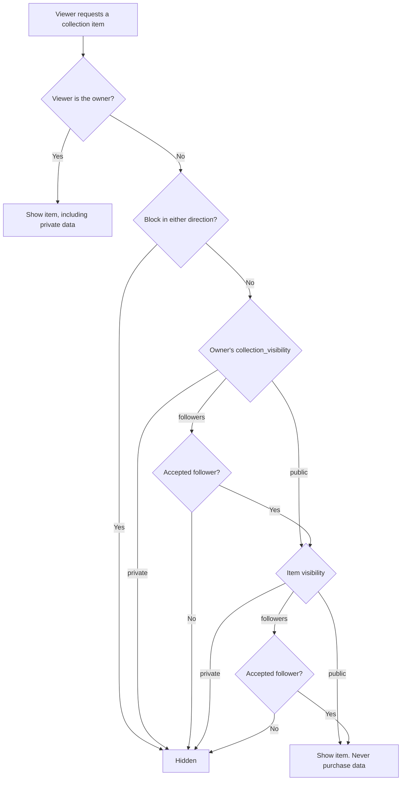
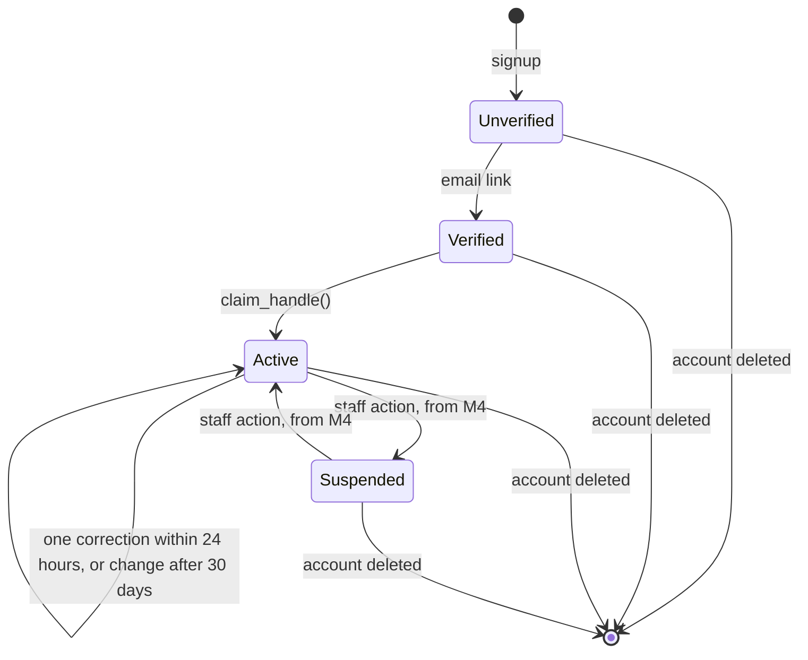

# Security and Row Level Security

**Status:** Approved design, including the decisions on D1 to D9, Q1 to Q12, A1 to A3, P1 to P10, R1 to R8 and D13, and the strict physical-only scope. M0 and M1 are implemented locally, and their rules are enforced by tests. Other SQL here illustrates the policies, and isn't a migration.

## The security model

A browser using the Supabase publishable key can call the Data API directly, without passing through Next.js. So **the database is the security boundary**, and application code can't be relied on to enforce access.

Access passes through four layers, each doing something the others can't:

| Layer | What it controls | Example |
| --- | --- | --- |
| **Grants** | Which tables and **columns** a role may touch | A user can't update `profiles.follower_count` |
| **RLS policies** | Which **rows** a role may touch | A user can only update their own profile |
| **Constraints** | Whether the data is valid and consistent | A shelf and its items must share one owner |
| **Server functions** | Multi-step or privileged actions | Publishing a catalog entry, starting a conversation |

### RLS alone isn't enough

Three properties of RLS shape this design:

1. **RLS can't hide columns.** If someone can read a row, they can read every column in it. That's why purchase prices are in a separate table and `profiles` holds only public-safe fields.
2. **RLS can't restrict which columns are updated.** A policy allowing users to update their own post also lets them set `like_count` to a million. Column-level grants close that gap.
3. **RLS doesn't validate.** Length limits and formats have to be `CHECK` constraints, because a direct API call skips application validation.

### Explicit grants

**The architecture doesn't depend on any Supabase default.** Defaults differ between environments and versions. Supabase [announced](https://github.com/orgs/supabase/discussions/45329) that new `public` tables would stop being exposed automatically. But on the local stack with CLI 3.0.0 and PostgreSQL 17.11, an untouched new table gave `anon` full access with RLS off, and through the real API `anon` could read, insert, delete and run new functions. The hosted behavior hasn't been observed.

So migration M0 sets the privileges explicitly, and tests check the result rather than the default:

| Scope | Change | Reason |
|---|---|---|
| `postgres` in `public` | Revoke all on tables, sequences and functions from `anon`, `authenticated`, `service_role` | New objects get no implicit access |
| `postgres` in `private` | The same | Stays closed if a platform default changes |
| `postgres` in all schemas | Revoke EXECUTE on functions from `PUBLIC` | See below |
| Schema `public` | Revoke CREATE from `PUBLIC` and the API roles | Only migrations create objects |
| Schema `private` | Revoke all from `PUBLIC` and the API roles | Not exposed, and helpers are granted one at a time |

**Default privileges apply per creating role.** Migrations run as `postgres`, a non-superuser that owns all application objects. `supabase_admin` keeps its own defaults, including in `public`, and `postgres` can't change them. So nothing else may own an application object, and a test fails if something does. Extensions go in the `extensions` schema, never `public`.

**The role-wide function revoke.** PostgreSQL grants EXECUTE to `PUBLIC` on every new function, and a schema-scoped default can't remove a built-in default, which we confirmed: `anon` could still execute the function. So this one revoke is role-wide. It applies only to functions `postgres` creates from now on. Existing functions, and those owned by platform roles such as `supabase_auth_admin`, `supabase_storage_admin` and `supabase_admin`, don't change. The consequence is that any `postgres`-owned function, in any schema, needs an explicit grant to be callable.

**Supabase-managed schemas aren't changed.** Comparing a snapshot of function, table and schema privileges and default privileges in `auth`, `storage`, `realtime`, `vault`, `graphql`, `graphql_public`, `supabase_functions`, `pgbouncer` and `_realtime` before and after M0 showed no differences. An API test also confirms auth, the REST API, storage and realtime still work.

**Every later table therefore needs, in the same migration:**

1. RLS enabled.
2. Explicit grants, including to `service_role`. **Its RLS bypass doesn't replace SQL privileges:** without a grant it's refused like any other role.
3. Policies.
4. An entry in the approved grant lists in `supabase/tests/database/03_schema_guards.test.sql`, or the tests fail.

A column default using `private.uuid_v7()` also needs EXECUTE for the inserting role. Tests confirmed that EXECUTE is enough, without USAGE on `private`.

### Known limitations

These are accepted for M0 and stay open until each is resolved:

| Limitation | What it means | Required action |
| --- | --- | --- |
| **Hosted permissions are unverified** | Tests have run only on the local stack | Run the database tests on a hosted project before production use |
| **Default privileges are per role** | `supabase_admin` keeps permissive defaults in `public`, which `postgres` can't change | Application objects must be created only by `postgres`, through migrations. The ownership guard detects others when tests run, not at creation |
| **Guards cover named schemas only** | They inspect `public` and `private` | Add any future application schema to the guards in the same migration that creates it |
| **Supabase-managed schemas stay untouched** | `postgres` keeps permissive defaults in `storage`, and no guard covers that schema | Never create application objects in `auth`, `storage`, `realtime` or other managed schemas, and don't alter their defaults |
| **Secret scanning isn't in CI** | The pre-commit hook is per clone and can be skipped | Add `secrets:check` and `secrets:bundle` to CI when CI exists |
| **Extension functions are callable by `anon`** | `anon` has USAGE on `extensions`, and extension functions are executable by `PUBLIC`. They're platform-owned, and aren't API endpoints because `extensions` isn't an exposed schema | Accepted. Keep extensions out of `public`, and keep `extensions` out of the exposed schemas |
| **Enum types are usable by `PUBLIC`** | This reveals only labels that are public anyway | Accepted. Don't put sensitive values in enum labels |
| **The migration role is powerful** | `postgres` isn't a superuser, but it can bypass RLS and create roles, as Supabase provides it | Accepted. Keep its credentials out of the application |

## Roles

| Role | Who | Key | Bypasses RLS |
| --- | --- | --- | --- |
| `anon` | Signed-out visitors | Publishable | No |
| `authenticated` | Signed-in users | Publishable + user session | No |
| `service_role` | Server jobs only | Secret | **Yes** |
| Staff | Signed-in users with a `staff_roles` row | Publishable + user session | No |

- Staff are normal `authenticated` users, and read policies check `staff_roles`. **Grants apply per role, not per user, so a column grant can't let staff write what users can't.** All staff writes therefore go through functions that check `private.has_staff_role()` and record a `moderation_actions` row, which also guarantees every staff change is audited. Wherever this document says "Staff" or "Catalog staff" under writes, it means through those functions.
- The secret key bypasses RLS, so server code using it can technically read anything, including private data. It's limited to the named jobs below and must not be used for general reads.
- The secret key is never in browser code, and `NEXT_PUBLIC_` variables never hold it. Supabase is replacing the legacy `anon` and `service_role` keys with publishable and secret keys ([Supabase docs](https://supabase.com/docs/guides/getting-started/api-keys)), so use the new ones from the start.
- Policies never trust `user_metadata` from the JWT, because users can edit it. Roles come from tables.

## Helper functions

These live in the `private` schema, which the Data API doesn't expose. They use `SECURITY DEFINER` so a policy can check membership without recursion, and `set search_path = ''` to prevent search-path attacks. A policy needs only EXECUTE on a helper. No role has USAGE on `private`, so a client calling one directly is refused. This was tested on the local stack.

| Function | Returns true when |
| --- | --- |
| `private.is_active_user()` | Caller has `account_status = 'active'`, a claimed handle and a verified email |
| `private.has_staff_role(role)` | Caller holds that role, or `admin` |
| `private.is_accepted_follower(owner)` | Caller has an **accepted** follow of `owner` |
| `private.is_blocked_between(other)` | A block exists in either direction |
| `private.can_view_collection(owner)` | Caller is the owner; or isn't blocked and the owner's `collection_visibility` allows it |
| `private.can_view_post(post_id)` | Caller can read that post under its policy |
| `private.is_published_release(release)`, `private.is_published_game(game)` | The record is `published` |
| `private.owns_copy_of(release)` | Caller owns a collection item on that release |
| `private.can_read_release(release)` | The record is `published` or `merged`, or the caller submitted it or is a catalog editor, or it's `excluded` and the caller owns a preserved copy |
| `private.can_use_release(release)` | The record is `published`, or the caller submitted it and it's `unverified`, `under_review` or `rejected`. Never `excluded` |
| `private.is_conversation_member(conversation)` | Caller is a current member (`left_at IS NULL`) |
| `private.can_send_message(conversation)` | Caller is a member and no block exists with another member of a direct conversation |

```sql
-- Illustrative
create function private.is_conversation_member(conv uuid)
returns boolean language sql stable security definer set search_path = '' as $$
  select exists (
    select 1 from public.conversation_members m
    where m.conversation_id = conv
      and m.user_id = (select auth.uid())
      and m.left_at is null
  )
$$;
```

**Why messaging needs a helper.** The obvious policy on `conversation_members` queries `conversation_members` itself, which PostgreSQL rejects with `infinite recursion detected in policy`. We reproduced this in the design probe below. The helper reads the table with its owner's rights and avoids the loop.

## Public profiles and public collections

### What signed-out visitors can browse

Approved as D3: public profiles, public collections, public games and public posts are available without signing in. The `anon` role gets read access to those and nothing else. Follower lists and who-liked lists are readable only when signed in, because D3 didn't include them and scraping them reveals people's connections.

Public pages should query as `anon`, even for signed-in visitors, wherever per-viewer data isn't needed. A query that runs as `anon` can't return private data, so its result is safe to cache.

### Search engine indexing

Approved as Q3: `profiles.allow_search_indexing` defaults to `false`, and users explicitly opt in for their public profile and eligible public content. **This preference has no effect on access.** No policy reads it. Turning it on can't make private content visible, and turning it off doesn't hide public content.

| Page | Indexed when |
| --- | --- |
| Published games and releases | Always |
| Unverified, rejected or merged catalog records | Never |
| A user's profile, public shelves and public items | `allow_search_indexing` is on |
| A public post | Its author has `allow_search_indexing` on |
| Anything else | Never |

The application enforces this with a `noindex` robots tag, and by leaving these pages out of the sitemap. **This is a request to search engines, not access control.** Public content stays reachable by URL and through the Data API, and the settings screen should say so. Privacy comes from the visibility settings.

### Profiles

**The public card is six columns: `id`, `handle`, `display_name`, `avatar_path`, `bio` and `country_code`.** Column grants enforce this, because RLS can't hide columns. Everything else on `profiles` has no client `SELECT`, including for signed-in users and the owner, so it also can't be filtered or sorted on to infer its value:

| Column | How it's read |
| --- | --- |
| `allow_search_indexing` | Owner, through `public.get_my_account()`. An owner-controlled setting, never on a public card |
| `follow_approval_required` | Owner, through `public.get_my_account()`. See below |
| `collection_visibility` | Owner, through `public.get_my_account()`. M3 policies read it through a helper |
| `account_status`, `handle_changed_at`, `handle_correction_until` | Owner, through `public.get_my_account()` |

A profile row is readable by everyone, signed in or not, once it has a claimed handle and unless the account is suspended. Claiming a handle requires a verified email, so unverified accounts are never public. Block checks arrive with M3. This is deliberate: comment authors and follow requests need a name and avatar to render, even for private accounts.

**`follow_approval_required` isn't public.** Clients don't need the setting itself, and exposing it would let anyone list which accounts are private. M3 should expose a narrower result to signed-in users, for example whether following a specific person would create a request.

**Follower counts don't exist yet, and arrive with `follows` in M3.** Public counts must not reveal private relationships. M3 has to decide what a count includes, and test it. In particular, a count on a private account shouldn't change in a way that confirms a specific person's pending or hidden follow.

**Search engine pages need a controlled read.** Pages can't read `allow_search_indexing` as `anon`. When public profile pages are built, they need a narrow server-side check that returns only whether a page may be indexed, and must default to `noindex` if it fails.

The public card is confirmed by the product owner as handle (username), display name, avatar, optional bio and optional country, and stays visible even when a collection is private. Private collections and private collection information stay inaccessible to signed-out visitors and unauthorized users. Search indexing is a separate preference and doesn't determine access.

A "private account" means `follow_approval_required = true` and `collection_visibility` set to `followers` or `private`. The card stays visible and the content doesn't. Email and auth data stay in `auth.users`, which is never exposed.

### Collections: three checks

Access to a collection item requires passing all of these, and the most restrictive setting wins. **Under D2, collections, shelves, items and wantlist entries are all private by default**, so nothing appears publicly until the user explicitly chooses.



| Owner's setting | Item's setting | Signed-out visitor | Other user | Accepted follower | Owner |
| --- | --- | --- | --- | --- | --- |
| `private` (default) | `private` (default) | No | No | No | Yes |
| `private` | `public` | No | No | No | Yes |
| `public` | `private` | No | No | No | Yes |
| `public` | `followers` | No | No | Yes | Yes |
| `public` | `public` | Yes | Yes | Yes | Yes |
| `followers` | `public` | No | No | Yes | Yes |

Consequences:

- **Purchase price, currency, purchase date, personal rating and notes are visible only to the owner, always.** They're in `collection_item_private`, which has no read path for anyone else, including followers and staff.
- **Shelves don't grant access to items.** Reading a `shelf_items` row requires being able to read both the shelf and the item. A private item on a public shelf is simply absent for other viewers, and displayed counts must count visible rows, not stored totals.
- **Preserved invalid records are private whatever their `visibility`.** The read policy requires `record_status = 'active'` for anyone but the owner, and a preserved record's components and shelf entries follow.
- **Search and aggregates** respect the same rules. Trending counts come from public activity only, and statistics count only [counted copies](database-schema.md#collection_items).

### Making things public under private defaults

Public display needs two or three settings to agree: the collection, the item and, for a shelf, the shelf. Marking one thing public can appear to do nothing, which is the main usability cost of D2. So:

- Each visibility control shows the **effective** result, such as "Hidden: your collection is private".
- A single explicit "publish" action changes the required settings together. It runs through a function and always confirms what will become visible, for example "Publish this shelf and its 40 items".
- Bulk publishing never happens without that confirmation, and changing a default only affects new records.
- Approved as Q5: `posts.visibility` has no database default, so an unspecified post fails rather than becoming public. The composer may preselect `public`, always shows the selection, and lets the user change it before publishing. RLS enforces the selected value.
- Posting a pickup from a private item shows that the release and completeness will be disclosed.
- Approved as Q4: wantlists default to private, and users can explicitly make them public. A wantlist entry's visibility is separate from `collection_visibility`, so a user can share what they're looking for while keeping their collection private.

### Followers-only needs approval to mean anything

If anyone can follow instantly, "followers only" is public with one extra click. So the setting is only as strong as `follow_approval_required`. Approved as D1: access requires `status = 'accepted'`, and a pending request grants nothing. A user who picks `followers` should be prompted to turn on approval.

### Blocks

Blocks are enforced in both directions for signed-in users, and they override an accepted follow. A block can't stop someone from viewing public content while signed out, because public means public. The block list has no client read path except a user reading their own blocks, so nobody can discover who blocked them.

## Policy matrix

R = read, I = insert, U = update, D = delete. "Own" means the row's owner column equals `auth.uid()`. Every table has RLS enabled. "Columns" lists what a client may update; anything else has no grant.

### User system

| Table | `anon` | `authenticated` | Update columns |
| --- | --- | --- | --- |
| `profiles` | R: public card columns, on claimed active accounts | R: same as `anon`. Blocks added in M3. U: own, when active. Created only by the signup trigger | `display_name`, `bio`, `country_code`, `collection_visibility`, `follow_approval_required`, `allow_search_indexing` |
| `user_preferences` | None | R: own. U: own, when active. Created only by the signup trigger | All except `user_id` and timestamps |
| `user_favorite_games` | R | R: not blocked. I, U, D: own, published games only | `position` |
| `follows` | **No grant** | R: own side, or accepted and permitted. I: as follower. U: as followee, to accept. D: either side | `status`, from `pending` to `accepted` only |
| `blocked_users` | None | R, I, D: as blocker | None |
| `staff_roles` | None | R: own. Audited admin functions arrive with M4 | None. An operator assigns the first administrator |
| `private.handle_holds` | None | None | None, and no grant to any API role |

`handle` changes only through `public.claim_handle()`, and `avatar_path` only through the server workflow. `service_role` has no direct access to these tables either: it can only execute `public.set_avatar_path()`.

`follows.status` isn't writable on insert. A trigger sets it from the target's settings and rejects the insert if a block exists.

### Gaming catalog

| Table | `anon` | `authenticated` | Writes |
| --- | --- | --- | --- |
| `region_codes`, `markets`, `platforms`, `platform_names`, `media_formats`, `platform_media_formats`, `hardware_requirements` | R | R | **No client write path.** `service_role` has `SELECT` only. Staff tooling arrives later, through functions. Implemented in M1 |
| `genres`, `franchises` | R | R | Catalog staff |
| `release_hardware_requirements` | R: `can_read_release` | Same | Submission and staff functions only |
| `release_markets`, `release_components` | R: `can_read_release` | Same | Submission and staff functions only |
| `game_relations` | R: both games published | Same | Catalog staff only |
| `games`, `releases`, `game_platforms` | R: `published`, `merged` | R: same, plus own submissions, and an `excluded` release the caller owns a preserved copy of. Catalog editors: all | Submission and staff functions only |
| `game_genres`, `game_franchises` | R | R | Catalog staff |
| `catalog_images` | R: approved, `licensed` or `user_contributed` | Same, plus own uploads. Catalog editors: all | Submission and staff functions only |
| `catalog_change_requests` | **No grant** | Catalog editors: R. Everyone else uses `my_catalog_submissions()` | Submission and staff functions only |
| `external_providers`, `external_references`, `catalog_field_locks` | None | Catalog staff | Server jobs and catalog staff |
| `private.provider_records` | None | None | Server jobs only |

### User-submitted releases

Approved as D5, with changes: submissions are marked unverified and can't become global catalog entries without a staff decision. The full workflow is in [relationships.md](relationships.md#submission-and-approval-workflow). The rules that enforce it:

| Rule | How |
| --- | --- |
| Unverified records are private to the submitter and catalog editors | Read policies on `games`, `releases` and `game_platforms` check `status` and `submitted_by` |
| Users can't approve anything, including their own | `status` has no client grant. Only staff functions change it, after checking the `catalog_editor` role |
| Nothing auto-approves | Approval has one path, the staff function. No job, threshold or provider sync calls it |
| A user can attach only their own submissions | `can_use_release()` in the `collection_items` policies. **This check is required because foreign keys ignore RLS**, so anyone who knew a record's ID could otherwise attach to it |
| Unverified records can't reach public content | `posts`, `reviews`, `wantlist_items` and `user_favorite_games` policies allow published records only |
| A published row doesn't reveal its submitter | `submitted_by` is cleared on approval and a `CHECK` enforces that. Otherwise a catalog entry for a rare release would reveal who owns it, even with a private collection. The credit stays in the staff-only `catalog_change_requests` |
| Duplicate checks don't reveal other submissions | Global uniqueness applies to published records only |
| Submitted images stay private | Held in the private `catalog-submissions` bucket until approved |

Separately from these rules, the submission function is rate limited. Approved as Q7: a public item pointing at an unverified release shows other viewers a neutral "Unverified release" placeholder, and nothing from the record, its markets or its components.

### Physical-only scope

No table, column or enum value represents a digital product, and `releases.media_format_code` is required. **The database can't inspect whether a cartridge or disc contains game data**, or whether a user physically holds what they declare. So eligibility is enforced by the only path into the global catalog, staff review, and the database enforces what follows from that decision.

An editor excludes an out-of-scope release through a staff function. That function:

- Sets the release to `excluded`, which removes it from public view.
- Sets attached items to `invalid_preserved`, without deleting them.
- Notifies every affected owner, and records an audit row.

`can_use_release()` then blocks new additions. The preservation and correction workflow is in [relationships.md](relationships.md#invalid-record-preservation-and-correction).

**`record_status` has no client grant**, so an owner can't clear the flag directly. Relinking to a usable release clears it through a trigger, and every other edit is rejected until then.

### Collection system

| Table | `anon` | `authenticated` | Update columns |
| --- | --- | --- | --- |
| `collection_items` | R: passes all checks, and `record_status = 'active'` | R: same, or own. I, U: own, active, `release_id` passes `can_use_release`. D: own | `release_id`, `completeness`, the four conditions, `visibility` |
| `collection_item_private` | **No grant** | R, I, U, D: own only | All except keys |
| `shelves` | R: visible | R: visible, or own. I, U, D: own | `name`, `description`, `visibility`, `sort_rank` |
| `shelf_items` | R: shelf and item both readable | Same, or own. I, U, D: own | `sort_rank` |
| `collection_item_components` | R: parent item readable | Same, or own. I, U, D: own | `kind`, `label`, `condition` |
| `wantlist_items` | R: entry is `public`, default `private` | R: `public`, or `followers` with an accepted follow and no block, or own. I, U, D: own, published records only | `minimum_completeness`, `priority`, `visibility` |

```sql
-- Illustrative
create policy collection_items_read on public.collection_items
for select to anon, authenticated using (
  owner_id = (select auth.uid())
  or (
    record_status = 'active'
    and visibility <> 'private'
    and private.can_view_collection(owner_id)
    and (visibility = 'public' or private.is_accepted_follower(owner_id))
  )
);

create policy collection_items_update on public.collection_items
for update to authenticated
using (owner_id = (select auth.uid()) and private.is_active_user())
with check (
  owner_id = (select auth.uid())
  and private.can_use_release(release_id)
);

-- Column grants do what the policy can't.
grant update (release_id, completeness, overall_condition, box_condition,
              media_condition, manual_condition, visibility)
  on public.collection_items to authenticated;
```

`WITH CHECK` plus the column grant means an owner can't transfer an item to someone else, or attach it to another user's submission.

### Social system

| Table | `anon` | `authenticated` | Update columns |
| --- | --- | --- | --- |
| `posts` | R: public, visible, not deleted | R: per visibility, not blocked, or own. Staff: all. I, U: own, active, published catalog references only, and `visibility` must be stated | `title`, `body`, `visibility`, `deleted_at` |
| `post_images` | R: post readable | Same. I, D: own post | `alt_text`, `position` |
| `comments` | R: post readable, not deleted | Same. I: own, post readable, not blocked. U: own | `body`, `deleted_at` |
| `likes` | **No grant** | R: post readable. I, D: own, target readable | None |
| `bookmarks` | **No grant** | R, I, D: own, post readable on insert | None |
| `reviews` | R: post readable | Same. Any active user may review a published game or release through a server function, and ownership isn't required (D9) | None directly |
| `achievements` | R | R | Staff |
| `user_achievements` | R | R | **Server only**, so a user can't award themselves |
| `notifications` | **No grant** | R, D: recipient. No insert | `read_at` |

A client can't insert a post with `kind = 'achievement'`. A `WITH CHECK` excludes it, and the server creates it after awarding the achievement.

### Messaging

| Table | `anon` | `authenticated` | Update columns |
| --- | --- | --- | --- |
| `conversations` | **No grant** | R: member. Created through a function | None |
| `conversation_members` | **No grant** | R: member of that conversation. Joined through a function | Own: `last_read_at`, `muted_until` |
| `messages` | **No grant** | R: member. I: sender is self, `can_send_message`. U: own | `body`, `deleted_at` |

```sql
-- Illustrative
create policy messages_read on public.messages
for select to authenticated
using (private.is_conversation_member(conversation_id));

create policy messages_insert on public.messages
for insert to authenticated
with check (
  sender_id = (select auth.uid())
  and private.can_send_message(conversation_id)
);
```

**Staff have no policy that reads conversations.** When a user reports a message, the filing function copies that message into `reports.content_snapshot`. Staff see the snapshot and nothing else in the conversation. Messages are protected by RLS and encrypted at rest, but they aren't end-to-end encrypted. See [D11](architecture-decisions.md#decisions-requiring-product-owner-approval).

### Moderation

| Table | `anon` | `authenticated` |
| --- | --- | --- |
| `reports` | **No grant** | Moderators: R. Everyone else has no read policy. Filed and updated through functions |
| `moderation_actions` | **No grant** | Moderators: R. Rows are added only by staff functions. No update or delete for anyone |

**Reporters don't read `reports` directly.** A read policy on their own rows would also expose the snapshot and the assigned moderator, because RLS can't limit columns. A `my_reports()` function returns only the target and status.

## Operations requiring server-side authorization

RLS handles simple ownership. These need trusted server code because they span several rows, check rules RLS can't express, or use privileges a client must never hold.

**Database functions callable by signed-in users** (`SECURITY DEFINER`, each checking the caller itself):

| Operation | Why |
| --- | --- |
| Start a conversation, add group members | Enforces `message_permission` and blocks, whose data the caller can't read |
| Publish a review | Writes `posts` and `reviews` atomically |
| File a report, list own reports | Captures a snapshot of content, verifying the reporter could see it. Listing returns only safe fields |
| Staff actions: hide content, set catalog status, review change requests | Column grants block direct writes, and each action records an audit row |
| Add an item with purchase data | Writes both item tables atomically |
| Submit a release or game | Creates `unverified` rows the caller can't otherwise insert, plus the review record. Rate limited |
| List own submissions | `my_catalog_submissions()` returns status and reviewer note, never the reviewer's identity |
| Publish a shelf or a collection | Changes several visibility settings together after explicit confirmation |
| Catalog review: approve, request changes, merge, reject, exclude | Crosses several tables atomically and records an audit row. Requires `catalog_editor` |
| Reverse an exclusion, or relink a preserved record for an owner | Restores valid state across owners. Requires `admin`, with an audit row |
| Collection statistics | One shared function, so every count uses the same definition of a counted copy. A separate summary function returns pending, not approved and invalid preserved, for the caller only (A1) |
| Classify games: write `game_relations` | Requires `catalog_editor`. Never automatic, and never based on marketing terms alone |
| Leave a conversation | Sets `left_at` |

**Next.js server code with the secret key** (Server Actions, route handlers, background jobs):

| Operation | Why |
| --- | --- |
| Delete an account | Removes the auth user and storage files |
| Export account data | Crosses every table, and needs identity re-verification |
| Award achievements | Must be unforgeable |
| Run metadata provider sync | Provider credentials must stay server-side |
| Image processing and malware checks | Strips location data before the file becomes visible |
| Send notifications and email | Fan-out and provider credentials |

**Next.js-level controls that the database can't provide:**

- **Rate limiting** of sign-ups, posts, reports, messages and follows. RLS has no notion of request rate.
- **Input validation** with friendly errors, duplicating the database constraints for usability.
- **Secure session handling.** Server code must verify the session rather than trust cookie contents. Confirm Supabase's current recommended method when implementing.
- **Cache safety.** Per-viewer data, including `viewerHasLiked` and anything read with a session, must never enter `use cache` or a shared cache. Only public catalog data can be cached. The existing `cacheComponents` setup makes this an easy mistake.

### Rules for `SECURITY DEFINER`

These functions bypass RLS, so each one is a potential hole:

- Lives in `private` when only policies call it. Functions meant to be called by clients must validate `auth.uid()` as their first step.
- Always sets `set search_path = ''` and schema-qualifies every name.
- Revokes `EXECUTE` from `public`, then grants only to the roles that need it.
- Never takes a user ID as a trusted parameter when `auth.uid()` will do.

Views use `security_invoker = true`, because a default view runs with its owner's rights and silently bypasses RLS.

## Where each rule is enforced

No single layer covers everything. The last column lists what the database can't do, because it can't examine a physical object or know what a user holds.

| Requirement | Database constraint | RLS and grants | Trigger or function | Application or editorial |
| --- | --- | --- | --- | --- |
| Others can't read private collection data | | Owner-only `collection_item_private`. Read policies on items | | Cache rules for per-viewer data |
| Can't attach to another user's submission | | `can_use_release()` on insert and update | | |
| Unverified submissions don't leak | Partial uniqueness on published rows. `submitted_by` cleared by `CHECK` | Read policies on `status` and `submitted_by` | Approval clears submitter | Neutral placeholder |
| Excluded releases can't be added | | `can_use_release()` | | Hide them from pickers |
| Preserved records stay private | `record_status` and `invalidated_at` must agree | `record_status` has no grant. Read policy requires `active` | Exclusion sets it, and relinking clears it | Notification and resolution screens |
| Statistics count only qualifying games (A1) | | Counts see only readable rows | One shared count function, and a caller-only summary for the other categories | All features use those functions |
| Preserved records aren't deleted by age (A2) | | Owners may delete their own | No function or job deletes by age | Retention policy, to be defined |
| No standalone components | `item_id` required, foreign key, cascade | Write limited to own items | | |
| No box-only or manual-only items | No enum value expresses it. `media_condition` can't be `not_included` | | | Declaration when adding an item |
| Medium really holds game data | `media_format_code` required, physical formats only, with a `CHECK` backstop | Users can't approve | One approval function | **Editorial only.** Editors follow written guidelines (A3), and unclear cases stay in review |
| Medium is really present | | | | **User's declaration only.** Can't be verified |
| Staff actions are authorized and audited | | Protected columns have no client grant | Functions check role and write `moderation_actions` | Limit who holds roles |
| Only staff approve the catalog | `status` constraints | `status` has no client grant | One approval function | |
| Public queries and search exclude invalid records | Search indexes are partial on `published` | Read policies on `status` | | Jobs using the secret key filter on status |
| Provider imports exclude invalid records | | Provider data has no client access | Matching skips excluded records | Adapters drop digital-only data |
| Purchase data is owner-only | | Separate table, no other read path | | |
| Accepted follows only (D1) | | `is_accepted_follower()` | Trigger sets follow status | |
| Rating scale (D8) | `CHECK` | | | |
| Region code set per Release | Foreign key to `region_codes` | Users can't edit a published release | | Editors classify it. No country rule exists |
| Partial media described (Q8) | Required enum, default `unknown` | Protected once published | | Editors set it, and don't guess |
| Reference data is public and read-only (M1) | | RLS read policies. Only `SELECT` is granted, including to `service_role` | | |
| Platform identity is stable (P2) | Unique slug | | Trigger blocks slug changes | |
| A format is valid for its platform (P7) | Composite foreign key, in M5 | | | Editors choose the format |
| Hardware requirements don't become a hardware catalog (R1) | No ownership column | | | Nothing links them to collections |

## Data region and legal review

Under D13, the proposed initial Supabase region is **Central EU (Frankfurt), AWS `eu-central-1`**. This is the product owner's preference for the initial deployment. The project hasn't been created.

**Hosting in Frankfurt isn't, by itself, proof of GDPR compliance**, and nothing in this design should be read as a claim of legal compliance. Before real user data is stored, these need review:

| Area | To check |
| --- | --- |
| Supabase Data Processing Agreement | Terms, and how it's put in place for this project |
| Data processing arrangements | Roles, purposes, and the subprocessors involved |
| Backups and logs | Where they're stored, what they contain, and how long they're kept |
| Storage and CDN behavior | Where files are stored and served from, and how caching affects deletion |
| International data transfers | Any transfer outside the EU, including by subprocessors and support access |
| Applicable law and privacy requirements | GDPR and other laws for a global audience, including D10 retention and D12 minimum age |

## Authentication lifecycle

This describes the local configuration in `supabase/config.toml`, tested through the real local Auth API and Mailpit. **It proves nothing about a hosted project, which doesn't exist.**



| State | Session | Public card | Can change profile and preferences | Can claim a handle |
| --- | --- | --- | --- | --- |
| Unverified | Refused: `email_not_confirmed` | No | No | No |
| Verified, no handle | Yes | No | No | Yes |
| Active | Yes | Yes | Yes | One correction within 24 hours, then after the cooldown |
| Suspended | Yes | No | No | No |

`private.is_active_user()` reads `auth.users.email_confirmed_at` as well as the profile, so a wrong Auth setting can't by itself activate an unverified account.

**The signup trigger** runs in the same transaction as the auth user. It reads only `new.id`, inserts a profile and a preferences row with their defaults, and never reads metadata, so nothing in a signup request can set a handle or a role. If it fails, the signup rolls back with no user left behind. Exception text reaches the client through Auth, so the trigger logs only the SQLSTATE and raises a fixed, generic message.

### Verified Auth behavior

| Behavior | Result on the local stack |
| --- | --- |
| Email verification | Signup returns no session. Sign-in is refused until the emailed link is used |
| Minimum password length | 12, enforced on signup and on password change |
| Password reset | The emailed link gives a recovery session, which sets a new password. The old password stops working. The link works once |
| Secure password change | A recent session can change its password. A session over 24 hours old gets `reauthentication_needed` |
| Sign-in errors | A wrong password and an unknown email give an identical response |
| Reset requests | The same response for known and unknown emails |
| Signup with a registered email | Doesn't report that it's taken. **This depends on confirmations being enabled for both email and SMS.** With email alone, Auth returned `user_already_exists`. Timing was not measured |
| Repeat emails | A second email to one address within 60 seconds gets a 429 |
| User metadata | A user can write anything to `user_metadata`, including `role: admin`. Nothing reads it. `app_metadata` can't be written by a user |

**What was not verified, and must not be claimed:**

- **Account lockout doesn't exist in this configuration.** 170 consecutive wrong passwords for one account got no 429 and no lockout, and the correct password still worked immediately. The documented `/token` limit of 150 per 5 minutes per IP wasn't observed locally. Don't rely on it without testing it on the hosted project.
- **Leaked-password checks aren't active.** `password1234` and `aaaaaaaaaaaa` were accepted. Supabase documents this check as a Pro plan feature, and it hasn't been tested.
- **Password strength beyond length isn't enforced.**
- **Real email delivery isn't tested.** Local mail goes to Mailpit.

`email_sent = 100` in the local configuration exists only so tests can run. It isn't a production value.

### Blockers before public authentication

**Public authentication must not open until every one of these is resolved:**

1. **Effective sign-in throttling and abuse protection.** None was observed locally.
2. **CAPTCHA or equivalent risk controls** where appropriate.
3. **Real email delivery and verification.** Only Mailpit has been tested.
4. **Hosted Supabase security verification.** Everything here was observed locally only.
5. **Minimum-age and applicable legal requirements.** See [Legal and age blockers](#legal-and-age-blockers).
6. **Approved retention and deletion policies.** See [Retention of unverified accounts](#retention-of-unverified-accounts) and D10.

### Requirements before any hosted registration

Registration stays closed. `enable_signup = true` applies to the local stack only. These are the technical steps behind the blockers above.

| Requirement | Why |
| --- | --- |
| Hosted `enable_signup = false` until the [legal blockers](#legal-and-age-blockers) are resolved | `supabase config push` can change hosted Auth settings, so compare before any push |
| Re-run every check in `scripts/db-identity-checks.mjs` on the hosted project | Everything above was observed locally only |
| Custom SMTP, with SPF and DKIM | Supabase's default sender is limited, and restricted to team members |
| Production email rate limit, in place of the local value | The local value is for tests |
| CAPTCHA on signup, sign-in and reset | Signup can be automated otherwise |
| Application-level login throttling, per account and per IP | No throttling was observed locally |
| Leaked-password protection, if the plan supports it | Then test it |
| Email templates that say what the message is for | The defaults are generic |
| A session-verification approach for the server, using `getClaims` or an equivalent | Connects to `getCurrentViewer()` |
| Decisions on JWT expiry | A token stays cryptographically valid until it expires, including after deletion. On the local stack it found no data, and Auth refused it |

## Assigning the first administrator

**No real administrator has been assigned, and nothing does this automatically.** There's no bootstrap endpoint, and no API role can write to `staff_roles`, including `service_role`. Staff status comes from this table only. It's never read from metadata or JWT claims. Tests confirm a signup, a JWT claim, a profile update, a direct write and an API request can't grant a role.

The first administrator is assigned by a named operator, who has direct database access, as a deliberate manual step:

1. The product owner approves in writing who will hold the role.
2. That person creates an account, verifies their email and claims a handle, like anyone else.
3. The operator connects directly to the database as `postgres`. This is never done from application code, and never through the API.
4. The operator runs this, replacing the placeholder, and checks that it reports exactly one inserted row:

```sql
begin;
insert into public.staff_roles (user_id, role, granted_by)
select p.id, 'admin', null
from public.profiles p
where p.handle = '<approved handle>';
-- Expect INSERT 0 1. If not, roll back.
commit;
```

5. The operator records who, when and why outside the database. `moderation_actions` doesn't exist until M4, and backfilling this entry is part of M4.

Removal is the matching `delete`. Assigning further staff should use audited functions from M4, which call `private.has_staff_role()`. Until a policy needs that helper, it has no EXECUTE grant.

## Handles

Handles are lowercase ASCII `a-z`, `0-9` and `_`, 3 to 24 characters. `public.claim_handle()` is the only client path to setting one.

**Ordinary uniqueness is by canonical spelling**, enforced by a database constraint. A claim may be in any case and is stored in lowercase, so `Marko` and `marko` are one handle. Input is validated as ASCII before lowercasing, because some non-ASCII letters lowercase to ASCII. `mike_1985` and `mike1985` can coexist, and so can `badminton` and `b4dminton`.

**Normalization protects reserved names and brand terms only.** `private.handle_skeleton()` removes underscores, lowercases, and folds the approved lookalikes: `0`→`o`, `1` and `i`→`l`, `3`→`e`, `4`→`a`, `5`→`s`, `7`→`t`. It's used only for comparison, and a stored handle is never changed.

| Attempt | Result |
| --- | --- |
| `admin`, `ADMIN`, `adm1n`, `admln`, `4dmin`, `a_d_m_i_n`, `_admin_` | Refused: reserved, same skeleton |
| `support`, `supp0rt`, `5upport` | Refused: reserved, same skeleton |
| `my_game_dex`, `myg4med3x`, `mygamedex_fan`, `the_gamedex` | Refused: a brand term anywhere in the name |
| `marko` or `Marko`, while `marko` is live or held | Refused: same canonical handle |
| `badminton`, `administrators_fan`, `support_group` | Allowed: reserved names other than brand terms only match whole |
| `b4dminton`, while `badminton` is live | Allowed: a different spelling, by product-owner decision |

A taken, reserved or held handle gives the same message, so the response doesn't reveal which applies. Display names are also checked for brand terms, including lookalikes. Other reserved words are allowed in display names, because a display name doesn't identify an account the way a handle does.

**Known limits.** Normalization covers only these approved variants. Other lookalikes like `rn` for `m` aren't caught, and non-ASCII lookalikes can't occur in handles but can in display names. Because lookalikes of ordinary users are allowed, someone can register `b4dminton` to imitate `badminton`. Handling that is a matter for reporting and moderation.

**Changing a handle.** All of this is enforced in `claim_handle()`, and the columns behind it have no client read or write grant.

| Situation | Result |
| --- | --- |
| First claim | Allowed. Starts the 30-day clock, and allows one correction until exactly 24 hours later |
| Within 24 hours, correction unused | One change allowed. Uses the correction, and restarts the 30-day clock |
| After using the correction | Refused until 30 days after the correction |
| At or after 24 hours, correction unused | Refused until 30 days after the first claim |
| 30 days or more since the handle was last set | One change allowed, restarting the 30-day clock. Never grants another correction |
| Same handle again, in any case | No change, and doesn't use the correction |
| Failed attempt: reserved, taken, held or invalid | No change, and doesn't use the correction |

**Holds.** Every released handle, whether from a correction, a later change or a deleted account, is held for 30 days by exact spelling, so nobody can take it immediately to impersonate its former owner. That includes the owner: a correction can't be undone straight away. A hold stores no link to the person. Expired holds stop applying immediately. `private.purge_expired_handle_holds()` only tidies expired rows. It never touches accounts, reserved names or anything else, and nothing schedules it yet. Clients have no access to holds, directly or through the API.

**Concurrency.** Claims and releases take a per-handle lock until commit, in a fixed order, and a claim first locks the user's own row. So a claim can't slip in while another transaction is releasing that handle, and one correction can't be used twice. Reserved-name checks read a table no client can change, and don't depend on any index on `profiles`.

## Avatar storage

The `avatars` bucket is public for reads because a profile card is public. **Clients have no write path.** With no policy on `storage.objects` for this bucket, an upload, overwrite, move, list or delete from `anon` or `authenticated` is refused, including an owner on their own folder. Files arrive only through the server workflow in `src/features/avatars`, imported through its `server-only` entry point:

1. **Verify on every mutation.** The user's token is checked with the Auth server, and `get_my_account` confirms the account is active.
2. **Validate the bytes.** At most 2 MB. The signature must be JPEG, PNG or WebP, and the declared type and name are ignored. The file must fully decode, with the decoded format matching the signature. Between 32 and 4096 pixels per side, at most 16 megapixels, and not animated. Both size limits are checked from the header, before decoding. The side limit stops extreme shapes, and the pixel limit bounds total memory. SVG and GIF are refused.
3. **Re-encode** to a 512×512 WebP with metadata removed. Only this output is stored.
4. **Upload with the secret key**, to `{user id}/{random uuid}.webp`, with overwriting off. The key stays on the server.
5. **Activate** through `public.set_avatar_path()`, executable only by `service_role`. It requires the file to exist, and a `CHECK` requires the path to be in the owner's folder with a random name.
6. **Remove the old file** through the Storage API. If activation fails, the new file is removed and the current avatar keeps working.

The bucket also accepts only `image/webp` up to 2 MB, even with the secret key. Errors return a code and never pass on upstream responses.

**Limits of this design:**

- Between steps 4 and 5, a validated file is publicly readable at an unguessable URL. A crash there leaves an orphan.
- `replaceAvatar` reports `previousRemoved: false` if removing the old file fails, and the caller must log and retry. A public file stays readable until then.
- Public files can be cached by browsers and CDNs after deletion. The workflow sets a long cache lifetime, because names never repeat, and this needs [legal review](#legal-and-age-blockers).
- Validation depends on `sharp` and its bundled image libraries, which need security updates.

**Future work, outside M2:** the upload route, meaning a route handler or server action, and its session integration. Also a request size limit applied before reading the body, per-user upload rate limits, the settings UI, production configuration of the secret key, and a sweep for orphaned files. Nothing in the application calls this workflow yet.

## Account deletion

`deleteAccountWithAvatars()` clears the avatar path, removes every file in the user's folder through the Storage API, and then deletes the user through the Auth Admin API. It takes a user ID, so its caller has to authorize the request. No client route exists yet.

| Data | On deletion |
| --- | --- |
| `auth.users`, `profiles`, `user_preferences`, `staff_roles` | Removed, by cascade |
| Files in the user's avatar folder | Removed by the workflow |
| Handle | Held for 30 days, with no link to the person |

**Deleting a user any other way leaves their files publicly readable.** Storage isn't part of the database. Tests confirm that a direct Auth Admin delete and a SQL delete from `auth.users` both succeed with the file still public. That includes the Supabase dashboard, which isn't tested but uses the same Admin path.

### Required deletion procedure

1. Delete accounts only through `deleteAccountWithAvatars()`. Don't use the dashboard, the Auth Admin API or SQL.
2. If it fails, run it again. It's safe to repeat until the auth user is gone.
3. If an account was deleted another way, an operator must immediately list `{user id}/` in the `avatars` bucket and remove those files **through the Storage API**, then record that it happened. Don't delete from `storage.objects` with SQL. Tests confirm Storage API removal works.
4. Deleted public files may remain in caches for a time. See [Legal and age blockers](#legal-and-age-blockers).

On the local stack, a deleted user's token was refused by Auth, found no account and changed nothing.

The treatment of later user content stays under [D10](architecture-decisions.md#decisions-requiring-product-owner-approval) as those tables arrive.

## Retention of unverified accounts

**Nothing deletes unverified accounts. No scheduled job exists, and no scheduler is installed.** A test confirms an old unverified account is left alone.

**Proposed, pending legal and product approval:** remove accounts unverified after seven days.

If approved, a safe design would be:

- Candidates must have `email_confirmed_at` null, no handle, and be older than the retention period, rechecked at deletion.
- It deletes through the Auth Admin API, not SQL, in small batches.
- It starts with a dry run that reports counts only, reviewed by an operator before any real run.
- It records counts without email addresses, and has its own tests.

Handle holds follow the approved 30-day rule, and don't depend on this decision.

## Legal and age blockers

These are legal and product questions. They need qualified legal advice, and **no technical control here answers them**.

**Registration stays closed for real users until these are resolved.**

| Question | Status |
| --- | --- |
| Minimum age (D12) | Provisionally 16, subject to legal review |
| Whether a self-declared age is acceptable | Open. Regulators in several jurisdictions, including Australia, the UK, Brazil and the EU, and the US FTC, have questioned or rejected self-declaration for some services. How this applies here is for counsel |
| What to do if a user turns out to be under age | Open |
| Whether a parental consent flow is needed in any market | Open |
| Retention of unverified accounts | Seven days proposed, not approved |
| Retention and deletion of user content (D10) | Open |
| How long deleted public files may remain in caches and backups | Open |
| Lawful basis, privacy notice and terms | Not written |
| Data region and processors (D13) | See [Data region and legal review](#data-region-and-legal-review) |

**Technical assumptions, separate from the above:**

- No age or date-of-birth field exists, and none is collected. No identity documents are collected, and no age verification exists.
- A future age requirement can be added without changing M2, but none has been designed, because the legal answer decides what it needs.
- Supabase's default error messages and tokens were tested for behavior, not compliance.

## Storage

Supabase Storage needs its own policies, and public buckets bypass them for reads: anyone with the URL gets the file.

| Bucket | Public | Contents | Write |
| --- | --- | --- | --- |
| `avatars` | Yes | Avatars, re-encoded to WebP | Server only. See [Avatar storage](#avatar-storage) |
| `catalog` | Yes | Approved catalog images | Staff and server |
| `catalog-submissions` | **No** | Images on unverified submissions | Own folder. Moved to `catalog` on approval |
| `post-media-public` | Yes | Images on public posts | Own folder |
| `post-media-private` | **No** | Images on followers-only or private posts | Own folder. Read through short-lived signed URLs |

The split matters. If followers-only images were in a public bucket, the URL alone would be enough to view them. Changing a post's visibility must move its images between buckets, handled by a server function.

Upload rules, for the buckets still to be built. Avatars are stricter, and `catalog` is staff and server only:

- Paths start with the user's ID, and the policy checks that against `auth.uid()`.
- Size limits and a MIME allow-list on each bucket.
- **Re-encode every image on the server, which strips metadata.** Photos of a collection taken at home can contain GPS coordinates, and this is a real risk to collectors who own valuable items.
- Serve only re-encoded files, and never allow SVG uploads from users because they can carry scripts.

## Requirements checklist

| Requirement | How it's enforced |
| --- | --- |
| Can't modify another user's profile | RLS `id = auth.uid()` on update; column grants. Tested directly and through the API |
| Private profile settings stay private (M2) | No `SELECT` grant on those columns for any client role, which also blocks filtering and sorting on them |
| Staff roles can't be self-assigned (M2) | No client or `service_role` write grant, a database-backed helper, and a signup trigger that never reads metadata |
| Handles can't bypass the rules (M2) | `claim_handle()` is the only path, with no client grant on `handle`, `handle_changed_at` or `handle_correction_until`, no access to holds, and per-handle locks |
| Avatars can't be written by clients (M2) | No storage policy for the bucket, server-only workflow, and a `CHECK` on the path |
| Can't modify another user's collection items | RLS on owner; `WITH CHECK` prevents transfer; composite keys prevent cross-owner links |
| Can't access private collections without permission | Private by default; layered visibility policy; accepted follows only; purchase data in an owner-only table |
| Can't modify another user's posts | RLS on author; column grants prevent forging counters and moderation status |
| Can't read conversations they don't belong to | Membership helper on all messaging tables; no `anon` grant; no staff read policy |
| Purchase information stays owner-only (D2) | Separate table with no read path for anyone else |
| Private information isn't exposed to signed-out visitors (D3) | `anon` grants limited to public tables, with row checks on each |
| Unverified records don't become global entries (D5) | Status has no client grant, one approval function, and published-only references |
| Users can't attach items to another user's submission (D5, Q7) | `can_use_release()` in insert and update policies, because foreign keys ignore RLS |
| Approval doesn't reveal who owns a copy (D5, Q7) | `submitted_by` is cleared on approval, enforced by a `CHECK`, with credit kept in a staff-only table |
| Indexing doesn't affect access (Q3) | No policy reads `allow_search_indexing` |
| Digital products stay out of the catalog (physical-only scope) | No digital values or fields, required `media_format_code`, staff review, and an `excluded` state |
| Reference data can't be changed by clients (M1) | Only `SELECT` is granted, with no write policy. Tested as `anon`, `authenticated` and `service_role`, directly and through the API |
| Invalid records stay private and uncounted (Q9) | `record_status` in the read policy and in the shared count function |

## Design probe

To test these patterns before writing them down, we ran throwaway scripts with a subset of the tables, real roles, and real policies. They ran on both PostgreSQL 18.6 and 17.5 (PGlite), because Supabase's platform appears to default to 17. All four rounds passed on both versions, **200 checks in total**: 49 on the original design, 43 on the D1 to D9 changes, 43 on the physical-only scope, region model, game relations and Q3 to Q7, and 65 on Q8, Q9, Q12, A1 and A2. The scripts weren't added to the repository.

| Area | Verified |
| --- | --- |
| Private data | A public item row has no price or notes columns. `anon` has no access to the private table. A follower reads 0 private rows. Owner reads their own |
| Modifying others | Updates to another user's profile, item and post affect 0 rows. Item ownership can't be transferred. Can't post as another user |
| Forgery | A user can't change their follower count, suspension status, a post's like count or its moderation status |
| Visibility | An accepted follower sees a followers-only collection. Pending followers, strangers and `anon` don't. A block overrides an accepted follow |
| Shelves | A private item on a public shelf is hidden. Can't shelve another user's item or use another user's shelf |
| Messaging | Non-members read and send nothing. Sender can't be spoofed. The naive policy fails with recursion, and the helper fixes it |
| Staff and reports | A moderator can't write a staff column directly, only through a function that checks the role and records an audit row. Non-staff callers are rejected. A reporter can't read `reports` and sees only safe fields through a function |
| Private defaults (D2) | New items and shelves are hidden from `anon` and other users. A public item stays hidden until the collection is also public. A post can't be created without a visibility |
| Indexing (D3) | A signed-out page can read the preference, which is off by default. Another user can't change it |
| Submissions (D5) | Marked unverified. Hidden from `anon` and others, including a new game-platform pairing. The submitter can attach copies immediately, and others can't, on insert or update. Posts and wantlists can't reference it. Users can't approve it. A second user can submit the same release without learning of the first. Approval publishes and clears the submitter, and a `CHECK` rejects publishing with one attached. Merge moves copies. Rejection keeps them |
| Identity and ratings (D6, D8, D9) | Different packaging is a separate release. Scores accept 0.5, 9.5 and 10, and reject 0, 9.3 and 10.5. A user owning no copy can review, and an unverified game can't be reviewed |
| Physical-only scope | Digital values aren't valid media formats. A release requires a physical medium |
| Allowed items (Q12) | Loose, incomplete, complete and sealed copies are accepted. Box-only values don't exist, a missing medium is rejected, and contradictory states fail. A component can't exist without an item, and adds nothing to a count |
| Partial media (Q8) | Playability defaults to `unknown`, a qualifying release can say a download is required, and users can't change it |
| Statistics and retention (A1, A2) | Owned, pending, not approved and invalid preserved are separate, and only owned is counted. The official count is the same signed out. The summary only describes the caller. A ten-year-old preserved record remains. The owner can delete it, and other users can't |
| Invalid records (Q9) | Only staff can exclude. Nothing is deleted. Every owner is notified, and it's audited. The owner still reads the record and its private data, while `anon` and others can't, and it leaves public shelves. It stops counting, and no new additions are allowed. The owner can't clear the flag, but relinking corrects it. A wrong exclusion can be reversed |
| Regions and markets (D7) | Old tree codes are rejected. One release can list several markets, and no rule ties markets to a region code. Unknown means `unknown` and no markets. Users can't edit markets. An unverified release's markets stay hidden |
| Classification and materials (Q2) | Relationships are public only between published games, and users can't write them. Components follow the parent item's visibility |
| Q3 to Q5, public cards | Indexing on doesn't expose a private collection, and indexing off doesn't hide public content. The profile card stays public with a private collection. Wantlists default to private. An unspecified post fails, and the selected visibility is enforced for `anon`, pending and accepted followers |
| Integrity | A composite foreign key with a null partner is skipped by PostgreSQL, and the `CHECK` closes that gap. Release needs a recorded game and platform. Duplicate release rejected, including with null variant. Release with owners can't be deleted. Two copies allowed. Post survives its item's deletion |

**What the probes didn't cover:** all 45 tables, a real Supabase environment, Supabase's own Auth, Storage and Realtime, or performance at scale. It validates the patterns, and the real policies still need their own tests. M0 to M2 have those tests on the local stack, and later steps add theirs.

The indexing result above predates M2: signed-out clients can no longer read that preference.

## Testing the real policies

When migrations are written:

1. **Policy matrix tests in CI.** For each table, act as `anon`, the owner, a stranger, a pending follower, an accepted follower, a blocked user and staff, then assert allowed and denied actions.
2. **Schema guard tests in CI.** Fail the build if any `public` table lacks RLS, if `anon` has a grant on a table not on the approved list, or if a `SECURITY DEFINER` function lacks a fixed `search_path`.
3. **Performance tests.** Run `EXPLAIN` on feed and collection queries with realistic data. Supabase's guidance is to wrap `auth.uid()` as `(select auth.uid())`, index the filtered columns, and scope policies with `TO authenticated` where possible ([Supabase RLS performance](https://supabase.com/docs/guides/database/postgres/row-level-security)). Helpers taking per-row values can't be cached this way, so they need measuring.
4. **Run Supabase's security advisor** before each release.

## To verify when creating the project

These were checked in November 2026 where possible, but could not be fully confirmed. Most can be checked first on the local Supabase stack, and must be confirmed again on the hosted project. The [Phase 2B plan](architecture-decisions.md#before-implementation) makes them a required first step:

- The Data API grant behavior on a hosted project. It differs from the announcement on the local stack, and the design no longer depends on it, but M0's tests must be rerun there.
- The PostgreSQL major version and supported extensions on a hosted project. The local stack runs 17.11, with no built-in `uuidv7()`. See [ADR-007](architecture-decisions.md#adr-007-uuid-strategy).
- The current recommended way to verify a session on the server.
- Every check in `scripts/db-identity-checks.mjs`, including Auth rate limits, the private-column denials, and bucket settings. See [Requirements before any hosted registration](#requirements-before-any-hosted-registration).
- That `postgres` can create the `on_auth_user_created` trigger and the `avatars` bucket through migrations on a hosted project. Local behavior is confirmed only.
- GraphQL. `pg_graphql` is disabled on the local stack, so no second path to private columns exists there. If enabled, it needs the same tests.
- Realtime authorization for messaging. Decide between Broadcast and Postgres Changes in the Messaging phase.
